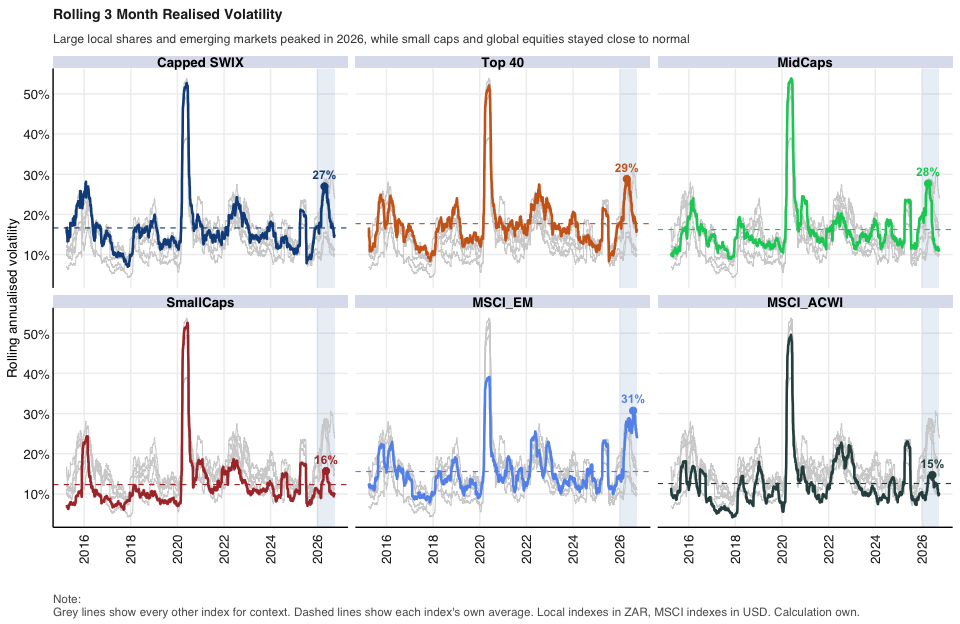
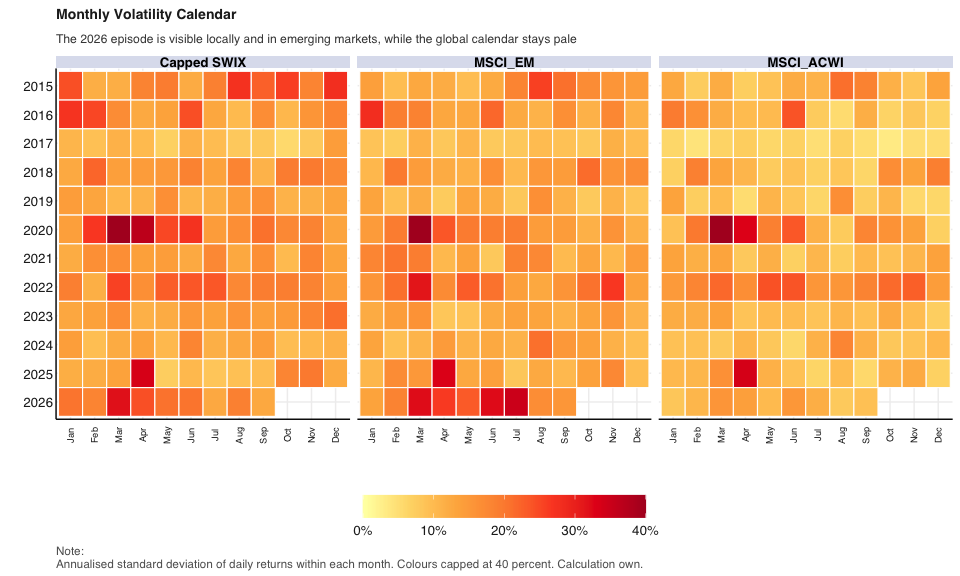
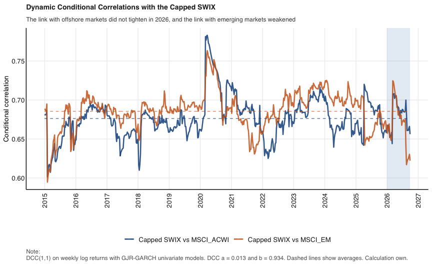
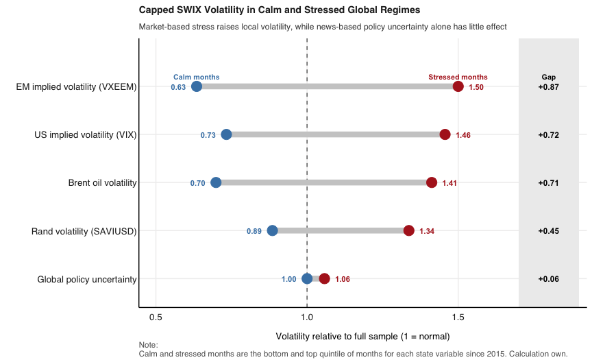
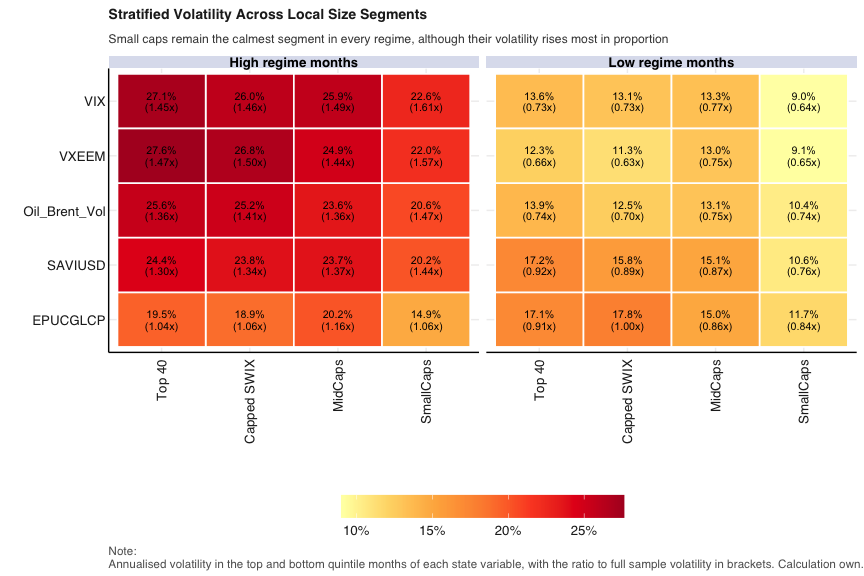

# Purpose

This repository contains the answers to the 2026 Financial Econometrics
practical examination for student number 24991422. This README is the
primary document, as it sets out the code and the reasoning behind each
question in the order in which the paper presents them. The finished
write-ups are stored in the `Questions` folder, with one folder per
question.

The repository follows a consistent structure. Every function is stored
in the `code` folder, with one subfolder per question, and this README
only calls those functions. The data is stored in the `data` folder,
which is excluded from the repository through the `.gitignore` file.

``` r
rm(list = ls()) # clean the environment so that nothing old leaks into the results
gc() # garbage collection, which hands memory back to the operating system after the clean
```

    ##          used (Mb) gc trigger (Mb) limit (Mb) max used (Mb)
    ## Ncells 497116 26.6    1062442 56.8         NA   715777 38.3
    ## Vcells 935289  7.2    8388608 64.0      16384  2011345 15.4

``` r
library(tidyverse) # load the tidyverse for data wrangling and plotting
list.files('code/', full.names = T, recursive = T) %>% .[grepl('.R', .)] %>% as.list() %>% walk(~source(.)) # source every function saved in the code folder and its subfolders
```

# Folder Construction

The root project was created with `fmxdat::make_project()`, and each
question folder was created with Texevier. The chunk below records those
calls for transparency but is not evaluated, since the folders already
exist.

``` r
fmxdat::make_project(Mac = TRUE) # build the root project with its code, data, bin and settings folders
Texevier::create_template(directory = "Questions", template_name = "Question1", build_project = TRUE, open_project = FALSE) # pdf write-up folder for question 1
Texevier::create_template(directory = "Questions", template_name = "Question2", build_project = TRUE, open_project = FALSE) # pdf write-up folder for question 2
Texevier::create_template(directory = "Questions", template_name = "Question3", build_project = TRUE, open_project = FALSE) # folder for question 3, which is later knitted to PowerPoint slides
Texevier::create_template(directory = "Questions", template_name = "Question4", build_project = TRUE, open_project = FALSE) # pdf write-up folder for question 4
```

The exam data was then downloaded from the course website and unzipped
into the `data` folder.

# Packages

``` r
if(!require("pacman")) install.packages("pacman") # make sure the package loader itself is installed
pacman::p_load(tidyverse, lubridate, tbl2xts, PerformanceAnalytics, RcppRoll, fmxdat, rmsfuns, glue, gt) # load the core packages that every question relies on
options(dplyr.summarise.inform = F) # stop summarise from printing a grouping message every time it runs
options(scipen = 999) # show numbers in full instead of scientific notation
```

# Question 1, Exploring Risk and Uncertainty

``` r
Uncertainty_Indexes <- read_rds("data/Econ_Uncertainty_Indexes.rds") # economic policy uncertainty indexes and the MOVE bond volatility index
Implied_Vol <- read_rds("data/Implied_Vol_Indexes.rds") # implied volatility indexes, namely the VIX, V2X and VXEEM
Local_Index_Constituents <- read_rds("data/Index_Constituents.rds") # daily constituents, weights and returns for nine local indexes
Idx_Daily <- read_rds("data/Index_Returns_Daily.rds") # daily returns for the local headline, size and factor indexes
Stock_Returns <- read_rds("data/Stock_Returns_Daily.rds") # daily returns for every local stock
Local_Cncy_Vol_Index <- read_rds("data/LCL_Currency_Vol_Index.rds") # the SAVIUSD index of rand volatility
Gl_Cncy_Vol_Index <- read_rds("data/Global_Currency_Vol_Index.rds") # the JP Morgan global currency volatility index
Commods <- read_rds("data/Commodities.rds") # total return indexes for the Bloomberg commodity index, gold and Brent oil
SafeCore <- read_rds("data/SafeCore.rds") # monthly holdings and weights of the SafeCore fund
Factor_Scores <- read_rds("data/Factor_Scores.rds") # third party factor scores per stock, where a lower value means a lower exposure
```

## Part A, Local Volatility in a Global Context

### Approach

This part establishes whether volatility on the local exchange has
increased and whether that increase mirrors the global experience. The
analysis moves from simple measures to model-based ones. It first
compares annualised volatility across sub-periods and traces its timing
with a rolling window and a monthly calendar. It then separates the
volatility signal from noise using GARCH models, examines how strongly
volatility responds to bad news, and uses a DCC model to test whether
the local market has become more tightly linked to global markets.
Finally, it stratifies the sample by global conditions to identify which
external forces local volatility responds to, and which local segment
holds up best when they strike.

Three choices shape the analysis. The Capped SWIX (J433) serves as the
local yardstick, since it is the fund’s benchmark in Part B and its
capping prevents a handful of large shares from dominating the result.
The MSCI All Country World index represents the global experience, while
the MSCI Emerging Markets index represents the peer group to which South
Africa belongs. The local index is quoted in rand and the MSCI indexes
in dollars, and each is kept in its own currency because the question
concerns the volatility that each investor base experiences. Part of any
difference between them may therefore reflect movements in the rand.

``` r
Local_Rets <- Idx_Daily %>% filter(Name %in% c("Capped SWIX", "Top 40", "MidCaps", "SmallCaps")) %>% mutate(dlogret = log(1 + Returns)) %>% select(date, Name, Returns, dlogret) # keep the four vanilla local indexes and add log returns for the volatility models
Global_Rets <- read_rds("data/MSCI_Indexes.rds") %>% filter(Name %in% c("MSCI_ACWI", "MSCI_EM", "MSCI_USA")) %>% TRI_Returns_Calc(Start_Date = lubridate::ymd(20150101)) # turn the global index levels into daily returns over the same sample as the local data
All_Rets <- bind_rows(Local_Rets, Global_Rets) # stack local and global returns into one tidy data frame
```

### Volatility by Period

The most direct test compares annualised volatility across periods. The
sample is divided into the calm years before Covid, the Covid year
itself, the recovery from 2021 to 2024, and 2025 and 2026 separately,
since these two years are the focus of the seminar.

``` r
Periods <- tibble(Period = c("2015-2019", "2020 (Covid)", "2021-2024", "2025", "2026 YTD"), # the names of the sub-periods
                  Start = lubridate::ymd(c(20150101, 20200101, 20210101, 20250101, 20260101)), # the first day of each sub-period
                  End = lubridate::ymd(c(20191231, 20201231, 20241231, 20251231, 20261231))) # the last day of each sub-period
Vol_Periods <- Vol_Period_Table(All_Rets, Periods) # annualised volatility of every index in every sub-period
Vol_Periods %>% select(Name, Period, SD) %>% mutate(SD = scales::percent(SD, accuracy = 0.1)) %>% spread(Period, SD) %>% knitr::kable(caption = "Annualised volatility by period") # reshape so that each period is a column and print as a table
```

| Name        | 2015-2019 | 2020 (Covid) | 2021-2024 | 2025  | 2026 YTD | Full Sample |
|:-----------|:---------|:------------|:---------|:------|:---------|:-----------|
| Capped SWIX | 16.0%     | 30.5%        | 15.7%     | 15.0% | 20.7%    | 17.8%       |
| MidCaps     | 14.1%     | 32.4%        | 15.3%     | 17.5% | 18.6%    | 17.4%       |
| MSCI_ACWI   | 11.0%     | 27.2%        | 13.4%     | 13.8% | 12.0%    | 14.1%       |
| MSCI_EM     | 14.1%     | 23.5%        | 15.5%     | 15.5% | 25.2%    | 16.6%       |
| MSCI_USA    | 13.2%     | 33.9%        | 16.6%     | 18.6% | 13.0%    | 17.5%       |
| SmallCaps   | 10.3%     | 29.5%        | 12.7%     | 12.1% | 12.0%    | 14.0%       |
| Top 40      | 16.3%     | 30.2%        | 17.8%     | 15.7% | 22.4%    | 18.7%       |

Annualised volatility by period

The table shows that local volatility rose in 2026 while global
volatility did not. The Capped SWIX recorded annualised volatility of
20.7 percent in 2026, above the 15.7 percent of 2021 to 2024 and its
full sample level of 17.8 percent. The MSCI ACWI moved in the opposite
direction, at 12.0 percent in 2026 against a full sample level of 14.1
percent, while the MSCI Emerging Markets index rose to 25.2 percent. The
rise in local volatility therefore resembles the emerging market
experience far more closely than the global one. Small caps are a
notable exception, with volatility of 12.0 percent in 2026 against 14.0
percent over the full sample, which suggests that the turbulence was
concentrated in the larger and more globally exposed shares of the Top
40, where volatility reached 22.4 percent.

### Rolling Realised Volatility

Period averages conceal the timing of volatility, so a rolling window of
three months (63 trading days) is passed through the sample. Three
months is long enough to give a stable estimate and short enough to show
when an episode begins and ends. The dashed lines in the figure mark
each index’s own long run average.

``` r
Roll_Vol <- Roll_SD_Calc(All_Rets, NSel = 63) # rolling three month annualised volatility for every index
Plot_Roll_Vol(Roll_Vol %>% filter(Name %in% c("Capped SWIX", "MSCI_ACWI", "MSCI_EM")), # plot the local benchmark against the global and emerging market indexes
              Title = "Rolling 3 Month Realised Volatility", # the plot title
              Subtitle = "Local volatility rose in 2026 alongside emerging markets, while global volatility stayed below its average", # the main message
              Caption = "Note:\nDashed lines show each index's own average. Local index in ZAR, MSCI indexes in USD. Calculation own.") # the note under the plot
```



The figure shows that the 2026 increase was a pronounced but temporary
episode. Rolling local volatility peaked at 27 percent in April 2026,
its highest level outside of the Covid crash and the 2015 to 2016
sell-off. By the end of September 2026 it had fallen back to 15 percent,
close to the median of its own history. Emerging market volatility
followed a similar path at a higher level, peaking at 31 percent in
July, while the global index peaked at only 14.7 percent against its
average of 12.6 percent. The evidence points to a volatility episode
rather than a lasting shift to a higher level of local volatility.

### A Calendar View of Volatility

The rolling measure shows when volatility rose, but not how unusual each
month was relative to the same months in other years. The calendar below
colours every month by its annualised realised volatility and places the
three indexes side by side, so that local, emerging market and global
episodes can be matched directly. The colour scale is capped at 40
percent so that the Covid months do not wash out the rest of the sample.

``` r
Monthly_Vol <- Monthly_Vol_Calc(All_Rets %>% filter(Name %in% c("Capped SWIX", "MSCI_EM", "MSCI_ACWI"))) # realised volatility of each index in every calendar month
Plot_Vol_Heatmap(Monthly_Vol %>% mutate(Name = factor(Name, levels = c("Capped SWIX", "MSCI_EM", "MSCI_ACWI"))), # order the panels as local, emerging and then global
                 Cap = 0.4, # the top of the colour scale
                 Title = "Monthly Volatility Calendar", # the plot title
                 Subtitle = "The 2026 episode is visible locally and in emerging markets, while the global calendar stays pale", # the main message
                 Caption = "Note:\nAnnualised standard deviation of daily returns within each month. Colours capped at 40 percent. Calculation own.") # the note under the plot
```



The calendar makes the timing of the 2026 episode precise. March 2026
was the fourth most volatile month on the local exchange since 2015, at
31.9 percent, behind only March and April 2020 and April 2025. The
emerging market calendar shows a longer episode, with June and July 2026
at 32.3 and 34.9 percent, the latter second only to March 2020. The
global calendar stays pale throughout 2026, with no month above 15.5
percent. April 2025, by contrast, is dark in all three panels, which
indicates that the US tariff announcements were a genuinely global shock
in a way that the 2026 episode was not. The local episode was also
shorter than its emerging market counterpart, since local volatility had
already fallen to 12.6 percent in July 2026, the month in which emerging
market volatility peaked.

### Conditional Volatility from GARCH Models

Realised volatility has a mechanical weakness, since a single large
return remains in the window for three months and then drops out
abruptly, which produces the cliff edges visible in mid 2025. A GARCH
model avoids this by separating the volatility signal from the noise in
returns. To avoid imposing a specification, the function fits four
candidate models to each index, namely the standard GARCH, GJR, EGARCH
and APARCH, each with an AR(1) mean equation and student t errors, and
retains the model with the lowest AIC.

``` r
Garch_Sigma <- c("Capped SWIX", "MSCI_ACWI", "MSCI_EM") %>% map_df(~Best_Garch_Sigma(All_Rets, Series = .x)) # fit the best GARCH model to each index and stack the conditional volatility series
Garch_Sigma %>% group_by(Name, Model) %>% summarise(Persistence = round(dplyr::first(Persistence), 3), `Average Sigma` = scales::percent(mean(Sigma), 0.1), `Average Sigma 2026` = scales::percent(mean(Sigma[date >= lubridate::ymd(20260101)]), 0.1)) %>% knitr::kable(caption = "Chosen GARCH model per index") # summarise which model won and what it says about 2026
```

| Name        | Model    | Persistence | Average Sigma | Average Sigma 2026 |
|:------------|:---------|------------:|:--------------|:-------------------|
| Capped SWIX | eGARCH   |       0.971 | 16.5%         | 19.1%              |
| MSCI_ACWI   | eGARCH   |       0.970 | 12.2%         | 11.6%              |
| MSCI_EM     | gjrGARCH |       0.946 | 15.4%         | 20.8%              |

Chosen GARCH model per index

``` r
Plot_Garch_Sigma(Garch_Sigma, # plot the three conditional volatility series together
                 Title = "Conditional Volatility of Local and Global Equities", # the plot title
                 Subtitle = "From late 2025 local volatility rises with emerging markets, while global volatility remains subdued", # the main message
                 Caption = "Note:\nBest fitting GARCH(1,1) model per index by AIC, smoothed with a 21 day average. Shaded area is 2026. Calculation own.") # the note under the plot
```


The data favour asymmetric models for all three indexes, with an EGARCH
selected for the Capped SWIX and the global index and a GJR model for
emerging markets. Asymmetry means that negative shocks raise volatility
by more than positive shocks of the same size, so volatility tends to
arrive when returns are already falling. This is relevant to the low
volatility argument made at the seminar, since the protection a low
volatility portfolio offers is most valuable in exactly those periods.
Persistence of 0.97 for the Capped SWIX implies that half of a
volatility shock is still present after roughly 24 trading days. Local
conditional volatility averaged 19.1 percent in 2026 against 16.5
percent over the full sample, while global conditional volatility
averaged 11.6 percent, slightly below its own norm of 12.2 percent. With
the noise removed, the GARCH estimates confirm the pattern found in
realised volatility.

### The Asymmetric Response to Bad News

The GARCH results establish that volatility responds asymmetrically to
shocks, but not how strongly each market does so. The news impact curve
from the univariate volatility practical answers this by tracing the
volatility implied for today across a range of shocks to yesterday’s
return, with the lagged variance held at its long run level. The curves
below use the model selected for each index in the previous step and a
common grid of shocks between minus and plus six percent.

``` r
Best_Models <- Garch_Sigma %>% distinct(Name, Model) # the model chosen by AIC for each index in the previous step
NIC_df <- Best_Models %>% pmap_df(~Garch_NIC_Calc(All_Rets, Series = ..1, Model = ..2, Shock_Range = 0.06)) # trace each index's news impact curve over shocks of minus to plus six percent
NIC_df %>%
    group_by(Name) %>% # one row per index
    summarise(`After a 4% fall` = Vol[which.min(abs(Shock + 0.04))], # implied volatility after an unexpected fall of four percent
              `No shock` = Vol[which.min(abs(Shock))], # implied volatility when yesterday held no surprise
              `After a 4% rise` = Vol[which.min(abs(Shock - 0.04))]) %>% # implied volatility after an unexpected rise of four percent
    mutate(Asymmetry = round(`After a 4% fall` / `After a 4% rise`, 2)) %>% # how many times larger the response to bad news is than to good news
    mutate(across(c(`After a 4% fall`, `No shock`, `After a 4% rise`), ~scales::percent(., accuracy = 0.1))) %>% # show the volatilities as percentages
    knitr::kable(caption = "Implied annualised volatility after a shock of a given size") # print as a table
```

| Name                 | After a 4% fall | No shock | After a 4% rise | Asymmetry |
|:--------------------|:---------------|:---------|:---------------|----------:|
| Capped SWIX (eGARCH) | 23.9%           | 14.6%    | 15.4%           |      1.55 |
| MSCI_ACWI (eGARCH)   | 26.4%           | 9.6%     | 9.2%            |      2.87 |
| MSCI_EM (gjrGARCH)   | 32.1%           | 14.8%    | 16.6%           |      1.93 |

Implied annualised volatility after a shock of a given size

``` r
Plot_NIC(NIC_df, # plot the three news impact curves together
         Title = "News Impact Curves for Local, Global and Emerging Markets", # the plot title
         Subtitle = "Local volatility starts higher but reacts less sharply to bad news than global or emerging markets", # the main message
         Caption = "Note:\nCurves from the best fitting GARCH(1,1) model per index, with lagged variance at its long run level. Calculation own.") # the note under the plot
```


All three curves rise far more to the left of zero than to the right,
which confirms the leverage effect described in the theory slides. The
local curve is, however, notably flatter. After an unexpected fall of 4
percent, implied local volatility rises to 23.9 percent, against 26.4
percent for the global index and 32.1 percent for emerging markets.
Measured as the response to a 4 percent fall relative to a 4 percent
rise, the asymmetry is 1.55 locally against 2.87 globally and 1.93 for
emerging markets. The local market therefore starts from a higher base
level of volatility, at 14.6 percent against 9.6 percent globally when
yesterday held no surprise, but reacts less violently to bad news. One
plausible explanation is the large weight of rand hedge shares in the
local index, whose rand value tends to be supported when the currency
weakens during a sell-off, although this reading would need to be tested
directly.

### Co-movement with Global Markets

Volatility can rise relative to global markets in two different ways.
The local market may become more tightly linked to them, so that global
shocks pass through more fully, or it may simply be exposed to larger
shocks in the markets it already moves with. The two carry different
implications for a risk ballast, so the time-varying correlation between
the Capped SWIX and the two MSCI indexes is estimated with the DCC model
from the multivariate volatility practical. Weekly log returns are used
because the Johannesburg and New York markets close at different times,
which biases daily correlations downwards, and because log returns can
be summed across the days of a week.

``` r
Weekly_Rets <- Weekly_Returns_Calc(All_Rets %>% filter(Name %in% c("Capped SWIX", "MSCI_ACWI", "MSCI_EM"))) # weekly log returns, which sidestep the different closing times of Johannesburg and New York
DCC_df <- DCC_Cor_Calc(Weekly_Rets, Base = "Capped SWIX") # time-varying correlation of the local index with the global and emerging market indexes
DCC_df %>%
    group_by(Pair) %>% # one row per pair
    summarise(`Full sample` = mean(Rho), # the average correlation over the whole sample
              `2015-2019` = mean(Rho[date < lubridate::ymd(20200101)]), # the average before Covid
              `2021-2024` = mean(Rho[date >= lubridate::ymd(20210101) & date < lubridate::ymd(20250101)]), # the average over the recovery
              `2026 YTD` = mean(Rho[date >= lubridate::ymd(20260101)]), # the average in the year the seminar was about
              Peak = max(Rho), # the highest correlation in the sample
              Latest = dplyr::last(Rho)) %>% # the most recent correlation
    mutate(across(-Pair, ~round(., 2))) %>% # round for easy reading
    knitr::kable(caption = "DCC correlations of the Capped SWIX with global and emerging market equities") # print as a table
```

| Pair                     | Full sample | 2015-2019 | 2021-2024 | 2026 YTD | Peak | Latest |
|:---------------------|----------:|---------:|---------:|--------:|-----:|------:|
| Capped SWIX vs MSCI_ACWI |        0.68 |      0.66 |      0.68 |     0.68 | 0.78 |   0.66 |
| Capped SWIX vs MSCI_EM   |        0.69 |      0.68 |      0.69 |     0.67 | 0.76 |   0.62 |

DCC correlations of the Capped SWIX with global and emerging market
equities

``` r
Plot_DCC(DCC_df, # plot both correlation series
         Title = "Dynamic Conditional Correlations with the Capped SWIX", # the plot title
         Subtitle = "The link with offshore markets did not tighten in 2026, and the link with emerging markets weakened", # the main message
         Caption = glue::glue("Note:\nDCC(1,1) on weekly log returns with GJR-GARCH univariate models. DCC a = {round(dplyr::first(DCC_df$dcc_a), 3)} and b = {round(dplyr::first(DCC_df$dcc_b), 3)}. Dashed lines show averages. Calculation own.")) # the note under the plot, including the fitted parameters
```



The correlations are remarkably stable. The local index has averaged a
correlation of 0.68 with the global index and 0.69 with emerging
markets, and the DCC parameters of a = 0.013 and b = 0.934 imply that
correlations adjust only slowly to new shocks. The one clear break is
the Covid crash, when the correlation with the global index rose to 0.78
in March 2020. In 2026 the correlation with the global index averaged
0.68, unchanged from 2021 to 2024, while the correlation with emerging
markets fell from 0.69 to 0.67 and reached 0.62 in August 2026, its
lowest reading since 2016. The rise in local volatility therefore did
not come from a tighter link with offshore markets. It came instead from
larger shocks to the emerging market and commodity complex to which the
local market is exposed, and the weakening correlation in the second
half of 2026 matches the calendar, in which emerging market volatility
kept rising after local volatility had settled.

### Volatility Across Global Regimes

The seminar attributed rising local volatility to oil price volatility
and global policy uncertainty. This claim is tested by stratifying the
sample, following the approach used for rand volatility in the Practical
2 bonus. Each month is ranked by a state variable, and the top and
bottom quintiles of months are labelled high and low. The volatility of
the Capped SWIX within those months is then compared with its full
sample volatility. Five state variables are considered, namely the VIX,
emerging market implied volatility (VXEEM), rand volatility (SAVIUSD),
the global economic policy uncertainty index (EPUCGLCP), and the
realised volatility of Brent oil.

``` r
Gauges <- bind_rows(Implied_Vol, Uncertainty_Indexes, Local_Cncy_Vol_Index %>% select(-Description)) # stack the volatility and uncertainty gauges that are quoted as levels
Oil_Rets <- Commods %>% TRI_Returns_Calc(Start_Date = lubridate::ymd(20150101)) # daily commodity returns, from which monthly oil volatility is measured
State_df <- State_Monthly_Calc(Level_df = Gauges, Level_Sel = c("VIX", "VXEEM", "SAVIUSD", "EPUCGLCP"), Vol_df = Oil_Rets, Vol_Sel = "Oil_Brent") # one monthly value per state variable
Vol_Strat <- Vol_Stratify(Local_Rets, States = State_df, Hi_Q = 0.8, Lo_Q = 0.2) # local index volatility in the high and low quintile months of each state
Plot_Vol_Stratify(Vol_Strat, Index_Sel = "Capped SWIX", # plot the result for the local benchmark
                  Title = "Capped SWIX Volatility by Global Regime", # the plot title
                  Subtitle = "Market-based stress raises local volatility, while news-based policy uncertainty alone has little effect", # the main message
                  Caption = "Note:\nHigh and Low are the top and bottom quintile of months for each state variable since 2015. Calculation own.") # the note under the plot
```



The figure separates market-based stress from news-based uncertainty. In
months when oil volatility sits in its top quintile, the Capped SWIX is
1.41 times as volatile as normal, and the equivalent ratios for emerging
market and US implied volatility are 1.50 and 1.46. Rand volatility has
a similar but smaller effect, at 1.34. Global policy uncertainty is the
exception, with local volatility only 1.06 times normal in its most
uncertain months and exactly normal in its calmest. Policy uncertainty
reached its highest annual average since 2015 in 2025, at 394 against
298 during the Covid year, yet it appears to affect local share prices
only once it is transmitted through a market channel, such as oil prices
or emerging market risk appetite.

### Volatility Across Local Size Segments

The final step turns from the causes of local volatility to the defences
against it. The stratification is repeated for the Top 40, the Capped
SWIX, mid caps and small caps, and the heatmap reports each index’s
annualised volatility in the high and low months of every state
variable, with the ratio to its own full sample volatility in brackets.
This shows which segment of the local market offers the most natural
ballast when global stress arrives.

``` r
Plot_Strat_Heatmap(Vol_Strat %>% mutate(Name = factor(Name, levels = c("Top 40", "Capped SWIX", "MidCaps", "SmallCaps"))), # order the indexes from largest to smallest companies
                   Title = "Stratified Volatility Across Local Size Segments", # the plot title
                   Subtitle = "Small caps remain the calmest segment in every regime, although their volatility rises most in proportion", # the main message
                   Caption = "Note:\nAnnualised volatility in the top and bottom quintile months of each state variable, with the ratio to full sample volatility in brackets. Calculation own.") # the note under the plot
```



Small caps are the calmest segment in every regime. In months of high
VIX, small caps ran at 22.6 percent against 27.1 percent for the Top 40,
and in months of high oil volatility at 20.6 percent against 25.6
percent. Their ratios are the highest in the table, reaching 1.61 times
normal, so their volatility rises proportionally more in stress, yet the
absolute gap of between 4 and 6 percentage points to the Top 40 survives
into the worst regimes, much like the gap of 4.7 points over the full
sample. Two caveats apply to this result. Small caps trade less
frequently, and stale prices tend to understate measured volatility, so
part of their apparent calm may reflect illiquidity rather than genuine
stability. Lower volatility also says nothing about the depth of
drawdowns or the cost of trading these shares in a crisis. The Top 40,
by contrast, is the most volatile segment in both the emerging market
and VIX regimes, at 27.6 and 27.1 percent, which is consistent with its
heavy weight in globally exposed resource and rand hedge shares.

### Conclusion to Part A

Local volatility has increased, subject to three qualifications. The
increase took the form of an episode, peaking in March and April 2026
and subsiding by the third quarter, rather than a permanent rise in the
level of volatility. It did not mirror the global experience, since
developed market volatility stayed below its average throughout 2026,
and instead followed emerging markets and the oil market. It also did
not reflect a tighter link with offshore markets, as the correlation
with global equities was unchanged in 2026 and the correlation with
emerging markets fell. The local market reacts less sharply to bad news
than global markets do, which suggests a degree of built-in resilience.

For a team considering a risk ballast in a local fund, the relevant
threat is therefore a commodity and emerging market shock rather than a
developed market sell-off, and a ballast calibrated only to developed
market stress would have missed the 2026 episode. Within the local
market, small caps offer the most natural ballast in absolute terms,
subject to the liquidity caveat noted above. Part B examines whether
SafeCore already holds such a ballast.

## Part B

## Part C

# Question 2, Mid, Small and Large Cap Indices

``` r
Size_Idx <- read_rds("data/Monthly_Index_Constituents.rds") # monthly constituents and weights for the Capped SWIX and the large, mid and small cap indexes
```

# Question 3, Portfolio Return Comparison

``` r
Active_Manager_Peers <- read_rds("data/Active_Managers.rds") # monthly returns for the active manager peer group
ABC_Fund <- read_rds("data/ABC_Fund.rds") # monthly returns for the ABC fund
```

# Question 4, Portfolio Construction

``` r
MSCI <- read_rds("data/MSCI_Indexes.rds") # total return indexes for the MSCI global equity indexes
Bond_Yields <- read_rds("data/Global_Bond_Yields.rds") # ten year government bond yields, which still need to be turned into a return series
LCL_Yield_Proxies <- read_rds("data/Monthly_LCL_Yield_Indexes.rds") # monthly returns for the local bond, inflation linked bond and listed property indexes
```
