# Purpose

This repository holds my answers to the 2026 Financial Econometrics
practical exam, student number 24991422. I wrote this README as the
record of how I worked through the paper, namely what I set out to find
in each question, the choices I faced, which ones I took and why, and
what each step told me before I moved to the next. It runs every
calculation and shows every figure, but it keeps the commentary short
and focused on the reasoning.

The full analyses are in the write-ups in the `Questions` folder, a PDF
report each for Questions 1, 2 and 4 and a PowerPoint deck for Question
3, and I link to the relevant one at the end of each question. Every
function sits in the `code` folder, with one subfolder per question and
one for the animations, so this README only calls functions. The data
sits in the `data` folder, which `.gitignore` keeps out of the
repository.

``` r
rm(list = ls()) # clean the environment so that nothing old leaks into the results
gc() # garbage collection, which hands memory back to the operating system after the clean
```

    ##          used (Mb) gc trigger (Mb) limit (Mb) max used (Mb)
    ## Ncells 502437 26.9    1077614 57.6         NA   715840 38.3
    ## Vcells 964346  7.4    8388608 64.0      16384  2011380 15.4

``` r
library(tidyverse) # load the tidyverse for data wrangling and plotting
list.files('code/', full.names = T, recursive = T) %>% .[grepl('.R', .)] %>% as.list() %>% walk(~source(.)) # source every function saved in the code folder and its subfolders
```

# Folder Construction

I built the root project with `fmxdat::make_project()` and each question
folder with Texevier. The chunk below records those calls but is not
run, since the folders already exist.

``` r
fmxdat::make_project(Mac = TRUE) # build the root project with its code, data, bin and settings folders
Texevier::create_template(directory = "Questions", template_name = "Question1", build_project = TRUE, open_project = FALSE) # pdf write-up folder for question 1
Texevier::create_template(directory = "Questions", template_name = "Question2", build_project = TRUE, open_project = FALSE) # pdf write-up folder for question 2
Texevier::create_template(directory = "Questions", template_name = "Question3", build_project = TRUE, open_project = FALSE) # folder for question 3, which is later knitted to PowerPoint slides
Texevier::create_template(directory = "Questions", template_name = "Question4", build_project = TRUE, open_project = FALSE) # pdf write-up folder for question 4
```

I then downloaded the exam data from the course website and unzipped it
into the `data` folder.

# Packages

I load the core packages here and install, without attaching, the ones
the functions only call with `::`, so the README runs on a fresh
machine.

``` r
if(!require("pacman")) install.packages("pacman") # make sure the package loader itself is installed
pacman::p_load(tidyverse, lubridate, xts, tbl2xts, PerformanceAnalytics, RcppRoll, fmxdat, rmsfuns, glue, gt, patchwork) # load the core packages that every question relies on, with xts attached because fmxdat::Safe_TE calls its functions directly
Needed <- c("quadprog", "Rsolnp", "Matrix", "ggdist", "treemapify", "geomtextpath", "circlize", "ggrepel", "ggridges", "sandwich", "lmtest", "rugarch", "rmgarch", "gganimate", "gifski", "callr") # packages that the functions only ever call with ::, so they are installed but not attached, including gganimate and its gif renderer for the two animations
Missing <- setdiff(Needed, rownames(installed.packages())) # the ones not yet installed on this machine
if(length(Missing) > 0) install.packages(Missing) # install only those
options(dplyr.summarise.inform = F) # stop summarise from printing a grouping message every time it runs
options(scipen = 999) # show numbers in full instead of scientific notation
```

# The Local Market in Motion

Before the questions I wanted a single picture of the market the exam is
about, so I start with an animated race of one rand invested in the
Capped SWIX and the three size indexes from 2015. It previews the themes
I return to throughout, the Covid crash, the long stretch in which the
indexes moved together and the separation of the size indexes in the
rally that followed. gganimate stalls when it renders inside a knitting
document, so I render each animation in a separate R session with a
small helper function.

``` r
dir.create("README_files/animations", recursive = TRUE, showWarnings = FALSE) # a folder for the animations, next to the README's other figures
Race_Monthly <- read_rds("data/Index_Returns_Daily.rds") %>% filter(Tickers %in% c("J433", "J200", "J201", "J202")) %>% mutate(Name = recode(Name, "Top 40" = "Large Caps", MidCaps = "Mid Caps", SmallCaps = "Small Caps")) %>% select(date, Name, Returns) %>% Monthly_Returns_Calc() # monthly returns of the benchmark and the size indexes
Animate_In_Fresh_R("Animate_Index_Race", # render the racing growth chart in a separate R session, where gganimate runs freely
                   Args = list(Monthly = Race_Monthly, File = "README_files/animations/index_race.gif", # the data and where the gif is saved
                               Cols = c(`Capped SWIX` = "black", `Large Caps` = "#B2182B", `Mid Caps` = "darkorange", `Small Caps` = "#4C78A8"), # one colour per index, matching question 2
                               Title = "The Local Equity Market Since 2015", Subtitle = "Growth of one rand invested in January 2015,", # the title and the start of the subtitle, which ends with the current month
                               Caption = "Note:\nMonthly total returns of the published indexes. Calculation own.")) # the note under the animation
```

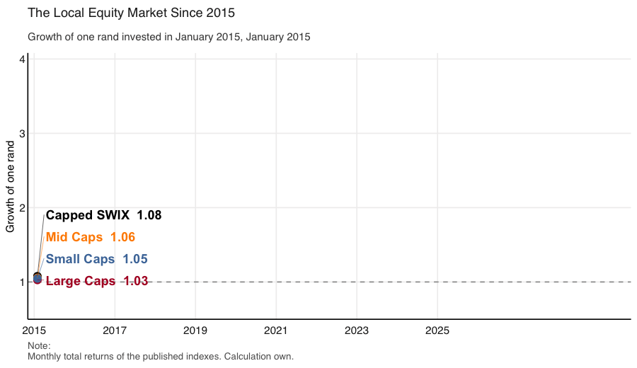

# Question 1, Exploring Risk and Uncertainty

Question 1 comes in three parts, and I treated them as one argument.
Part A asks whether local volatility has really risen and where it comes
from, Part B asks whether SafeCore is exposed to it, and Part C asks
what the same forces have done to the room for stock picking. Each part
hands a finding to the next, so the order of the work follows the order
of the paper. I load every dataset Question 1 uses in one place, so the
inputs are visible before any analysis starts.

``` r
Uncertainty_Indexes <- read_rds("data/Econ_Uncertainty_Indexes.rds") # economic policy uncertainty indexes and the MOVE bond volatility index
Implied_Vol <- read_rds("data/Implied_Vol_Indexes.rds") # implied volatility indexes, namely the VIX, V2X and VXEEM
Local_Index_Constituents <- read_rds("data/Index_Constituents.rds") # daily constituents, weights and returns for nine local indexes
Idx_Daily <- read_rds("data/Index_Returns_Daily.rds") # daily returns for the local headline, size and factor indexes
Stock_Returns <- read_rds("data/Stock_Returns_Daily.rds") # daily returns for every local stock
Local_Cncy_Vol_Index <- read_rds("data/LCL_Currency_Vol_Index.rds") # the SAVIUSD index of rand volatility
Gl_Cncy_Vol_Index <- read_rds("data/Global_Currency_Vol_Index.rds") # the JP Morgan global currency volatility index
Commods <- read_rds("data/Commodities.rds") # total return indexes for the Bloomberg commodity index, gold and Brent oil
SafeCore <- read_rds("data/SafeCore.rds") # monthly holdings and weights of the SafeCore fund
Factor_Scores <- read_rds("data/Factor_Scores.rds") # third party factor scores per stock, where a lower value means a lower exposure
Monthly_Constituents <- read_rds("data/Monthly_Index_Constituents.rds") # monthly constituents and weights of the Capped SWIX and the size indexes, used to rebuild the benchmark
STeFI <- read_rds("data/STeFI_Index.rds") # daily returns of the local cash index, used as the risk free rate
```

## Part A, Local Volatility in a Global Context

### Approach

I chose the Capped SWIX as the local yardstick, since it is SafeCore’s
benchmark in Part B and its capping stops a few large shares from
dominating. For the global experience I used the MSCI All Country World
index, and I added the MSCI Emerging Markets index because South
Africa’s natural peer group is emerging markets, not the developed
world. I kept each index in its own currency, since the question is
about the volatility each investor base experiences, and I note that
rand moves sit inside the local numbers.

I planned the work to move from blunt to refined measures, so that each
step could check the last. Period averages come first, then rolling and
calendar views for timing, then GARCH models to strip out noise, then
correlation and stratification to find the cause. The brief allows the
low volatility index to be rebuilt back to 2015, and I decided against
it here. Part A is about the market as a whole, the size indexes already
give me a defensive segment to compare, and Part B builds its own low
volatility score from prices.

``` r
Local_Rets <- Idx_Daily %>% filter(Name %in% c("Capped SWIX", "Top 40", "MidCaps", "SmallCaps")) %>% mutate(dlogret = log(1 + Returns)) %>% select(date, Name, Returns, dlogret) # keep the four vanilla local indexes and add log returns for the volatility models
Global_Rets <- read_rds("data/MSCI_Indexes.rds") %>% filter(Name %in% c("MSCI_ACWI", "MSCI_EM", "MSCI_USA")) %>% TRI_Returns_Calc(Start_Date = lubridate::ymd(20150101)) # turn the global index levels into daily returns over the same sample as the local data
All_Rets <- bind_rows(Local_Rets, Global_Rets) # stack local and global returns into one tidy data frame
Index_Order <- c("Capped SWIX", "Top 40", "MidCaps", "SmallCaps", "MSCI_EM", "MSCI_ACWI") # the order in which indexes appear in the figures, local first and then emerging and global
```

### Volatility by Period

I started with the bluntest test, annualised volatility by period,
because any more elaborate result would need to agree with it. I took
2021 to 2024 as the baseline, since it excludes Covid but contains an
ordinary mix of shocks, and plotted the shift from that baseline into
2026 with the full sample norm for reference.

``` r
Periods <- tibble(Period = c("2015-2019", "2020 (Covid)", "2021-2024", "2025", "2026 YTD"), # the names of the sub-periods
                  Start = lubridate::ymd(c(20150101, 20200101, 20210101, 20250101, 20260101)), # the first day of each sub-period
                  End = lubridate::ymd(c(20191231, 20201231, 20241231, 20251231, 20261231))) # the last day of each sub-period
Vol_Periods <- Vol_Period_Table(All_Rets, Periods) # annualised volatility of every index in every sub-period
Vol_Facts <- Vol_Periods %>% mutate(Key = paste(Name, Period)) # every index and period in one keyed table, used for the numbers in the text
Plot_Vol_Shift(Vol_Periods, Base_Per = "2021-2024", Target_Per = "2026 YTD", Index_Sel = Index_Order, # the shift from the 2021 to 2024 baseline into 2026 for each index
               Title = "Shift in Annualised Volatility from the 2021-2024 Baseline to 2026", # the plot title
               Subtitle = "Local large caps and emerging markets surged, while global equities and small caps cooled", # the main message
               Caption = "Note:\nAnnualised standard deviation of daily returns. Arrows run from the 2021-2024 baseline to 2026 YTD.\nDiamonds mark the 2015-2026 full sample norm. Calculation own.") # the note under the plot
```

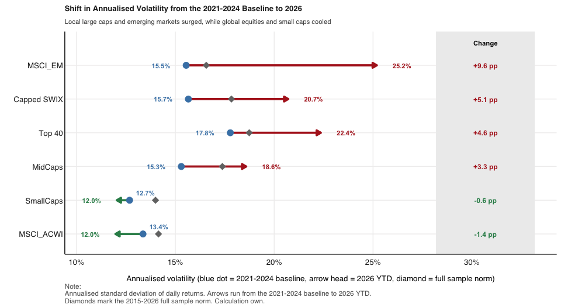

The first answer was already mixed. The Capped SWIX rose to 20.7 percent
in 2026, while the global index stayed below its norm of 14.1 percent
and emerging markets rose sharply. That pointed me away from a global
story and towards an emerging market one, and it raised the question of
timing, which a period average cannot answer.

### Rolling Realised Volatility

To see when volatility rose, I passed a three month rolling window
through the sample. I chose small multiples with every other index drawn
in grey, because six overlapping lines on one panel are hard to read and
the grey context still lets each index be judged against the rest.

``` r
Roll_Vol <- Roll_SD_Calc(All_Rets, NSel = 63) # rolling three month annualised volatility for every index
Roll_Facts <- Roll_Vol %>% group_by(Name) %>% summarise(Last = dplyr::last(RollSD), Pctile = mean(RollSD <= dplyr::last(RollSD)), Peak_2026 = max(RollSD[date >= lubridate::ymd(20260101)])) # the latest reading, where it ranks in the index's history and the 2026 peak, used in the text
Plot_Roll_Vol(Roll_Vol %>% filter(Name %in% Index_Order) %>% mutate(Name = factor(Name, levels = Index_Order)), # plot the local, emerging and global indexes as small multiples
              Title = "Rolling 3 Month Realised Volatility", # the plot title
              Subtitle = "Large local shares and emerging markets peaked in 2026, while small caps and global equities stayed close to normal", # the main message
              Caption = "Note:\nGrey lines show every other index for context. Dashed lines show each index's own average. Local indexes in ZAR, MSCI indexes in USD. Calculation own.") # the note under the plot
```


The rolling view showed that 2026 was an episode that had largely passed
by September, with the Capped SWIX back at 15 percent. It also showed
that small caps barely moved, which I followed up at the end of this
part.

### A Heatmap of Monthly Volatility

Rolling windows blur one episode into the next, so I added a calendar
heatmap to see how unusual each month was across all the indexes at
once, with the events I wanted to check marked above it.

``` r
Monthly_Vol <- Monthly_Vol_Calc(All_Rets %>% filter(Name %in% Index_Order)) %>% mutate(Name = factor(Name, levels = Index_Order)) # realised volatility of each index in every calendar month
Events <- tibble(date = lubridate::ymd(c(20151209, 20200315, 20220224, 20250402, 20260301)), # the dates of the events to mark
                 Label = c("Nenegate", "Covid crash", "Ukraine invasion", "US tariffs", "2026 episode")) # the names of the events
Plot_Vol_Heatmap(Monthly_Vol, Events = Events, Cap = 0.4, # plot the monthly heatmap with the events marked
                 Title = "Monthly Realised Volatility, 2015 to 2026", # the plot title
                 Subtitle = "April 2025 was a global shock, while the 2026 episode was confined to large local shares and emerging markets", # the main message
                 Caption = "Note:\nAnnualised standard deviation of daily returns within each month. Colours capped at 40 percent. Calculation own.") # the note under the plot
```

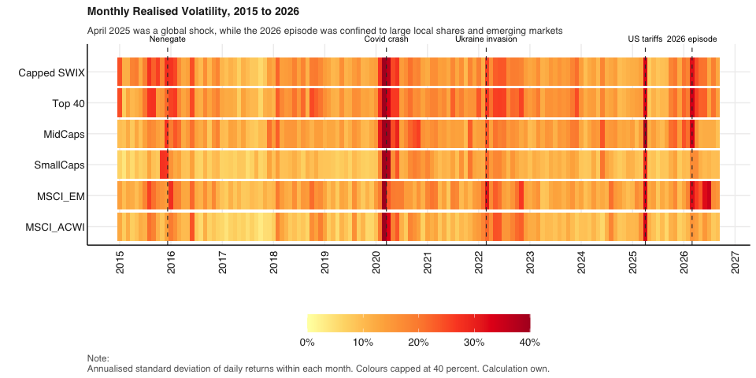

``` r
Cal_Facts <- Monthly_Vol %>% group_by(Name) %>% mutate(Rank = rank(-Vol)) %>% ungroup() %>% mutate(Key = paste(Name, format(Month_Date, "%b %Y"))) # rank every month within its own index, where one is the most volatile month, used in the text
```

The heatmap separated two kinds of shock. April 2025 darkened every row,
while 2026 was confined to the large local shares and emerging markets,
and March 2026 was the 4th most volatile month for the Capped SWIX since
2015.

### Volatility Clustering in Daily Returns

Before fitting GARCH models I wanted evidence that volatility clusters
in this data, so I checked the autocorrelation of returns and of squared
returns with the Ljung-Box test, as in the univariate GARCH practical.

``` r
Acf_df <- Acf_Calc(All_Rets, Series = c("Capped SWIX", "MSCI_ACWI", "MSCI_EM"), Lags = 25) # autocorrelation of returns and squared returns, with the Ljung-Box test
Acf_Facts <- Acf_df %>% group_by(Name, Type) %>% summarise(LB = dplyr::first(LB_Stat), Out = sum(abs(ACF) > Bound), .groups = "drop") %>% mutate(Key = paste(Name, Type)) # the test statistic and the number of lags outside the band, used in the text
Plot_Acf_Clustering(Acf_df, # returns next to squared returns for each index
                    Title = "Volatility Clustering in Daily Returns", # the plot title
                    Subtitle = "Returns carry little memory, while squared returns stay autocorrelated for weeks in every market", # the main message
                    Caption = "Note:\nDaily log returns from 2015, demeaned. The shaded band marks plus and minus 1.96 over the square root of the sample size. Calculation own.") # the note under the plot
```

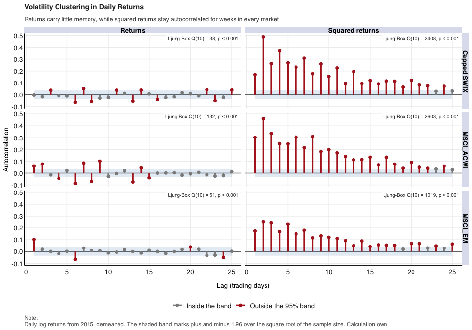

Squared returns stayed autocorrelated for weeks in all three markets,
while returns themselves showed only small autocorrelations. That
justified both the GARCH variance equation and the AR(1) mean equation I
used next.

### Conditional Volatility from GARCH Models

Realised volatility drops a large return out of its window abruptly, so
I moved to conditional volatility. I did not want to impose one
specification, so my function fits four GARCH models to each index and
keeps the one with the lowest AIC. I showed the result as yearly
ridgelines because I cared about the whole distribution of volatility
within each year, not only its average.

``` r
Garch_Sigma <- c("Capped SWIX", "MSCI_ACWI", "MSCI_EM") %>% map_df(~Best_Garch_Sigma(All_Rets, Series = .x)) # fit the best GARCH model to each index and stack the conditional volatility series
Garch_Facts <- Garch_Sigma %>% group_by(Name) %>% summarise(Persistence = dplyr::first(Persistence), Half_Life = log(0.5) / log(dplyr::first(Persistence)), Avg = mean(Sigma), Avg_2026 = mean(Sigma[date >= lubridate::ymd(20260101)])) # persistence, the half life of a shock in trading days and the average volatility, used in the text
Plot_Garch_Sigma(Garch_Sigma, X_Max = 0.5, # plot the yearly distributions of conditional volatility
                 Title = "Distribution of GARCH Conditional Volatility by Year", # the plot title
                 Subtitle = "In 2026 the local and emerging market distributions shift right and widen, while the global distribution barely moves", # the main message
                 Caption = "Note:\nBest fitting GARCH(1,1) model per index by AIC, with student t errors. Vertical lines mark each year's median. Axis truncated at 50 percent. Calculation own.") # the note under the plot
```

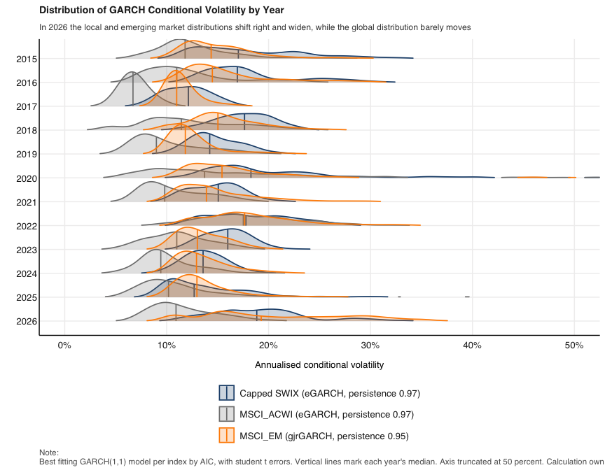

Asymmetric models won for all three indexes, and with the noise removed
the 2026 shift was still local and emerging market, not global.
Persistence of 0.97 told me that a local shock loses half its effect in
about 24 trading days.

### The Asymmetric Response to Bad News

Because the selected models were asymmetric, the next question was how
strongly each market reacts to bad news, so I traced news impact curves
from the fitted models.

``` r
Best_Models <- Garch_Sigma %>% distinct(Name, Model) # the model chosen by AIC for each index in the previous step
NIC_df <- Best_Models %>% pmap_df(~Garch_NIC_Calc(All_Rets, Series = ..1, Model = ..2, Shock_Range = 0.06)) # trace each index's news impact curve over shocks of minus to plus six percent
NIC_Facts <- NIC_df %>% group_by(Name) %>% summarise(At_Zero = Vol[which.min(abs(Shock))], Asym = Vol[which.min(abs(Shock + 0.04))] / Vol[which.min(abs(Shock - 0.04))]) %>% mutate(Name = as.character(Name)) # the volatility after no surprise and the ratio of the response to a 4 percent fall relative to a 4 percent rise, used in the text
Plot_NIC(NIC_df, Mark_Shock = 0.04, # plot the three news impact curves together
         Title = "News Impact Curves for Local, Global and Emerging Markets", # the plot title
         Subtitle = "Local volatility starts higher but reacts less sharply to bad news than global or emerging markets", # the main message
         Caption = "Note:\nCurves from the best fitting GARCH(1,1) model per index, with lagged variance at its long run level. Points mark shocks of plus and minus 4 percent. Calculation own.") # the note under the plot
```

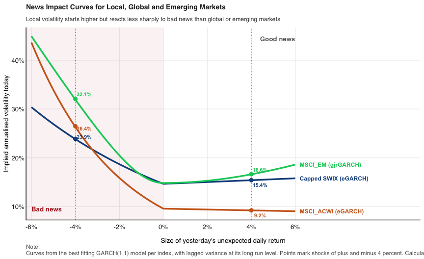

The local curve starts higher but rises less steeply on the bad news
side, with an asymmetry ratio of 1.55 against 2.87 globally. A rand
hedge explanation is plausible, but I had no direct test of it, so I
present it as a possibility in the report.

### Forecasting Volatility Forward

To judge whether the episode should be expected to last, I used the same
fitted models to forecast volatility six months ahead.

``` r
Garch_Fc <- Best_Models %>% pmap_df(~Garch_Forecast_Calc(All_Rets, Series = ..1, Model = ..2, N_Ahead = 126, Show_From = lubridate::ymd(20250101))) # recent fitted volatility and a six month forecast for each index, using the model selected above
Fc_Facts <- Garch_Fc %>% group_by(Name) %>% summarise(Last_Fit = dplyr::last(Sigma[Part == "Fitted"]), Fc_3m = Sigma[Part == "Forecast"][63], Long_Run = dplyr::first(Long_Run), Half_Life = dplyr::first(Half_Life), .groups = "drop") # the latest fitted value, the three month forecast, the long run level and the half life, used in the text
Plot_Garch_Forecast(Garch_Fc, Cols = c(`Capped SWIX` = "#1F3A6B", MSCI_ACWI = "#B5451B", MSCI_EM = "#1E7B3A"), # the fitted path and forecast for each index
                    Title = "GARCH Volatility Forecasts Six Months Ahead", # the plot title
                    Subtitle = "Local volatility is expected to drift back to its long run level within a few months", # the main message
                    Caption = "Note:\nThin lines are fitted conditional volatility since 2025 and thick lines the forecast, in the grey band. Dashed lines mark each model's long run level. Calculation own.") # the note under the plot
```

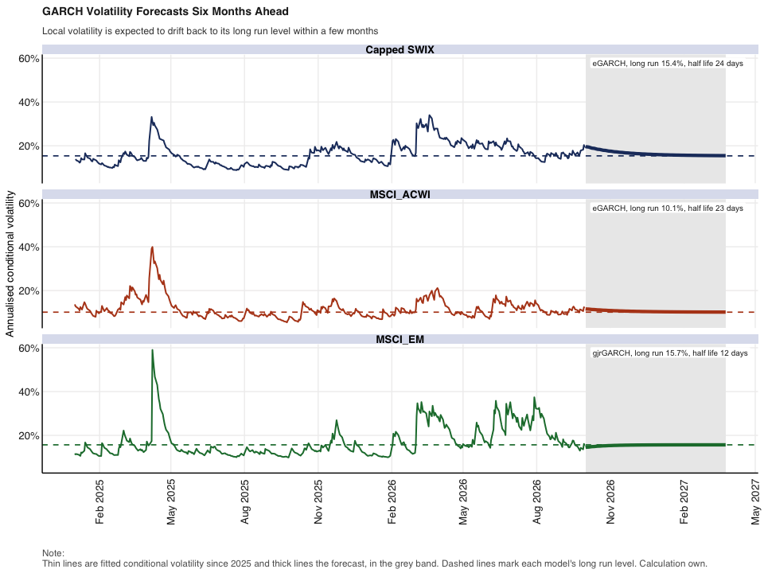

The local forecast falls from 19.2 percent towards its long run level of
15.4 percent, which supports reading 2026 as temporary. A GARCH forecast
always reverts to the sample average, so I lean on the rolling and
heatmap evidence, not on the forecast alone, to rule out a lasting
shift.

### Co-movement with Global Markets

Higher local volatility could come from a tighter link with offshore
markets or from bigger shocks in the markets we already move with, and
the two call for different ballasts. I estimated DCC correlations on
weekly returns, because Johannesburg and New York close at different
times and daily correlations would be biased downwards.

``` r
Weekly_Rets <- Weekly_Returns_Calc(All_Rets %>% filter(Name %in% c("Capped SWIX", "MSCI_ACWI", "MSCI_EM"))) # weekly log returns, which sidestep the different closing times of Johannesburg and New York
DCC_df <- DCC_Cor_Calc(Weekly_Rets, Base = "Capped SWIX") # time-varying correlation of the local index with the global and emerging market indexes
DCC_Facts <- DCC_df %>% mutate(Pair = as.character(Pair)) %>% group_by(Pair) %>% summarise(Avg_2124 = mean(Rho[date >= lubridate::ymd(20210101) & date < lubridate::ymd(20250101)]), Avg_2026 = mean(Rho[date >= lubridate::ymd(20260101)]), Low_2016 = min(Rho[date >= lubridate::ymd(20160101)]), Low_Date = format(date[date >= lubridate::ymd(20160101)][which.min(Rho[date >= lubridate::ymd(20160101)])], "%B %Y")) # period averages and the lowest weekly reading since 2016, used in the text
Plot_DCC(DCC_df, # plot both correlation series as lollipops from their averages
         Title = "Dynamic Conditional Correlations with the Capped SWIX", # the plot title
         Subtitle = "The link with offshore markets did not tighten in 2026, and the link with emerging markets weakened", # the main message
         Caption = glue::glue("Note:\nMonthly averages of weekly DCC(1,1) correlations with GJR-GARCH univariate models, measured from each pair's average. DCC a = {round(dplyr::first(DCC_df$dcc_a), 3)} and b = {round(dplyr::first(DCC_df$dcc_b), 3)}. Calculation own.")) # the note under the plot, including the fitted parameters
```


The correlation with the global index in 2026, at 0.68, was essentially
unchanged from its 2021 to 2024 average, so the link did not tighten.
That ruled out contagion as the explanation and sent me to test which
external forces matter.

### Volatility Across Global Regimes

The seminar named oil volatility and policy uncertainty as the drivers,
so I tested that claim directly with the stratification from the
Practical 2 bonus, adding implied volatility and rand volatility as
competing explanations.

``` r
State_Names <- c(VIX = "US implied volatility (VIX)", VXEEM = "EM implied volatility (VXEEM)", SAVIUSD = "Rand volatility (SAVIUSD)", EPUCGLCP = "Global policy uncertainty", Oil_Brent_Vol = "Brent oil volatility") # readable names for the state variables
Gauges <- bind_rows(Implied_Vol, Uncertainty_Indexes, Local_Cncy_Vol_Index %>% select(-Description)) # stack the volatility and uncertainty gauges that are quoted as levels
Oil_Rets <- Commods %>% TRI_Returns_Calc(Start_Date = lubridate::ymd(20150101)) # daily commodity returns, from which monthly oil volatility is measured
State_df <- State_Monthly_Calc(Level_df = Gauges, Level_Sel = c("VIX", "VXEEM", "SAVIUSD", "EPUCGLCP"), Vol_df = Oil_Rets, Vol_Sel = "Oil_Brent") %>% mutate(State = recode(State, !!!State_Names)) # one monthly value per state variable, with readable names
Vol_Strat <- Vol_Stratify(Local_Rets, States = State_df, Hi_Q = 0.8, Lo_Q = 0.2) # local index volatility in the high and low quintile months of each state
EPU_Annual <- Uncertainty_Indexes %>% filter(Name == "EPUCGLCP", date >= lubridate::ymd(20150101)) %>% group_by(Year = as.character(lubridate::year(date))) %>% summarise(Avg = mean(TRI)) # the yearly average of global policy uncertainty, used in the text
Plot_Vol_Stratify(Vol_Strat, Index_Sel = "Capped SWIX", # plot the result for the local benchmark
                  Title = "Capped SWIX Volatility in Calm and Stressed Global Regimes", # the plot title
                  Subtitle = "Market-based stress raises local volatility, while news-based policy uncertainty alone has little effect", # the main message
                  Caption = "Note:\nCalm and stressed months are the bottom and top quintile of months for each state variable since 2015. Calculation own.") # the note under the plot
```


Market-based stress raised local volatility clearly, while news-based
policy uncertainty barely mattered, even though it peaked in 2025. I
concluded that uncertainty reaches local shares through market channels
such as oil and emerging market risk appetite.

### Volatility Across Local Size Segments

Having identified the threat, I wanted to know which part of the local
market already acts as a ballast, so I repeated the stratification
across the size indexes and drew it as a bubble grid.

``` r
Plot_Strat_Heatmap(Vol_Strat %>% mutate(Name = factor(Name, levels = c("Top 40", "Capped SWIX", "MidCaps", "SmallCaps"))), # order the indexes from largest to smallest companies
                   Title = "Stratified Volatility Across Local Size Segments", # the plot title
                   Subtitle = "Small caps remain the calmest segment in every regime, although their volatility rises most in proportion", # the main message
                   Caption = "Note:\nBubble size and label show annualised volatility in the top and bottom quintile months of each state variable. Colour shows the ratio to full sample volatility. Calculation own.") # the note under the plot
```

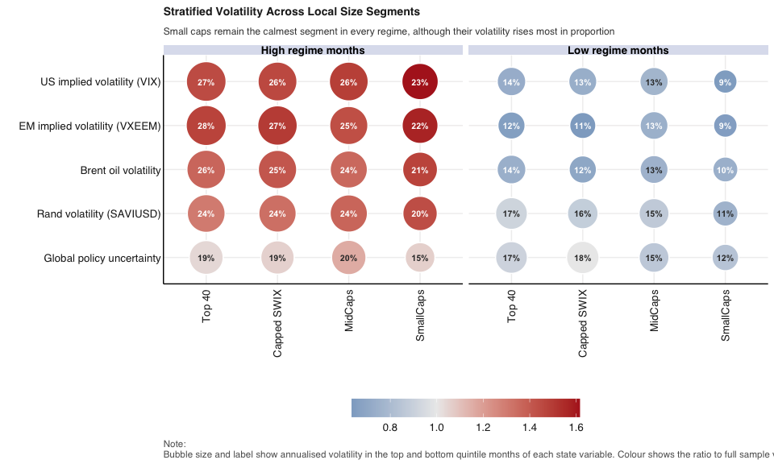

Small caps were the calmest segment in every regime, although their
volatility rises most in proportion, up to 1.61 times normal. I kept a
liquidity caveat in mind here, and Question 2 returns to it with a
direct test for stale prices.

### Conclusion to Part A

My answer to Part A is that local volatility did increase, but as a
temporary episode that followed emerging markets and oil, not developed
markets, and without a tighter link to offshore markets. That shaped
Part B, since a ballast built for developed market stress would have
missed 2026. The full analysis is in
[Question1.pdf](Questions/Question1/Question1.pdf).

## Part B, Volatility and Factor Exposures of SafeCore

### Approach

Part B asks whether a fund built without reference to volatility still
manages it, where its risk comes from and what factor exposures it
carries. I needed a like-for-like benchmark first, so I rebuilt both
SafeCore and the Capped SWIX from holdings with the same return
function. I then judged volatility management from several angles,
decomposed the fund’s risk, and built my own factor scores before
comparing them with the vendor’s.

### Reconstructing the Fund and its Benchmark

I rebuilt the benchmark from its monthly constituents with the same
method as the fund, so that any gap between the two reflects holdings
and not differences in data or rebalancing. Before relying on it, I
checked the rebuild against the published J433 returns.

``` r
SafeCore_Rets <- Holdings_Returns_Calc(SafeCore, Stock_Returns, Start_Date = lubridate::ymd(20150101), Ret_Cap = 0.25, Port_Name = "SafeCore") # daily returns of SafeCore rebuilt from its monthly holdings
BM_Rets <- Holdings_Returns_Calc(Monthly_Constituents %>% filter(Fund == "CappedSWIX"), Stock_Returns, Start_Date = lubridate::ymd(20150101), Ret_Cap = 0.25, Port_Name = "Capped SWIX") # daily returns of the Capped SWIX rebuilt in exactly the same way
J433_Published <- Idx_Daily %>% filter(Tickers == "J433") %>% select(date, Returns) %>% mutate(Name = "Published") # the published index returns, used only to validate the rebuild
Rebuild_Check <-
    bind_rows(BM_Rets %>% mutate(Name = "Rebuilt"), J433_Published) %>% # stack the rebuilt and published benchmark returns
    group_by(Name, Year = as.character(lubridate::year(date))) %>% # one number per series per calendar year
    summarise(Return = prod(1 + Returns) - 1, .groups = "drop") %>% # chain the daily returns into a calendar year return
    spread(Name, Return) %>% # one column for the rebuilt index and one for the published index
    mutate(Gap = abs(Rebuilt - Published)) # the absolute difference between the two in each year, used in the text
Port_Daily <- bind_rows(SafeCore_Rets, BM_Rets) # the fund and its like for like benchmark in one tidy data frame
```

Calendar year returns of the rebuild differ from the published index by
less than one percentage point in 9 of the 12 years, which gave me
confidence to compare the fund with it.

### Return and Risk Profile

A fund can earn its outperformance through upside capture without
offering any protection, so I looked at return, volatility and capture
together, over the full sample and since 2020.

``` r
Stats_Full <- Fund_Stats_Table(Port_Daily, BM_Name = "Capped SWIX", Rf_df = STeFI) %>% mutate(Period = "2015-2026") # statistics over the full sample
Stats_2020 <- Fund_Stats_Table(Port_Daily %>% filter(date >= lubridate::ymd(20200101)), BM_Name = "Capped SWIX", Rf_df = STeFI) %>% mutate(Period = "2020-2026") # statistics since the start of 2020
Stats_All <- bind_rows(Stats_Full, Stats_2020) # combine full and post-2020 statistics
Stats_Facts <- Stats_All %>% filter(Name == "SafeCore") # the fund's relative measures, used for the numbers in the text that the figure does not show
Plot_Fund_Capture(Stats_All, BM_Name = "Capped SWIX", Fund_Name = "SafeCore", # plot the capture quadrant and risk-return profile
                  Title = "Return and Risk Profile of SafeCore Against the Capped SWIX", # the plot title
                  Subtitle = "SafeCore outperforms via upside capture, but offers no volatility reduction or downside protection", # the main message
                  Caption = "Note:\nMonthly returns. Capture ratios use the arithmetic calculation. Modified CVaR shown as a positive loss. Calculation own.") # the note under the plot
```

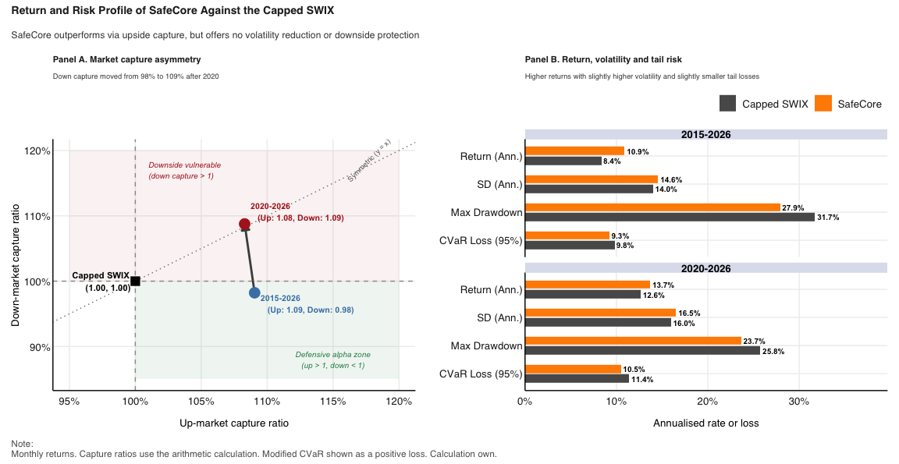

SafeCore earned an information ratio of 0.61 with a beta of 1.00, but
its down capture rose after 2020, so its outperformance came from rising
markets.

### Daily Tail Risk

Volatility describes typical moves, while a ballast exists for the bad
days, so I added the Practical 2 tail measures, Value at Risk and
Expected Shortfall, by three methods.

``` r
Tail_Risk <- VaR_ES_Calc(Port_Daily, p = 0.95) # daily VaR and ES of the fund and the benchmark by three methods
Tail_Facts <- Tail_Risk %>% mutate(Key = paste(Name, Measure)) # keyed for the numbers in the text
Plot_VaR_ES(Port_Daily, Tail_Risk, # the return distributions with the tail measures marked
            Title = "Daily Tail Risk of SafeCore and the Capped SWIX", # the plot title
            Subtitle = "SafeCore's bad days are as bad as the benchmark's on every historical and Gaussian measure", # the main message
            Caption = "Note:\nOne-day measures at 95 percent from daily returns since 2015. Solid lines mark VaR and dashed lines ES. Histograms trimmed at plus and minus 8 percent. Calculation own.") # the note under the plot
```

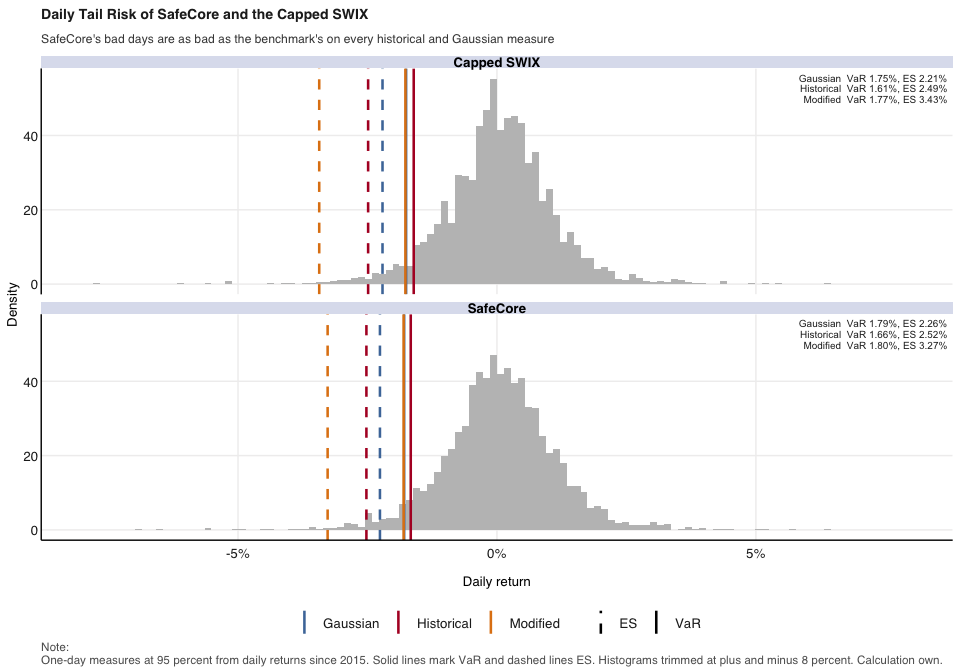

The fund’s historical VaR and ES were marginally worse than the
benchmark’s, so there is no tail protection to point to.

### Calendar Year Returns

I also wanted to know whether the outperformance was steady or
concentrated in a few years, so I compared calendar year returns.

``` r
Cal_B <- Port_Daily %>% mutate(Year = lubridate::year(date)) %>% group_by(Name, Year) %>% summarise(Ret = prod(1 + Returns) - 1, .groups = "drop") %>% spread(Name, Ret) %>% mutate(Diff = SafeCore - `Capped SWIX`) # each year's return of the fund and benchmark and the gap between them
Plot_Calendar_Returns(Port_Daily, Fund_Name = "SafeCore", BM_Name = "Capped SWIX", # the yearly returns side by side
                      Title = "SafeCore and the Capped SWIX by Calendar Year", # the plot title
                      Subtitle = "SafeCore led in most years, but its average lead shrank sharply after 2020", # the main message
                      Caption = "Note:\nCompounded daily returns in each calendar year. Labels give SafeCore's lead or lag in percentage points. * Year to September 2026. Calculation own.") # the note under the plot
```

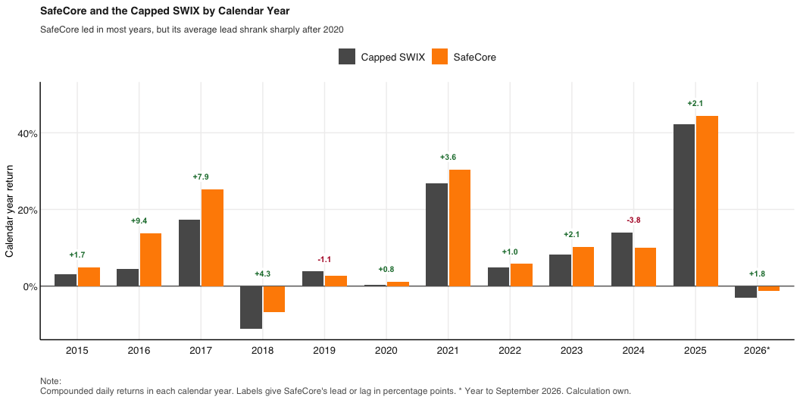

SafeCore led in 10 of the 12 years, but its average lead fell sharply
after 2020, which matched the capture evidence.

### Rolling Volatility Relative to the Benchmark

The core question was whether SafeCore runs less volatility than its
benchmark, so I compared one year rolling volatility day by day, with
the gap underneath, and then reused the stressed regimes from Part A.

``` r
Gap_Facts <- Port_Daily %>% Roll_SD_Calc(NSel = 252) %>% select(date, Name, RollSD) %>% spread(Name, RollSD) %>% tidyr::drop_na() %>% rename(BM = `Capped SWIX`) %>% summarise(Share = mean(SafeCore > BM), Avg_Gap = mean(SafeCore - BM)) # how often and by how much SafeCore ran more risk than its benchmark, used in the text
Plot_Roll_Vol_Gap(Port_Daily, Fund = "SafeCore", BM = "Capped SWIX", NSel = 252, # rolling one year volatility of the fund against its benchmark
                  Title = "SafeCore Rolling Volatility Against the Capped SWIX", # the plot title
                  Subtitle = "SafeCore has run slightly more risk than its benchmark on nine days out of ten", # the main message
                  Caption = "Note:\nRolling 252 day annualised standard deviation of daily returns. The lower strip shows SafeCore minus the Capped SWIX. Calculation own.") # the note under the plot
```

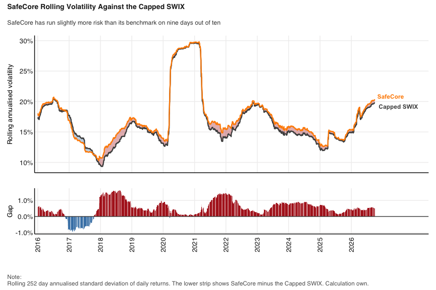

``` r
SC_Strat <- Vol_Stratify(Port_Daily, States = State_df, Hi_Q = 0.8, Lo_Q = 0.2) %>% select(State, Regime, Name, SD) %>% spread(Name, SD) %>% rename(BM = `Capped SWIX`) %>% mutate(Rel = SafeCore / BM) # SafeCore volatility relative to its benchmark in the high and low months of each state variable from Part A, used in the text
```

SafeCore ran more volatility than the benchmark on 91 percent of days
and offered no relief in stressed regimes, which answered the first part
of the question in the negative.

### Sources of Portfolio Volatility

To find where the risk comes from, I decomposed the fund’s ex ante
volatility into each holding’s contribution with the marginal
contribution method from Practical 2, at every quarter end, and mirrored
each sector’s share of capital against its share of risk.

``` r
Risk_Dates <- SafeCore %>% distinct(date) %>% filter(date >= lubridate::ymd(20151231), lubridate::month(date) %in% c(3, 6, 9, 12) | date == max(date)) %>% pull(date) # every quarter end since 2015, plus the latest holdings date
Risk_Contrib <- Risk_Dates %>% map_df(~Risk_Contribution_Calc(SafeCore, Stock_Returns, Date_Sel = .x, Lookback_Months = 12)) # each holding's contribution to fund volatility on every date
Sector_Shares <- Risk_Contrib %>% mutate(Sector = coalesce(Sector, "Unclassified")) %>% group_by(date, Sector) %>% summarise(Capital = sum(Weight), Risk = sum(Risk_Share), .groups = "drop") %>% mutate(Key = paste(Sector, date)) # sector shares of capital and of risk on every date, used in the text
Plot_Risk_vs_Weight(Risk_Contrib, # sector shares of capital and of risk through time
                    Title = "SafeCore Sector Shares of Capital and of Risk", # the plot title
                    Subtitle = "Resources hold a third of the capital but have generated over half of the risk since late 2025", # the main message
                    Caption = "Note:\nRisk shares from weight times marginal contribution to risk, using a trailing one year covariance matrix at each quarter end. Calculation own.") # the note under the plot
```

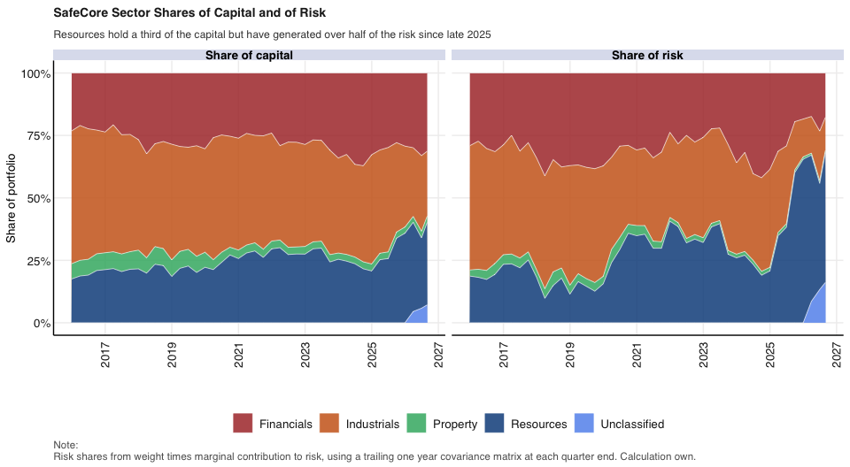

The resources sector’s share of risk swelled from late 2025 while its
share of capital barely changed, which pointed to a handful of stocks.

### The Largest Contributors to Risk

I then zoomed in on the latest holdings date to name the stocks behind
that shift.

``` r
Latest_Risk <- Risk_Contrib %>% filter(date == max(date)) # the decomposition on the latest holdings date
Risk_Conc <- Latest_Risk %>% summarise(Top5_Capital = sum(sort(Weight, decreasing = TRUE)[1:5]), Top5_Risk = sum(sort(Risk_Share, decreasing = TRUE)[1:5]), Gold_Risk = sum(Risk_Share[Tickers %in% c("ANG", "GFI")]), Gold_Capital = sum(Weight[Tickers %in% c("ANG", "GFI")])) # concentration of capital and risk, used in the text
Plot_Top_Risk(Latest_Risk, Top_N = 12, # the twelve largest contributors to risk
              Title = "Largest Contributors to SafeCore's Volatility", # the plot title
              Subtitle = "Two gold miners carry 45 percent of the fund's risk on less than 20 percent of its capital", # the main message
              Caption = glue::glue("Note:\nHoldings at {format(max(Latest_Risk$date), '%d %B %Y')}. Ex ante fund volatility of {scales::percent(unique(Latest_Risk$Port_Vol), accuracy = 0.1)} from a trailing one year covariance matrix. Calculation own.")) # the note under the plot, including the date and the fund volatility
```

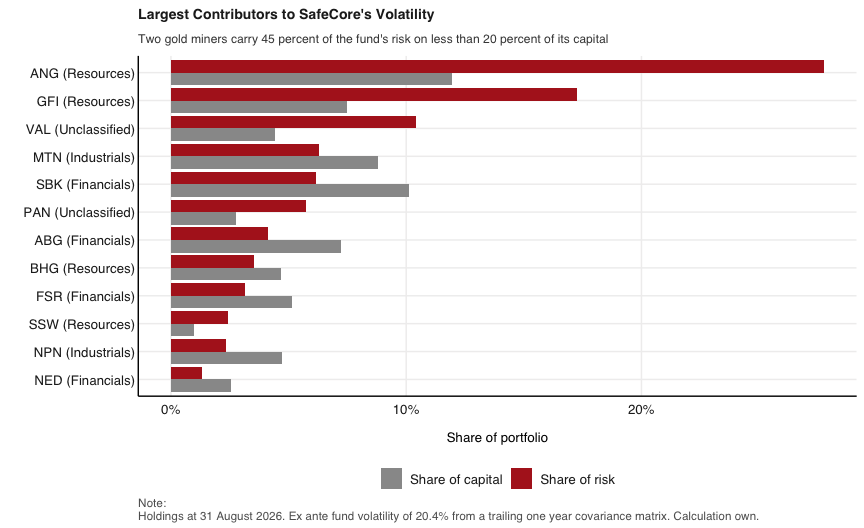

AngloGold Ashanti alone carried 27.8 percent of the fund’s risk on 12.0
percent of its capital, so the fund’s volatility had become largely a
bet on gold.

### Building Own Momentum and Low Volatility Scores

The brief suggests six month momentum skipping the last month and six
month realised volatility, and I kept both because they are standard
definitions and match what the vendor claims to measure. Skipping the
latest month avoids short-term reversal. I capped extreme daily returns
and required 80 percent data coverage, so that thin histories do not
produce extreme scores. I also built a twelve month momentum and market
and downside betas, not as final scores but as diagnostics, so that I
could tell what the vendor’s scores were really capturing. All scores
are standardised within the vendor’s universe each month so they share
one scale.

``` r
Score_Dates <- sort(unique(Factor_Scores$date)) # the month ends on which the vendor provides scores
Own_Scores <- Own_Factor_Scores(Stock_Returns, Score_Dates, Mom_Months = 6, Skip_Months = 1, Vol_Months = 6, Ret_Cap = 0.25, Min_Coverage = 0.8) # own 6-1 momentum and 6 month realised volatility for every stock
Own_Mom12 <- Own_Factor_Scores(Stock_Returns, Score_Dates, Mom_Months = 12, Skip_Months = 1, Vol_Months = 6) %>% select(date, Tickers, Mom12_Raw = Mom_Raw) # a 12-1 momentum variant, used only as a diagnostic
Stock_Betas <- Stock_Beta_Calc(Stock_Returns, Idx_Daily %>% filter(Tickers == "J433") %>% select(date, Mkt = Returns), Score_Dates, Months = 12) # market and downside betas against the Capped SWIX, used only as a diagnostic
Scores_All <-
    Factor_Scores %>%
    spread(Factor, Factor_Value) %>% # one column per vendor factor
    left_join(Own_Scores, by = c("date", "Tickers")) %>% # attach the own measures
    left_join(Own_Mom12, by = c("date", "Tickers")) %>% # attach the 12-1 momentum variant
    left_join(Stock_Betas, by = c("date", "Tickers")) %>% # attach the betas
    mutate(LowVol_Raw = -Vol_Raw) %>% # flip the sign so that a higher score means lower volatility
    Zscore_Calc(Cols = c("Mom_Raw", "Mom12_Raw", "LowVol_Raw"), Cap = 3) %>% # standardise within the vendor's universe each month
    rename(Momentum_Own = Mom_Raw, Momentum12_Own = Mom12_Raw, LowVol_Own = LowVol_Raw) # clearer names for the own scores
```

### Own Scores Against the Vendor Scores

I compared my scores with the vendor’s by monthly Spearman rank
correlation, since only the ranking of stocks matters for a factor
portfolio, and added a heatmap against every diagnostic.

``` r
Score_Pairs <- tibble(X = c("Momentum_Own", "Momentum12_Own", "LowVol_Own"), # the own scores
                      Y = c("Momentum", "Momentum", "Volatility Sensitivity"), # the vendor score each is compared with
                      Label = c("Own 6-1 momentum vs vendor", "Own 12-1 momentum vs vendor", "Own low volatility vs vendor volatility sensitivity")) # readable labels
Score_Cor <- Score_Rank_Cor(Scores_All, Score_Pairs) # the monthly rank correlation of each pair
Own_Names <- c(Beta = "Market beta", Downside_Beta = "Downside beta", LowVol_Own = "Own low volatility", Momentum_Own = "Own 6-1 momentum", Momentum12_Own = "Own 12-1 momentum") # readable names for the own measures
Diag_Pairs <- tidyr::expand_grid(Y = c("Earnings Quality", "Growth", "Momentum", "Value", "Volatility Sensitivity"), X = names(Own_Names)) %>% mutate(Label = paste(X, Y, sep = " | ")) # every own measure against every vendor factor, with a label that can be split again
Score_Diag <-
    Score_Rank_Cor(Scores_All, Diag_Pairs) %>% # the monthly rank correlation of every combination
    group_by(Label) %>% # one number per combination
    summarise(Rho = mean(Rho)) %>% # the average over all months
    tidyr::separate(Label, c("Own", "Vendor"), sep = " \\| ") %>% # split the label back into its two parts
    mutate(Own = factor(recode(Own, !!!Own_Names), levels = rev(Own_Names))) # readable names in a fixed order
Plot_Score_Cor(Score_Cor, Diag = Score_Diag, # the time series and the diagnostic heatmap side by side
               Title = "Own Scores Against the Vendor's Scores", # the plot title
               Subtitle = "Vendor momentum matches a 12-1 definition almost exactly, while its volatility score tracks downside beta, not volatility", # the main message
               Caption = "Note:\nMonthly Spearman rank correlations across stocks. Dashed lines show averages. The heatmap averages each combination over all months. Calculation own.") # the note under the plot
```

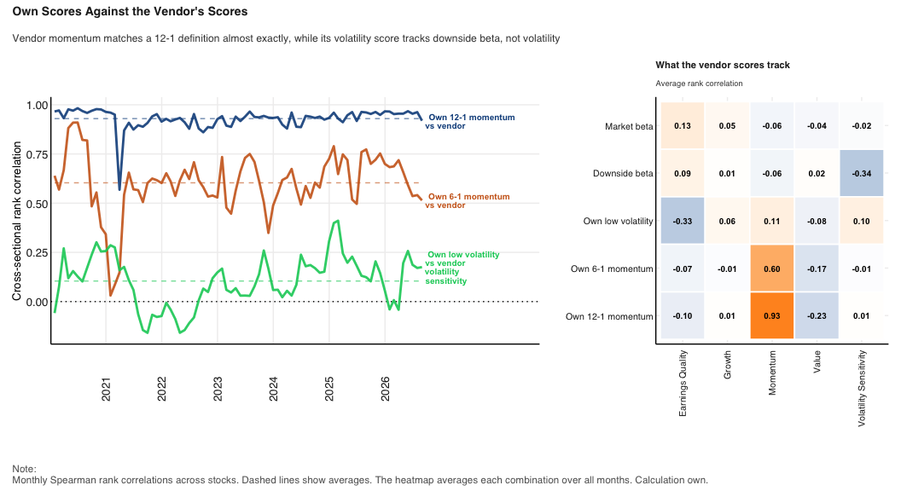

Vendor momentum matched my twelve month version almost exactly, while
its volatility score lined up with downside beta and not with
volatility, so I treat it as a beta score and rely on my own low
volatility score from here.

### Composite Factor Scores Across Strategies

The brief asks for composite scores across strategies to put SafeCore in
context, so I weighted the stock scores by holdings for each local
strategy index and for the fund.

``` r
Strategy_Holdings <-
    Local_Index_Constituents %>%
    mutate(YM = format(date, "%Y%m")) %>% # a year and month label
    group_by(Index, YM) %>% # one set of holdings per index per month
    filter(date == max(date)) %>% # keep the last trading day of each month
    ungroup() %>% # remove the grouping again
    select(date, Portfolio = Index, Tickers, Weight = weight) # the shape that the composite score function expects
All_Holdings <- bind_rows(Strategy_Holdings, SafeCore %>% filter(date >= lubridate::ymd(20200101)) %>% select(date, Portfolio = Fund, Tickers, Weight)) # the strategy indexes and SafeCore together
Scores_Long <-
    Scores_All %>%
    select(date, Tickers, `Earnings Quality`, Growth, Value, `Vendor Momentum` = Momentum, `Vendor Volatility Sensitivity` = `Volatility Sensitivity`, # the vendor factors
           `Own Momentum (6-1)` = Momentum_Own, `Own Low Volatility` = LowVol_Own) %>% # and the own scores
    gather(Factor, Score, -date, -Tickers) # long format, one row per stock, factor and month
Port_Factor_Scores <- Portfolio_Factor_Scores(All_Holdings, Scores_Long) # the weighted average score of every portfolio for every factor and month
Comp_Avg <- Port_Factor_Scores %>% filter(date >= lubridate::ymd(20200801)) %>% group_by(Portfolio, Factor) %>% summarise(Score = mean(Score), .groups = "drop") %>% mutate(Key = paste(Portfolio, Factor, sep = " | ")) # the average composite score of every portfolio and factor, used in the text
Plot_Factor_Lollipops(Port_Factor_Scores, Start_Date = lubridate::ymd(20200801), Fund = "SafeCore", BM = "Capped SWIX", # average exposures since the strategy index data begins
                      Port_Order = c("SafeCore", "Capped SWIX", "LowVol", "Momentum", "Value", "Quality", "Large Caps", "Mid Caps", "Small Caps", "REITS"), # SafeCore and its benchmark first, then the strategies
                      Title = "Composite Factor Scores by Strategy", # the plot title
                      Subtitle = "SafeCore tilts towards earnings quality, value and momentum, but has no low volatility tilt", # the main message
                      Caption = "Note:\nWeighted average z-scores of holdings, averaged from August 2020 to August 2026. Calculation own.") # the note under the plot
```

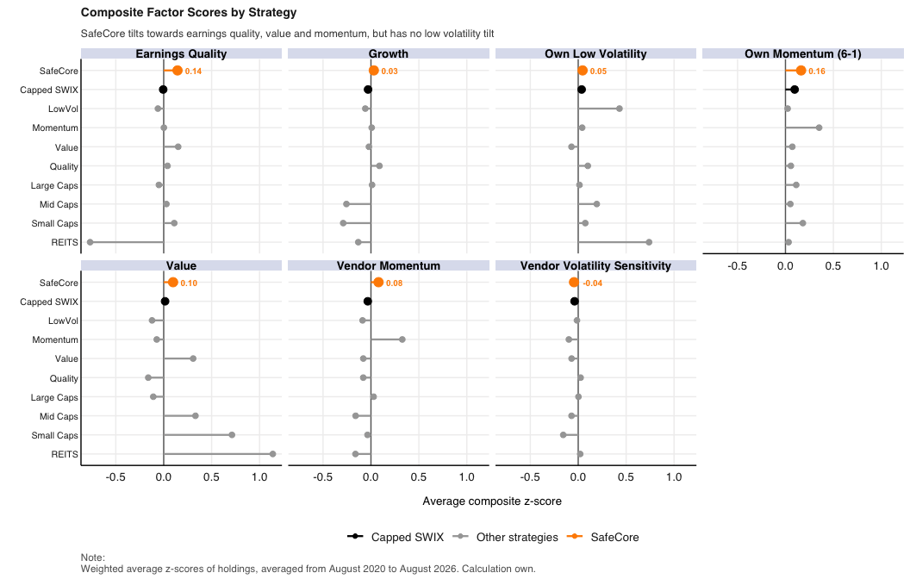

My low volatility score picked out the LowVol index correctly, at 0.43
against 0.04 for the benchmark, which validated it, and SafeCore showed
no low volatility tilt.

### SafeCore’s Active Factor Exposures

Averages hide drift, so I tracked SafeCore’s active exposures against
the Capped SWIX through time.

``` r
Active_Factors <- c("Own Low Volatility", "Vendor Volatility Sensitivity", "Own Momentum (6-1)", "Vendor Momentum", "Earnings Quality", "Value") # the factors most relevant to the volatility question, leaving out growth, which sits close to zero throughout
Active_Period <-
    Port_Factor_Scores %>%
    filter(Portfolio %in% c("SafeCore", "Capped SWIX"), Factor %in% Active_Factors, date >= lubridate::ymd(20200801)) %>% # the fund and benchmark scores for the chosen factors
    select(date, Portfolio, Factor, Score) %>% # keep only what the summary needs
    spread(Portfolio, Score) %>% # one column for the fund and one for the benchmark
    mutate(Active = SafeCore - `Capped SWIX`, Period = ifelse(date < lubridate::ymd(20250101), "Before 2025", ifelse(date < lubridate::ymd(20260101), "2025", "2026"))) %>% # the active exposure and the period it falls in
    group_by(Factor, Period) %>% # one number per factor per period
    summarise(Active = mean(Active), .groups = "drop") %>% # the average active exposure in the period
    mutate(Key = paste(Factor, Period, sep = " | ")) # a key for the inline numbers in the text
Plot_Active_Exposure(Port_Factor_Scores %>% filter(date >= lubridate::ymd(20200801), Factor %in% Active_Factors), Fund = "SafeCore", BM = "Capped SWIX", # active exposures of SafeCore against its benchmark
                     Title = "SafeCore Active Factor Exposures Against the Capped SWIX", # the plot title
                     Subtitle = "In 2026 the fund became a momentum play with more downside exposure than its benchmark", # the main message
                     Caption = "Note:\nSafeCore composite z-score minus Capped SWIX composite z-score. Orange marks an overweight tilt and blue an underweight tilt. Calculation own.") # the note under the plot
```

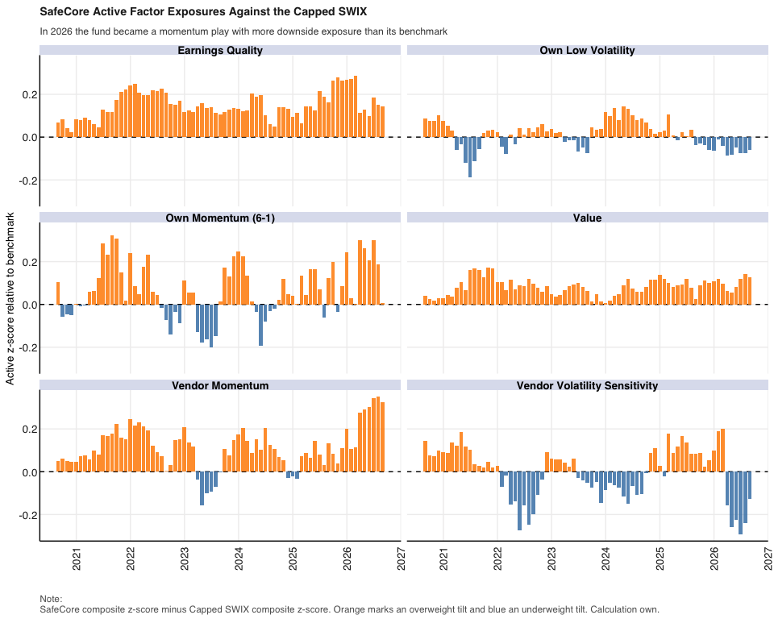

In 2026 the fund became a momentum play, with an active vendor momentum
exposure of 0.26 against 0.10 before 2025.

### Conclusion to Part B

My answer to Part B is that SafeCore did not manage volatility. It
outperformed, with an information ratio of 0.61, but it ran more risk
than its benchmark on 91 percent of days, gave no protection in stress,
held no low volatility tilt and became concentrated in gold miners. The
full analysis is in [Question1.pdf](Questions/Question1/Question1.pdf).

## Part C, Dispersion, Correlation and Alpha Opportunity

### Approach

Part C asks about the alpha opportunity since 2020, which needs both
dispersion and correlation. I used the daily Capped SWIX constituents,
which start in August 2020 and match the period asked about. I tied the
two measures together with an exact variance split, checked whether the
opportunity showed up in manager outcomes, and finally related both
measures to macro variables.

### Cross-Sectional Volatility

The brief asks me to motivate weighted or unweighted dispersion. I chose
weighted dispersion as the headline, because managers are measured
against a cap-weighted benchmark, so a large move in a heavyweight stock
forces a large active bet whether or not they hold it. I kept the
unweighted version beside it for comparison.

``` r
SWIX_Cons <- Local_Index_Constituents %>% filter(Index == "Capped SWIX") # daily constituents, weights and returns of the Capped SWIX
Dispersion <- Dispersion_Calc(SWIX_Cons, NSel = 21, Ret_Cap = 0.5) # rolling one month weighted and unweighted dispersion
Disp_Events <- tibble(date = lubridate::ymd(c(20220707, 20260828)), Label = c("Naspers and Prosus buyback", "Gold miners rally")) # the two largest spikes, identified by decomposing them stock by stock
Disp_Facts <- Dispersion %>% mutate(Period = ifelse(date < lubridate::ymd(20260101), "Before 2026", "2026")) %>% group_by(Period) %>% summarise(W = mean(Dispersion_W), U = mean(Dispersion_U), Max_W = max(Dispersion_W)) # average and peak dispersion before and during 2026, used in the text
Plot_Dispersion(Dispersion, Events = Disp_Events, Smooth_N = 63, # plot both dispersion measures with the event spikes labelled
                Title = "Cross-Sectional Volatility of the Capped SWIX", # the plot title
                Subtitle = "Weighted dispersion spikes when heavyweights make large stock-specific moves, as Naspers did in 2022 and the gold miners did in 2026", # the main message
                Caption = "Note:\nDispersion of rolling 21 day constituent returns. Faded lines are daily values and bold lines are 63 day averages. Calculation own.") # the note under the plot
```

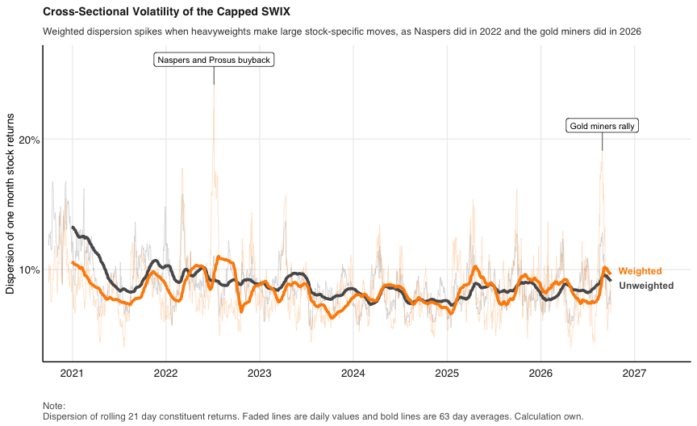

Weighted dispersion averaged 8.5 percent before 2026, with sharp spikes
when heavyweights moved on their own. I traced the two largest spikes
stock by stock and labelled them on the chart.

### Rolling Inter-Constituent Correlation

For correlation I wanted more than one average, so beside the average
pairwise correlation of the 40 largest stocks I built a cap-weighted
implied correlation in the spirit of the CBOE index. The gap between the
two shows whether the largest stocks are moving as a block.

``` r
Month_Ends <- SWIX_Cons %>% mutate(YM = format(date, "%Y%m")) %>% group_by(YM) %>% summarise(date = max(date)) %>% pull(date) # the last trading day of every month
Corr <- Avg_Corr_Calc(SWIX_Cons, Month_Ends, Lookback = 63, Top_N = 40, Ret_Cap = 0.5) # average pairwise and implied correlation, plus the variance split, at every month end
Corr_Facts <- Corr %>% mutate(Period = ifelse(date < lubridate::ymd(20260101), "Before 2026", "2026")) %>% group_by(Period) %>% summarise(Implied = mean(Implied_Corr), Pairwise = mean(Avg_Corr), Share = mean(Dispersion_Var / (Common_Var + Dispersion_Var)), Vol = mean(Avg_Vol)) # averages before and during 2026, used in the text
Plot_Avg_Corr(Corr, # plot both correlation measures
              Title = "Correlation Among the 40 Largest Capped SWIX Constituents", # the plot title
              Subtitle = "In 2026 the largest stocks moved together more closely than at any point since 2020", # the main message
              Caption = "Note:\nRolling 63 day correlations of daily returns at each month end. Red shading marks months when the cap-weighted measure exceeds the pairwise average. Calculation own.") # the note under the plot
```

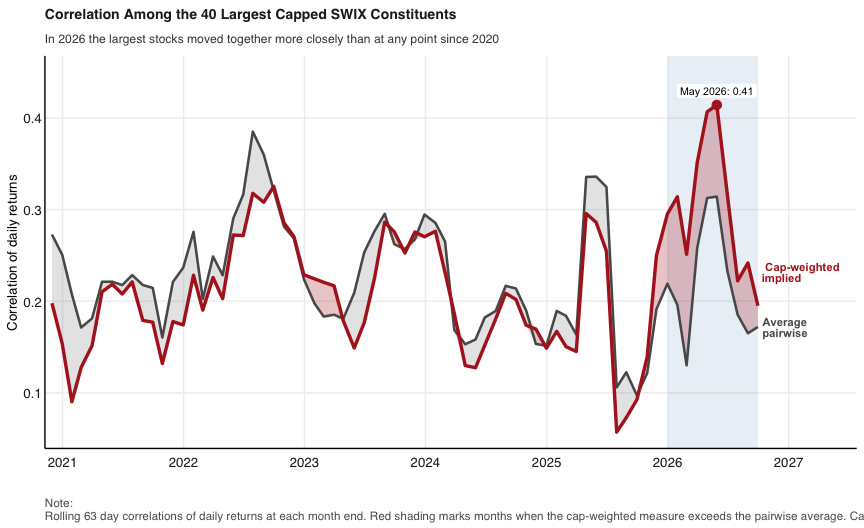

Implied correlation ranged from 0.06 to 0.41 and peaked in 2026, above
the pairwise average, so the largest stocks moved together more than at
any point since 2020.

### How Volatility and Correlation Combine

Dispersion and correlation are two sides of the same variance, so I used
the exact identity that splits average stock variance into the part
common to the basket and the remainder, which is the opportunity.

``` r
Plot_Opportunity_Split(Corr, # plot the split of average stock variance into its common and diversifiable parts
                       Title = "Splitting Stock Risk into Common and Diversifiable Parts", # the plot title
                       Subtitle = "Stock risk rose in 2026, but a larger share of it was common to the whole market", # the main message
                       Caption = "Note:\nAverage stock variance of the 40 largest constituents over rolling 63 day windows, split into basket variance and the remainder. Calculation own.") # the note under the plot
```

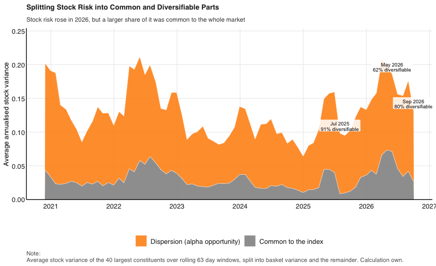

Stock risk rose in 2026, to 37 percent from 33 percent, but a larger
share of it was common to the market, so more volatility did not mean
more opportunity.

### The Strength of the Common Factor

I added a principal component view from Practical 4 as an independent
check on the correlation result, since it measures the common factor
without using index weights.

``` r
Pca_Roll <- Rolling_PCA_Calc(SWIX_Cons, Month_Ends, Lookback = 126, Top_N = 40, Ret_Cap = 0.5) # the share of variance explained by the first three components at every month end
Pca_Facts <- Pca_Roll %>% mutate(Period = ifelse(date < lubridate::ymd(20260101), "Before 2026", "2026")) %>% group_by(Period) %>% summarise(PC1 = mean(PC1), Top3 = mean(PC1 + PC2 + PC3), .groups = "drop") # average shares before and during 2026
Pca_2026 <- Pca_Roll %>% filter(date >= lubridate::ymd(20260101)) # the 2026 months
Pca_Corr <- cor(Pca_Roll$PC1, Corr$Implied_Corr[match(Pca_Roll$date, Corr$date)], use = "complete.obs") # how closely the first component's share tracks the implied correlation
Plot_Rolling_PCA(Pca_Roll, # the stacked shares of the first three components
                 Title = "Share of Constituent Risk Explained by Common Factors", # the plot title
                 Subtitle = "The market factor explains about 30 percent of stock risk, and its share jumped within 2026", # the main message
                 Caption = "Note:\nPrincipal components of standardised daily returns of the 40 largest Capped SWIX constituents over trailing six month windows. 2026 shaded. Calculation own.") # the note under the plot
```

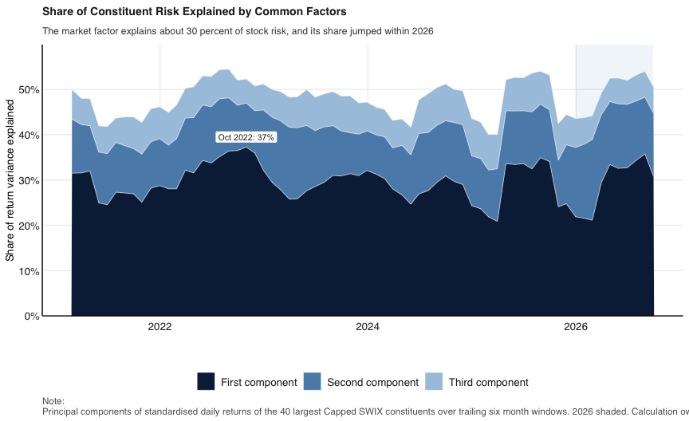

The first component explained 29.5 percent of stock risk before 2026 and
30.2 percent in 2026, with a sharp rise within the year. It agreed with
the correlation result in direction, if not in size.

### Opportunity and Active Manager Outcomes

Opportunity only matters if it shows up in outcomes, so I related
trailing dispersion to the spread of active manager returns and to the
share of managers beating the benchmark, following the Practical 2
bonus.

``` r
Active_Managers <- read_rds("data/Active_Managers.rds") # monthly returns of the active manager universe
BM_Monthly <- Idx_Daily %>% filter(Tickers == "J433") %>% mutate(YM = format(date, "%Y%m")) %>% group_by(YM) %>% summarise(BM = prod(1 + Returns) - 1) # monthly Capped SWIX returns, keyed by year and month
Hit_Rate <- Manager_Hit_Rate(Active_Managers, BM_Monthly, NSel = 12) # share of managers beating the benchmark and the spread of their excess returns over rolling 12 months
Opportunity <-
    Dispersion %>%
    mutate(YM = format(date, "%Y%m")) %>% # a year and month label
    group_by(YM) %>% filter(date == max(date)) %>% ungroup() %>% # the dispersion reading at each month end, which covers that month
    arrange(date) %>% # order by date before rolling
    mutate(Disp12 = RcppRoll::roll_mean(Dispersion_W, n = 12, fill = NA, align = "right")) %>% # the average over the trailing 12 months, matching the manager window
    select(YM, date, Disp12) %>% # keep only what is needed
    inner_join(Hit_Rate %>% select(YM, Share_Outperform, Median_Excess, Mgr_Spread), by = "YM") # attach the manager outcomes of the same month
Opp_Facts <- Opportunity %>% tidyr::drop_na() %>% summarise(N = n(), Cor_Spread = cor(Disp12, Mgr_Spread), Cor_Share = cor(Disp12, Share_Outperform), Cor_Median = cor(Disp12, Median_Excess)) # correlations between opportunity and outcomes, used in the text
Plot_Alpha_Opportunity(Opportunity, # the connected scatter of opportunity against manager outcomes
                       Title = "Market Dispersion and the Spread of Active Manager Results", # the plot title
                       Subtitle = "Higher dispersion separates managers from one another, but does not lift the share that beat the benchmark", # the main message
                       Caption = "Note:\nEach point is a month. Manager spread is the cross-sectional standard deviation of 12 month returns relative to the Capped SWIX. Calculation own.") # the note under the plot
```

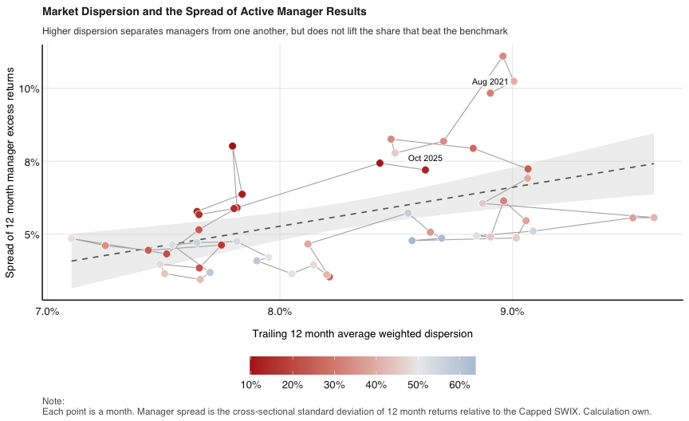

Over 51 months dispersion had a correlation of 0.48 with the spread of
manager results, so dispersion separates managers from one another.

### Manager Outcomes by Dispersion Regime

I grouped the months into dispersion quintiles to make that relationship
easier to read.

``` r
Regime_Facts <- Opportunity %>% tidyr::drop_na(Disp12, Share_Outperform, Mgr_Spread) %>% mutate(Q = ntile(Disp12, 5)) %>% group_by(Q) %>% summarise(Share = mean(Share_Outperform), Spread = mean(Mgr_Spread), .groups = "drop") # the averages in each dispersion quintile, used in the text
Plot_Dispersion_Regimes(Opportunity, N_Groups = 5, # manager outcomes in each dispersion quintile
                        Title = "Active Manager Outcomes by Dispersion Regime", # the plot title
                        Subtitle = "Higher dispersion widens the spread of manager results, while the share beating the benchmark stays below half", # the main message
                        Caption = "Note:\nMonths sorted into quintiles of trailing 12 month weighted dispersion. Outcomes are over the same trailing 12 months. Calculation own.") # the note under the plot
```

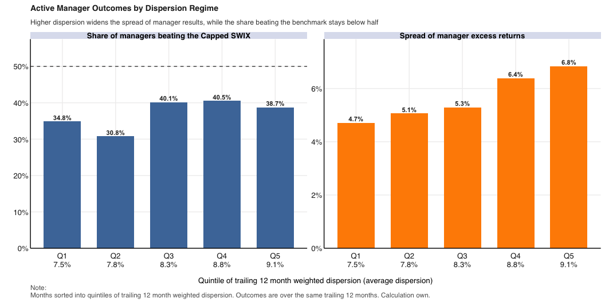

The spread rises from 4.7 percent to 6.8 percent, while the share
beating the benchmark stays below half in every quintile.

### Alpha Opportunity and the Global Macro Backdrop

For the macro link I chose variables that carry offshore shocks into
local prices, namely US equity and bond market volatility, global policy
uncertainty, oil and gold volatility and rand volatility. I looked at
each relationship on its own first.

``` r
Macro_Gauges <- bind_rows(Implied_Vol, Uncertainty_Indexes, Local_Cncy_Vol_Index %>% select(-Description), Gl_Cncy_Vol_Index) # every macro gauge quoted as a level
Commod_Rets <- Commods %>% TRI_Returns_Calc(Start_Date = lubridate::ymd(20200101)) # daily commodity returns, from which monthly oil and gold volatility are measured
Macro_Names <- c(VIX = "US implied vol (VIX)", MOVE_Index = "Bond vol (MOVE)", EPUCGLCP = "Global policy uncertainty", Oil_Brent_Vol = "Brent oil vol", Gold_Vol = "Gold vol", SAVIUSD = "Rand vol (SAVIUSD)") # readable names for the macro variables
Macro_Monthly <- State_Monthly_Calc(Level_df = Macro_Gauges, Level_Sel = c("VIX", "MOVE_Index", "EPUCGLCP", "SAVIUSD"), Vol_df = Commod_Rets, Vol_Sel = c("Oil_Brent", "Gold")) %>% mutate(State = recode(State, !!!Macro_Names)) %>% spread(State, Value) # one row per month with every macro variable as a column
Macro_Panel <-
    Dispersion %>%
    mutate(YM = format(date, "%Y%B")) %>% # the same year and month label that State_Monthly_Calc uses
    group_by(YM) %>% filter(date == max(date)) %>% ungroup() %>% # the dispersion reading at each month end
    left_join(Corr %>% mutate(YM = format(date, "%Y%B")) %>% select(YM, Implied_Corr), by = "YM") %>% # attach the implied correlation of the same month
    left_join(Macro_Monthly, by = "YM") # attach the macro variables of the same month
Plot_Macro_Scatter(Macro_Panel, Y = "Dispersion_W", X_Vars = unname(Macro_Names), Highlight_Year = 2026, # dispersion against each macro variable
                   Title = "Weighted Dispersion Against the Global Macro Backdrop", # the plot title
                   Subtitle = "Only US equity volatility has a clear positive link with dispersion on its own", # the main message
                   Caption = "Note:\nMonthly values from September 2020. Orange points are 2026 months. Lines are linear fits with 95 percent confidence bands. Calculation own.") # the note under the plot
```

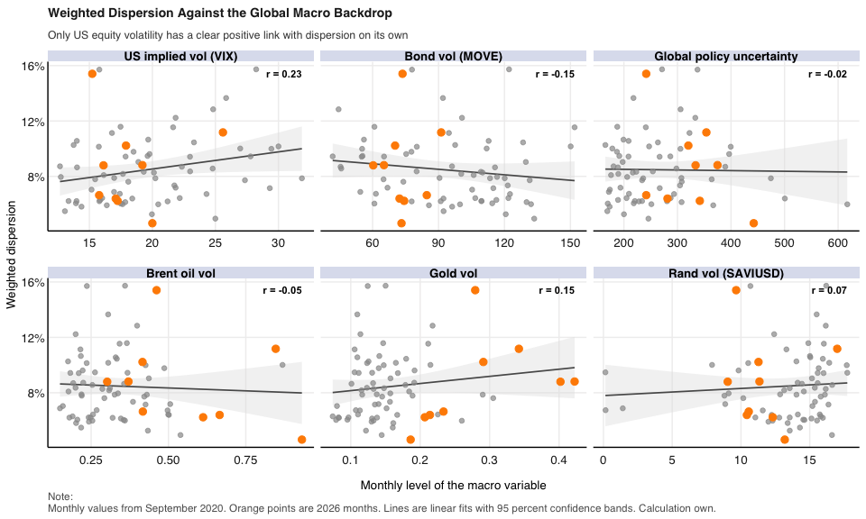

On their own the variables said little, which told me I needed a joint
model.

### Multiple Regression on the Macro Variables

Because the macro variables move together, I regressed dispersion and
implied correlation on all six at once, standardised so the coefficients
are comparable, with Newey-West standard errors because overlapping
windows make the residuals autocorrelated.

``` r
Macro_Coefs <- bind_rows(Macro_Regression(Macro_Panel, Y = "Dispersion_W", X_Vars = unname(Macro_Names), Lag = 3, Label = "Weighted dispersion"), # dispersion on the standardised macro variables
                         Macro_Regression(Macro_Panel, Y = "Implied_Corr", X_Vars = unname(Macro_Names), Lag = 3, Label = "Implied correlation")) # implied correlation on the same variables
Coef_Facts <- Macro_Coefs %>% mutate(Key = paste(Model, Term, sep = " | ")) # a key for the inline numbers in the text
Plot_Macro_Coefs(Macro_Coefs, # the coefficients of both models side by side
                 Title = "What Moves Alpha Opportunity in the Local Market", # the plot title
                 Subtitle = "Oil and bond market volatility make local stocks move together, while US equity volatility widens dispersion", # the main message
                 Caption = "Note:\nStandardised OLS coefficients with 95 percent intervals from Newey-West standard errors with three lags. Monthly data from September 2020. Calculation own.") # the note under the plot
```

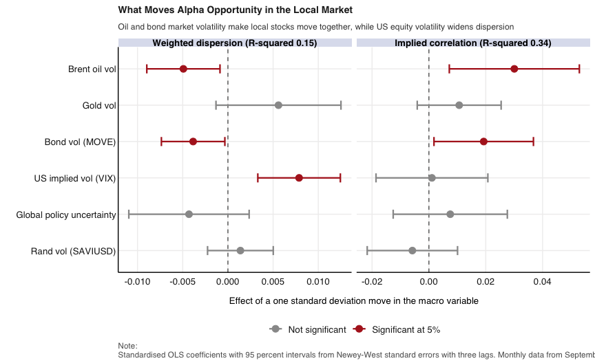

Implied correlation was the better explained of the two, with an
R-squared of 0.34, driven by oil and bond market volatility.

### Conclusion to Part C

My answer to Part C is that the alpha opportunity since 2020 has been
episodic. In 2026 stock risk rose, but more of it was common to the
market, and the oil and bond market volatility that carries offshore
shocks into local prices is also what raises correlations and compresses
the opportunity. This ties the three parts together, since the forces
behind the 2026 volatility are the same ones that make a gold-heavy fund
like SafeCore move with the market. The full analysis is in
[Question1.pdf](Questions/Question1/Question1.pdf).

# Question 2, Mid, Small and Large Cap Indices

## Approach

Question 2 asks for a short report on the traits of the large, mid and
small cap indexes, using stratification, realised volatility, rolling
returns and active share. I ordered my answer as what each index holds,
then how volatile its constituents are, then how each has rewarded that
risk. The constituent file starts in 2007 and the daily stock returns
only in 2015, so I used the holdings for the structural questions and
the returns for volatility and performance. I rescaled weights to sum to
one each month and labelled missing sectors as unclassified, since
dropping those stocks would have understated the small caps.

``` r
Size_Idx <- read_rds("data/Monthly_Index_Constituents.rds") # monthly constituents and weights for the Capped SWIX and the large, mid and small cap indexes
Size_Hold <- Size_Holdings_Prep(Size_Idx) # readable index names, a label for missing sectors and weights rescaled to sum to one in every month
```

## Sector Exposure

Sector exposure comes first because it explains much of what follows. I
used stacked areas for each index with the same sector colours as
Question 1.

``` r
Sector_Facts <- Size_Hold %>% filter(date %in% c(min(date), max(date))) %>% group_by(Fund, date, Sector) %>% summarise(W = sum(Weight), .groups = "drop") %>% mutate(Key = paste(Fund, lubridate::year(date), Sector)) # sector weights in the first and last month, used in the text
Plot_Size_Sectors(Size_Hold, # the stacked sector weights of every index
                  Title = "Sector Exposure by Size Index", # the plot title
                  Subtitle = "Large caps carry the market's resource exposure while small caps lean on property and the domestic economy", # the main message
                  Caption = "Note:\nMonthly index weights summed by sector. Unclassified stocks have no sector in the constituent file. Calculation own.") # the note under the plot
```

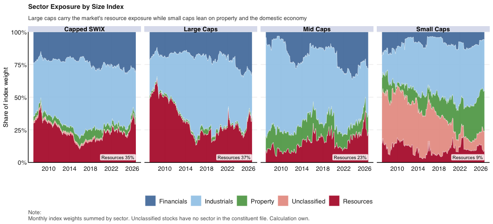

Large caps carry the market’s resource exposure, at 37 percent in 2026,
while small caps lean on property, so I expected very different
responses to commodity and rand shocks.

## Stock Concentration

For concentration I chose the effective number of stocks, the inverse of
the Herfindahl index, because it is comparable across indexes of
different sizes, which a simple count of holdings is not.

``` r
Size_Conc <- Concentration_Calc(Size_Hold, Top_N = 10) # the number of stocks, effective number of stocks, top 10 share and effective number of sectors in every month
Conc_Facts <- Size_Conc %>% filter(date %in% c(min(date), max(date))) %>% mutate(Key = paste(Fund, ifelse(date == min(date), "First", "Last"))) # concentration in the first and last month, used in the text
Conc_Avg <- Size_Conc %>% group_by(Fund) %>% summarise(Eff_N = mean(Eff_N), Top_Share = mean(Top_Share), Eff_Sectors = mean(Eff_Sectors)) # averages over the full sample, used in the text
CFR_Facts <- Size_Hold %>% filter(Fund == "Large Caps", Tickers == "CFR", date %in% lubridate::ymd(c(20230531, 20230630))) %>% mutate(Key = format(date, "%B")) # Richemont's large-cap weight either side of its reweighting in June 2023
Overlap <- Size_Hold %>% filter(Fund %in% c("Large Caps", "Mid Caps")) %>% group_by(date) %>% summarise(Mid_Share = sum(Weight[Fund == "Mid Caps" & Tickers %in% Tickers[Fund == "Large Caps"]]), N_Shared = sum(Fund == "Mid Caps" & Tickers %in% Tickers[Fund == "Large Caps"]), .groups = "drop") # the share of mid-cap weight, and the number of mid-cap stocks, that are also large-cap constituents
Overlap_Start <- Overlap %>% filter(Mid_Share > 0) %>% pull(date) %>% min() # the first month in which the two indexes share a stock
Plot_Size_Concentration(Size_Conc, Overlap_From = Overlap_Start, Overlap_Y = 20, # the effective number of stocks in every index, with the overlap period shaded
                        Title = "Stock Concentration by Size Index", # the plot title
                        Subtitle = "Large caps are the most concentrated index, while mid caps have become steadily more concentrated since 2019", # the main message
                        Caption = "Note:\nEffective number of stocks is the inverse of the Herfindahl index of monthly weights. Calculation own.") # the note under the plot
```

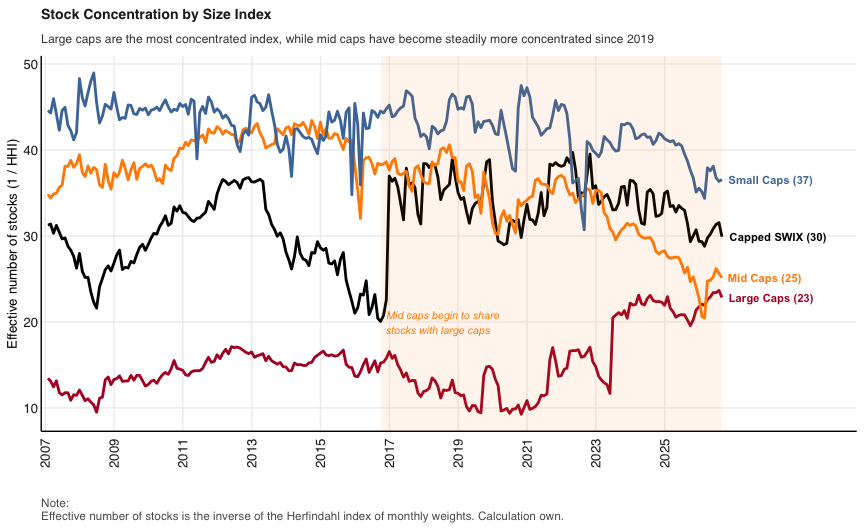

Large caps averaged an effective 15 stocks. The jump in June 2023 sent
me looking for its cause, which turned out to be Richemont’s
reweighting, and the mid caps’ drift towards the large caps led me to
measure the overlap between the two indexes directly.

## Active Share Against the Capped SWIX

Active share is a required technique, and I measured it against the full
Capped SWIX, as the brief specifies.

``` r
Size_AS <- Active_Share_Calc(Size_Hold, BM = "Capped SWIX") # the active share of each size index against the Capped SWIX in every month
AS_Facts <- Size_AS %>% group_by(Fund) %>% summarise(Avg = mean(Active_Share), Pre = mean(Active_Share[date < lubridate::ymd(20230601)]), Post = mean(Active_Share[date >= lubridate::ymd(20230601)]), Last = dplyr::last(Active_Share)) # average active share before and after June 2023, used in the text
Plot_Active_Share(Size_AS, # the active share of each index through time
                  Title = "Active Share Against the Capped SWIX", # the plot title
                  Subtitle = "The large-cap index has become a near copy of the benchmark, while small caps share almost nothing with it", # the main message
                  Caption = "Note:\nActive share is half the sum of absolute weight differences against the Capped SWIX. Dashed lines are full sample averages. Calculation own.") # the note under the plot
```

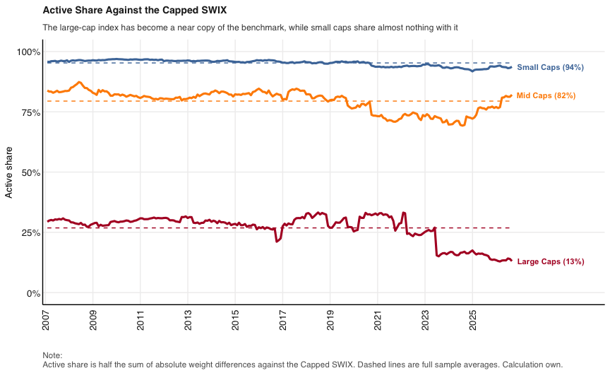

The large caps fell from 29 percent to 15 percent after June 2023, so
they are now close to a copy of the benchmark, while the small caps
share almost nothing with it.

## Realised Volatility of the Constituents

The brief asks for the realised volatility of the constituents, not just
of the index, so I applied each index’s weights to the daily stock
returns, measured each stock’s three month volatility, averaged it with
the weights and compared it with the volatility of the index built from
the same weights. The ratio of the two is the diversification ratio.
Because the small caps looked calm, I also tested for stale prices with
the autocorrelation of monthly returns and the ratio of monthly to daily
volatility.

``` r
Size_Dates <- Size_Hold %>% filter(date >= lubridate::ymd(20150401)) %>% distinct(date) %>% pull(date) # month ends with at least three months of daily stock returns behind them
Size_Vol <- Size_Vol_Calc(Size_Hold, Stock_Returns, Size_Dates, Lookback = 63, Ret_Cap = 0.25, Min_Coverage = 0.8) # average constituent volatility, index volatility and the diversification ratio at every month end
Vol_Facts <- Size_Vol %>% mutate(Period = case_when(lubridate::year(date) == 2026 ~ "2026", date >= lubridate::ymd(20200301) & date <= lubridate::ymd(20200630) ~ "Covid", TRUE ~ "Other")) %>% group_by(Fund, Period) %>% summarise(Avg_Vol = mean(Avg_Vol), Index_Vol = mean(Index_Vol), DR = mean(Div_Ratio), .groups = "drop") %>% mutate(Key = paste(Fund, Period)) # averages in 2026, in the Covid crash and in all other months, used in the text
Vol_Avg <- Size_Vol %>% group_by(Fund) %>% summarise(Avg_Vol = mean(Avg_Vol), Index_Vol = mean(Index_Vol), DR = mean(Div_Ratio)) # full sample averages, used in the text
Plot_Size_Diversification(Size_Vol, Smooth_N = 3, # constituent and index volatility in every index
                          Title = "Constituent and Index Volatility by Size", # the plot title
                          Subtitle = "Small caps hold the most volatile stocks but form the calmest index, as their risks largely cancel out", # the main message
                          Caption = "Note:\nRolling 63 day realised volatility at each month end, smoothed over three months. The shaded gap is the risk removed by diversification. Calculation own.") # the note under the plot
```

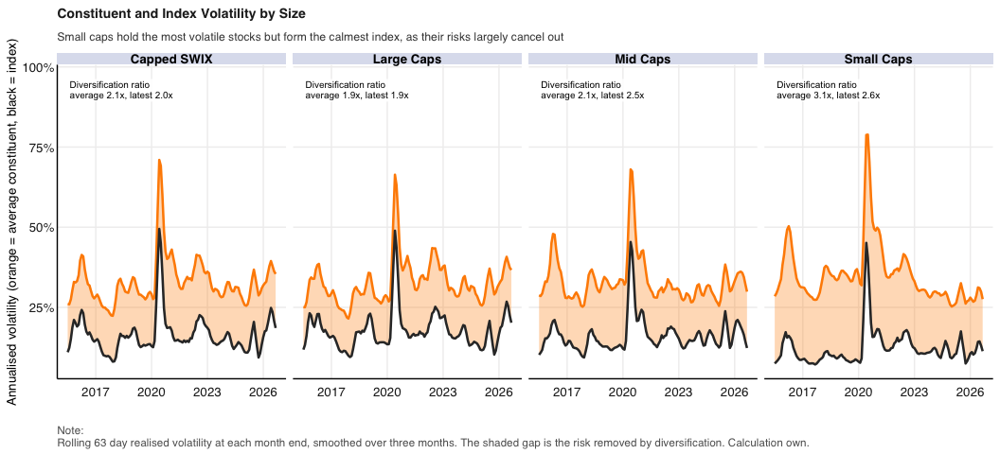

``` r
Size_Pub <- Idx_Daily %>% filter(Tickers %in% c("J433", "J200", "J201", "J202")) %>% mutate(Name = recode(Name, "Top 40" = "Large Caps", MidCaps = "Mid Caps", SmallCaps = "Small Caps")) %>% select(date, Name, Returns) # daily returns of the published Capped SWIX and size indexes, with the same names as the constituent indexes
Size_Monthly <- Monthly_Returns_Calc(Size_Pub) # calendar month returns of each published index
Thin_Facts <-
    Size_Pub %>%
    group_by(Name) %>% # one row per index
    summarise(Vol_Daily = sd(Returns) * sqrt(252), .groups = "drop") %>% # annualised volatility measured from daily returns
    left_join(Size_Monthly %>% arrange(date) %>% group_by(Name) %>% summarise(Vol_Monthly = sd(Returns) * sqrt(12), AC1 = cor(Returns, dplyr::lag(Returns), use = "complete.obs"), .groups = "drop"), by = "Name") # annualised volatility from monthly returns and the first order autocorrelation of monthly returns
```

Small-cap stocks were the most volatile, at 35 percent against 33
percent for the large caps, yet their index was the calmest, and the
stale price test showed that part of that calm is a measurement effect.

## Return and Risk Profiles

For performance I switched to the published indexes, which have a full
return history from 2015, used the same statistics function as Question
1 with the STeFI as the risk free rate, and split the sample into three
periods.

``` r
Size_Stats <- Fund_Stats_Table(Size_Pub, BM_Name = "Capped SWIX", Rf_df = STeFI) # return, risk and capture statistics of each index against the Capped SWIX
Size_Periods <- tibble(Period = c("2015-2019", "2020-2022", "2023-2026"), Start = lubridate::ymd(c(20150101, 20200101, 20230101)), End = lubridate::ymd(c(20191231, 20221231, 20261231))) # the three sub-periods
Period_Stats <- Size_Period_Calc(Size_Monthly, Size_Periods) %>% mutate(Key = paste(Name, Period)) # annualised return, volatility and maximum drawdown in each sub-period
Plot_Size_RiskReturn(Period_Stats, # the path of each index through risk and return space
                     Title = "Risk and Return by Sub-Period", # the plot title
                     Subtitle = "Small caps moved from the worst to the best risk-return trade-off, while mid caps were hit hardest in 2020 to 2022", # the main message
                     Caption = "Note:\nAnnualised from monthly returns of the published indexes. Point size shows the maximum drawdown. Grey paths show the other indexes. Calculation own.") # the note under the plot
```

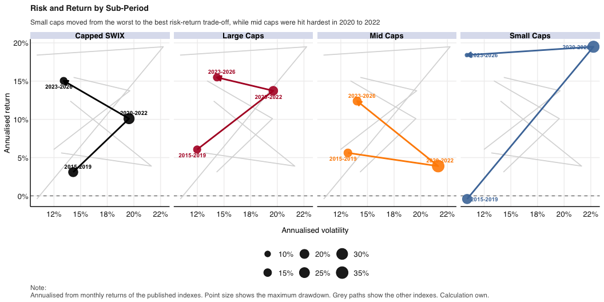

Large caps had the best full-sample trade-off, with a Sharpe ratio of
0.77, but the sub-periods showed the small caps moving from the worst
profile to the best.

## Downside Risk

Because the small caps combined low volatility with a deep drawdown, I
added the Practical 2 downside risk measures to see the different kinds
of loss side by side.

``` r
Size_Cols <- c(`Capped SWIX` = "grey25", `Large Caps` = "#B2182B", `Mid Caps` = "darkorange", `Small Caps` = "#4C78A8") # one colour per index, as in the earlier figures
Size_Down <- Downside_Risk_Calc(Size_Monthly) # downside deviation, semi deviation, monthly VaR and ES, and maximum drawdown of each index
Down_Facts <- Size_Down %>% mutate(Key = paste(Name, Measure)) # keyed for the numbers in the text
Plot_Downside_Risk(Size_Down, Size_Cols, # one dot plot per measure
                   Title = "Downside Risk by Size Index", # the plot title
                   Subtitle = "Large caps have the smallest losses on almost every measure, while small caps combine a mild typical month with the deepest drawdown", # the main message
                   Caption = "Note:\nFrom monthly returns of the published indexes, 2015 to 2026. Deviations annualised, VaR and ES are one-month measures at 95 percent. Calculation own.") # the note under the plot
```

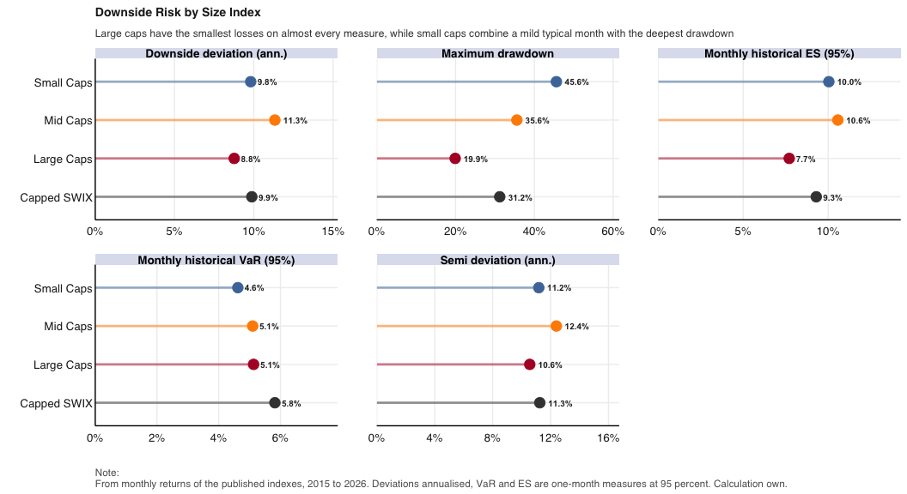

Large caps had the smallest losses on almost every measure, with a
downside deviation of 8.8 percent, while the small caps combined the
lowest monthly VaR with the deepest drawdown.

## Rolling Returns

Rolling three year returns are a required technique, and I shaded the
months in which small caps led large caps, since that leadership was the
question I wanted answered.

``` r
Size_Roll <- Roll_Return_Calc(Size_Monthly, NSel = 36) # rolling three year annualised returns of each index
Roll_Wide <- Size_Roll %>% select(date, Name, RollRet) %>% spread(Name, RollRet) # one column per index
Roll_Facts <- Size_Roll %>% group_by(Name) %>% summarise(Min = min(RollRet), Max = max(RollRet), Min_Date = date[which.min(RollRet)], Max_Date = date[which.max(RollRet)], Last = dplyr::last(RollRet), .groups = "drop") # the range and latest value of each index, used in the text
Plot_Size_Rolling(Size_Roll, # rolling returns with the small-cap lead shaded
                  Title = "Rolling 3 Year Annualised Returns", # the plot title
                  Subtitle = "Small caps have the widest range of outcomes and have led large caps for most of the period since 2022", # the main message
                  Caption = "Note:\nRolling 36 month annualised returns of the published indexes. Blue shading marks months in which small caps beat large caps. Calculation own.") # the note under the plot
```

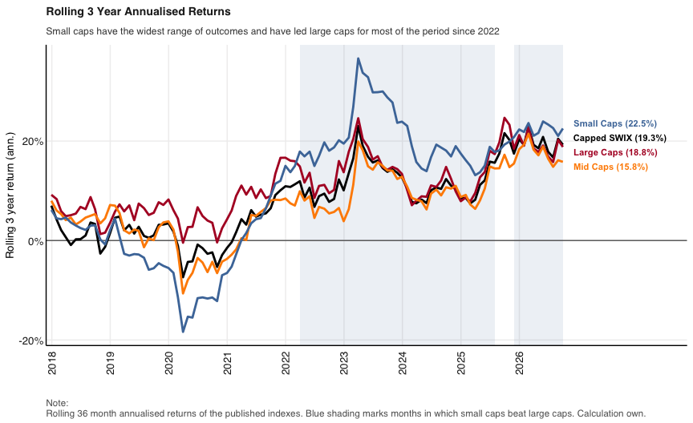

Small caps had the widest range of outcomes, from -18.4 percent in March
2020, and their leadership came almost entirely from 2022 onwards.

## Returns Over Different Horizons

To check that the ranking did not depend on one window, I compared
trailing returns over five horizons, as in Practical 1.

``` r
Size_Hz <- Horizon_Returns_Calc(Size_Monthly) # returns over six months and one, three, five and ten years
Hz_Facts <- Size_Hz %>% mutate(Key = paste(Name, Horizon)) # keyed for the numbers in the text
Plot_Horizon_Returns(Size_Hz, Size_Cols, # grouped bars by horizon
                     Title = "Returns Over Trailing Horizons to September 2026", # the plot title
                     Subtitle = "Small caps lead over every horizon up to five years, while large caps lead over ten", # the main message
                     Caption = "Note:\nReturns of one year or less are cumulative and longer horizons are annualised. Monthly returns of the published indexes. Calculation own.") # the note under the plot
```

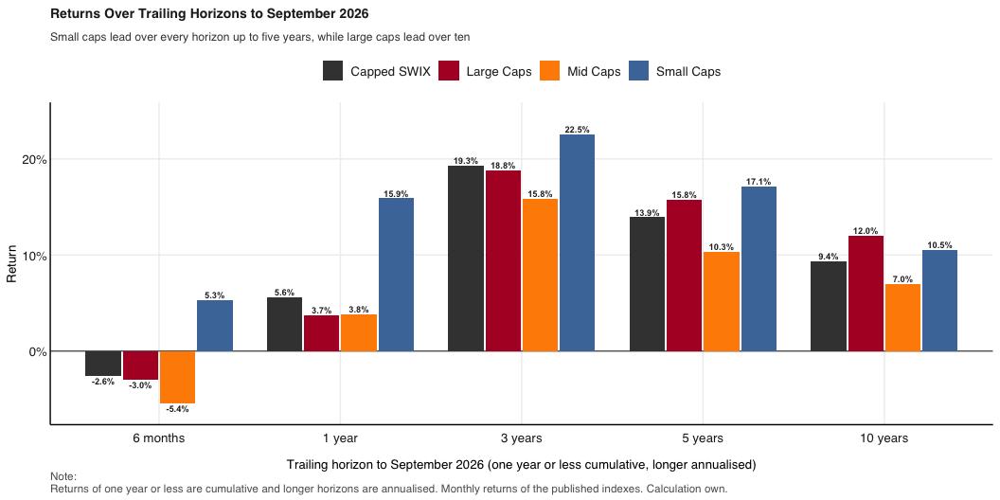

Small caps led over every horizon up to five years, with 15.9 percent
over one year, while large caps led over ten years.

## Stratification

For stratification, the last required technique, I chose three state
variables that I expected to separate the indexes given their sector
mix, namely the market return, rand volatility and the VIX, and sorted
the months into quintiles.

``` r
Size_States <- bind_rows(State_Monthly_Calc(Level_df = bind_rows(Implied_Vol, Local_Cncy_Vol_Index %>% select(-Description)), Level_Sel = c("VIX", "SAVIUSD")), # the monthly average level of the VIX and the SAVIUSD
                         Size_Monthly %>% filter(Name == "Capped SWIX") %>% transmute(YM, State = "Market return", Value = Returns)) # the monthly return of the benchmark as a third state
Size_Strat <- Size_Stratify(Size_Monthly %>% filter(Name != "Capped SWIX"), Size_States, Hi_Q = 0.8, Lo_Q = 0.2) # annualised return and volatility of each size index in the top and bottom quintile months
Strat_Facts <- Size_Strat %>% mutate(Key = paste(State, Regime, Name)) # a key for the inline numbers in the text
Size_Strat %>%
    mutate(State = recode(State, "Market return" = "Capped SWIX return", SAVIUSD = "Rand volatility (SAVIUSD)", VIX = "US implied volatility (VIX)")) %>% # readable panel names
    Plot_Size_Slopes(Title = "Size Indexes in Calm and Stressed Regimes", # slopes from the bottom to the top quintile of each state
                     Subtitle = "Small caps lose least when the market falls but suffer the largest losses when the rand is volatile", # the main message
                     Caption = "Note:\nAnnualised return and volatility of monthly returns in the bottom and top quintile months of each state variable, from 2015. Calculation own.") # the note under the plot
```

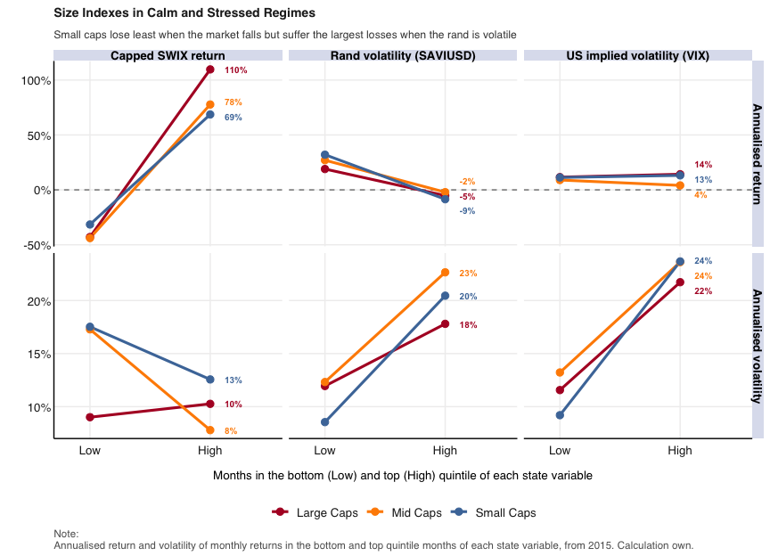

With 29 months in each quintile, small caps lost least in the worst
market months, at an annualised -32 percent, but rand volatility
separated the indexes most clearly.

## Conclusion to Question 2

My conclusion is that the three size indexes are not interchangeable.
The large caps are a concentrated, resource-heavy portfolio that is now
close to the benchmark, with an active share of 13 percent. The small
caps are the only genuinely different portfolio, calm in ordinary times
but exposed in crises and in periods of rand stress, with part of their
calm explained by stale prices. The mid caps have drifted towards the
large caps and offered the weakest return. The full report is in
[Question2.pdf](Questions/Question2/Question2.pdf).

# Question 3, Portfolio Return Comparison

## Approach

Question 3 is a deck for a portfolio manager who is not quantitative, so
I built it as a PowerPoint knitted from R Markdown, gave every slide one
message in its headline and a one-line takeaway under its chart, and put
the explanation in the speaker notes. I treated each of the manager’s
four suggestions as a claim to test, since a conference audience will
probe anything overstated. The deck is
[Question3.pptx](Questions/Question3/Question3.pptx).

``` r
Active_Manager_Peers <- read_rds("data/Active_Managers.rds") # monthly returns for the active manager peer group
ABC_Fund <- read_rds("data/ABC_Fund.rds") # monthly returns for the ABC fund
BM_Monthly <- Idx_Daily %>% filter(Tickers == "J433") %>% select(date, Name, Returns) %>% Monthly_Returns_Calc() %>% transmute(date = lubridate::ceiling_date(date, "month") - 1, YM, BM = Returns) # monthly Capped SWIX returns, dated at the calendar month end like the fund returns
Q3_End <- max(ABC_Fund$date) # the last month that the fund and its peers cover
Univ <- Fund_Universe_Prep(Active_Manager_Peers, ABC_Fund, BM_Monthly, Fund_Label = "ABC Fund", End_Date = Q3_End) # peers, the fund and the benchmark return of each month in one data frame
```

The peer file holds 247 managers, including funds that later closed,
which avoids survivorship bias. I found that one peer, X102, has returns
identical to ABC Fund in every month, so I removed it, since comparing
the fund with a copy of itself would understate how far it stands apart.

## Standing Against the Peer Group

I opened with a scorecard because the manager needs one picture that
sums up the case, and I turned every measure into the share of peers
beaten so that very different statistics share one scale.

``` r
Q3_Stats <- Fund_Stats_Calc(Univ, Min_Months = 36) # return, risk and exposure statistics for every fund with at least three years of returns since 2015
Q3_Fund <- Q3_Stats %>% filter(Group == "ABC Fund") # the fund's own statistics
Q3_Med <- Q3_Stats %>% filter(Group == "Peer") %>% summarise(across(c(Ret, Excess, Vol, Beta, Alpha, R2, MaxDD, IR), median)) # the typical peer
Plot_Peer_Scorecard(Q3_Stats, Fund_Label = "ABC Fund", # the scorecard of percentile standings
                    Title = glue::glue("ABC Fund Against {sum(Q3_Stats$Group == 'Peer')} Peers, 2015 to 2025"), # the plot title
                    Subtitle = "ABC Fund ranks in the top fifth of the peer group on return and on risk at the same time", # the main message
                    Caption = "Note:\nPeers with at least three years of returns since 2015. Lower volatility, drawdown and beta count as better. Calculation own.") # the note under the plot
```

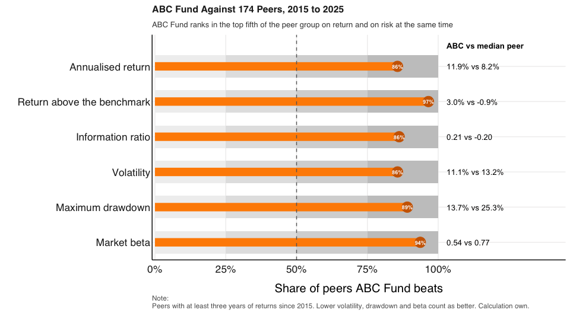

ABC Fund returned 11.9 percent a year against 8.2 percent for the median
peer, with lower volatility and a shallower drawdown.

## Rolling Beta Across the Industry

The manager asked for boxplots over a scatter of rolling three year
betas, so I drew exactly that, with ABC Fund’s yearly average across it.

``` r
Q3_Roll_Beta <- Roll_Beta_Calc(Univ, NSel = 36) # rolling three year betas of every fund, using consecutive months only
Beta_Range <- Q3_Roll_Beta %>% filter(Group == "Peer", lubridate::year(date) >= 2019) %>% group_by(Year = lubridate::year(date)) %>% summarise(Med = median(Beta)) %>% pull(Med) %>% range() # the range of the typical peer's yearly beta since 2019
Beta_Latest <- Q3_Roll_Beta %>% filter(date == max(date)) %>% summarise(Peer = median(Beta[Group == "Peer"]), Fund = Beta[Group == "ABC Fund"]) # the latest rolling betas
Plot_Roll_Beta_Box(Q3_Roll_Beta, Fund_Label = "ABC Fund", Min_Months = 6, # boxplots of peer betas over the individual fund points
                   Title = "Rolling 3 Year Beta to the Capped SWIX", # the plot title
                   Subtitle = "The typical active manager carries a beta close to one, while ABC Fund's beta has drifted down to the bottom of the range", # the main message
                   Caption = "Note:\nEach grey dot is one peer fund's beta over the preceding three years in one month. Boxes span the middle half of peers. Calculation own.") # the note under the plot
```

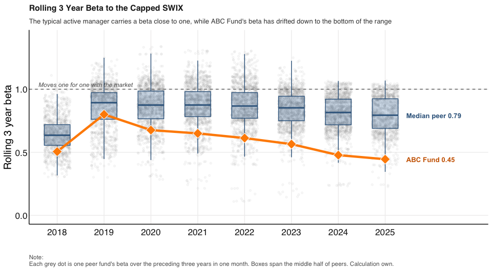

The median peer’s beta has stayed between 0.79 and 0.89 since 2019, so
most peers mainly deliver market exposure.

## Return Beyond the Market

A low beta alone could simply mean holding cash, so I paired beta with
alpha to show whether the low exposure cost the fund return.

``` r
Plot_Beta_Alpha(Q3_Stats, Fund_Label = "ABC Fund", # every fund's beta against its alpha
                Title = "Market Beta and Alpha, 2015 to 2025", # the plot title
                Subtitle = "ABC Fund sits alone in the corner of low market exposure and high return of its own", # the main message
                Caption = "Note:\nAlpha is the annualised return left after removing each fund's market exposure, from a regression on the Capped SWIX. Calculation own.") # the note under the plot
```

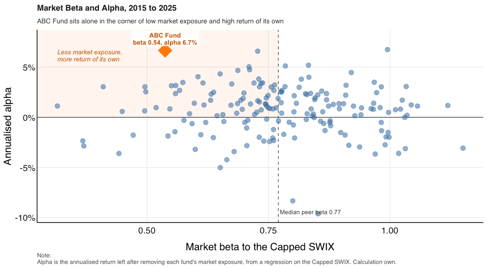

ABC Fund’s alpha of 6.7 percent against 0.9 percent for the median peer
showed that it did not.

## What Drives the Returns

To answer how different the fund is in what drives its returns, I split
each fund’s return variance into a market part, a part shared with the
other managers and a part unique to the fund.

``` r
Q3_Drivers <- Return_Drivers_Calc(Univ, Min_Months = 60) # the split of return variance into market, shared and unique parts
Drv_Fund <- Q3_Drivers %>% filter(Group == "ABC Fund") # the fund's split
Drv_Peer <- Q3_Drivers %>% filter(Group == "Peer") %>% summarise(across(c(Market, Shared, Unique), median)) # the typical peer's split
Plot_Return_Drivers(Q3_Drivers, Fund_Label = "ABC Fund", # the sorted barcode of return drivers
                    Title = "What Drives Each Fund's Returns, 2015 to 2025", # the plot title
                    Subtitle = "ABC Fund is among the least market driven funds, with more than twice the typical share of return of its own", # the main message
                    Caption = "Note:\nShares of monthly return variance explained by the Capped SWIX, then by the median non-market return of the other peers. Calculation own.") # the note under the plot
```

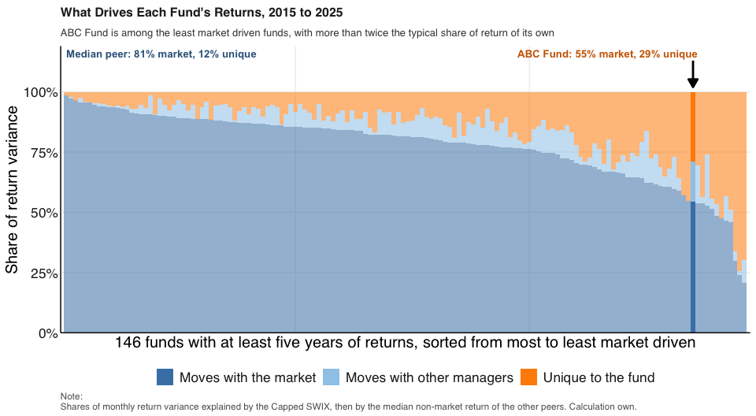

The market explains 81 percent of the typical peer’s return variance
against 55 percent for ABC Fund. Its shared part was higher than most
peers’, so I advised the manager not to call the fund contrarian.

## Tracking Error and Information Ratio

I added tracking error and the information ratio from Practical 1 to
show how much active risk the fund takes and whether it has been paid
for it.

``` r
Q3_TE_IR <- Roll_TE_IR_Calc(Univ, NSel = 36) # rolling three year tracking error and information ratio of every fund
TI_Facts <- Q3_TE_IR %>% group_by(date) %>% summarise(Fund_TE = TE[Group == "ABC Fund"][1], Peer_TE = median(TE[Group == "Peer"]), Fund_IR = IR[Group == "ABC Fund"][1], Peer_IR = median(IR[Group == "Peer"]), .groups = "drop") %>% filter(!is.na(Fund_TE)) # the fund and the median peer in every month
Plot_Roll_TE_IR(Q3_TE_IR, Fund_Label = "ABC Fund", # the fund inside the peer bands for both measures
                Title = "Activeness and the Reward for It", # the plot title
                Subtitle = "ABC Fund has taken twice the typical active risk, and was rewarded for it through 2020 to 2023", # the main message
                Caption = "Note:\nRolling 36 month tracking error and information ratio against the Capped SWIX. Bands span the middle half of peers. Calculation own.") # the note under the plot
```

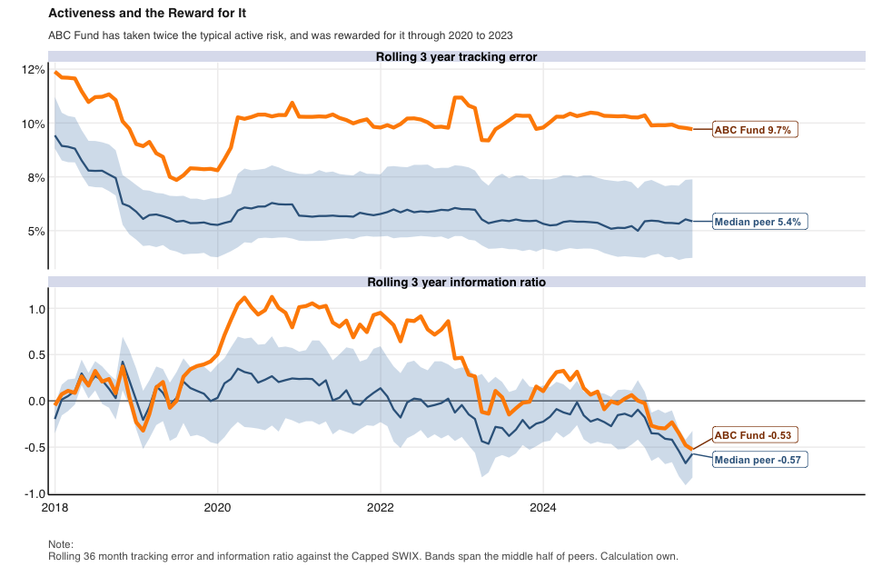

Its tracking error averaged 10.0 percent against 5.9 percent for the
median peer.

## A Map of the Peer Group

As a check that does not depend on the benchmark, I mapped the peer
group with a principal component analysis, as in Practical 4.

``` r
Q3_Pca <- Peer_PCA_Calc(Univ) # each fund's correlation with the first two principal components
Pca_Fund <- Q3_Pca %>% mutate(Rank1 = rank(PC1), Rank2 = rank(PC2)) %>% filter(Name == "ABC Fund") # the fund's position and rank
Plot_Peer_PCA(Q3_Pca, Fund_Label = "ABC Fund", # the variable map
              Title = "A Map of the Peer Group", # the plot title
              Subtitle = "One common factor explains most peer returns, and ABC Fund sits apart from the cluster", # the main message
              Caption = "Note:\nCorrelations of each fund with the first two principal components of standardised monthly returns, 2015 to 2025, for funds with a complete history. Calculation own.") # the note under the plot
```

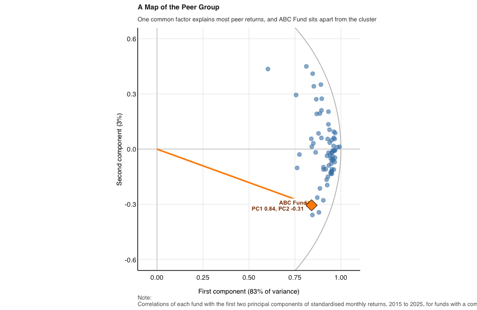

The first component explains 83 percent of peer variance, and ABC Fund
sits apart from the cluster of funds that follow it closely.

## Relative Performance Over Time

For the visual of relative performance over time I combined a peer fan
of rolling three year returns with a strip of calendar year percentiles,
so the audience sees both the path and the consistency.

``` r
Q3_Pct <- Peer_Percentile_Calc(Univ, BM_Monthly %>% filter(date <= Q3_End), Fund_Label = "ABC Fund", NSel = 36) # rolling three year returns in peer percentile bands
Q3_Cal <- Calendar_Rank_Calc(Univ, Fund_Label = "ABC Fund") # the fund's calendar year ranks against the peers open for the whole year
Plot_Peer_Fan(Q3_Pct, Q3_Cal, Fund_Label = "ABC Fund", # the peer fan with the calendar year strip
              Title = "Rolling 3 Year Returns Against the Peer Group", # the plot title
              Subtitle = "ABC Fund has spent most of its history in the top half, and led clearly through the Covid period", # the main message
              Caption = "Note:\nBands span the middle half and middle 90 percent of peers. Tiles give the percentage of peers beaten each year.\n* Year to October 2025. Calculation own.") # the note under the plot
```

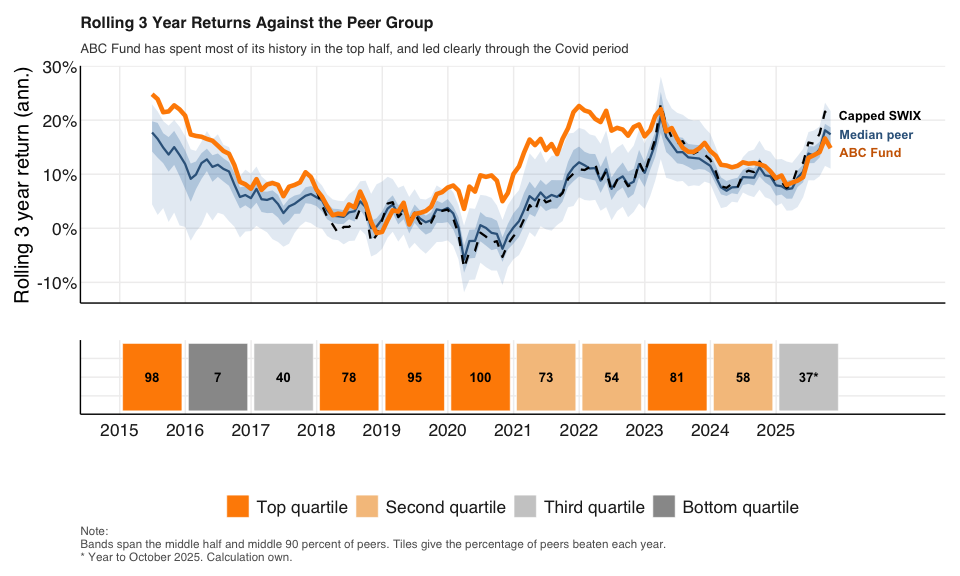

ABC Fund finished in the top half of its peers in 10 of 13 calendar
years.

## Market Dispersion and Performance

The dispersion claim was the one I most wanted to test carefully. I
built monthly dispersion back to 2015 from the constituent weights and
stock returns, and tested the claim both in raw monthly excess returns
and in market-adjusted alpha over 12 month windows.

``` r
Q3_Disp <- Market_Dispersion_Calc(Monthly_Constituents %>% filter(Fund == "CappedSWIX"), Stock_Returns, Ret_Cap = 0.25) # monthly market dispersion from 2015
Q3_DA <- Dispersion_Alpha_Calc(Univ, Q3_Disp, Fund_Label = "ABC Fund", NSel = 12) # trailing 12 month dispersion against trailing 12 month alpha for the fund and the typical peer
DA_Terc <- Q3_DA %>% group_by(Tercile) %>% summarise(Fund = mean(Fund_Alpha), Peer = mean(Peer_Alpha), Hit = mean(Fund_Alpha > Peer_Alpha)) # averages in each third of windows
NW_Fund <- NW_Slope_Test(Q3_DA, "Fund_Alpha", "Disp_Roll", Lag = 12) # does the fund's alpha rise with dispersion
NW_Gap <- NW_Slope_Test(Q3_DA %>% mutate(Gap = Fund_Alpha - Peer_Alpha), "Gap", "Disp_Roll", Lag = 12) # does the fund's lead over the typical peer rise with dispersion
Monthly_Cor <- Univ %>% filter(Group == "ABC Fund", !is.na(BM)) %>% inner_join(Q3_Disp %>% select(YM, Disp), by = "YM") %>% summarise(Cor = cor(Returns - BM, Disp)) %>% pull(Cor) # the raw monthly relationship
Plot_Dispersion_Alpha(Q3_DA, Fund_Label = "ABC Fund", # dispersion against trailing alpha
                      Title = "Market Dispersion and 12 Month Alpha", # the plot title
                      Subtitle = "Once market exposure is removed, ABC Fund's lead over the typical peer widens as stocks diverge", # the main message
                      Caption = "Note:\nDispersion is the weighted spread of Capped SWIX constituent returns each month. Alpha removes each fund's market exposure. Calculation own.") # the note under the plot
```

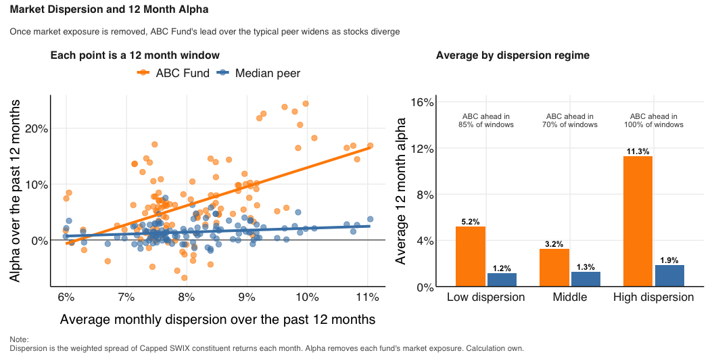

The raw monthly correlation was only -0.07, but the 12 month alpha rose
significantly with dispersion, with a slope of 3.40. The claim therefore
holds only in that framing, and the speaker notes give the manager the
safe wording.

## Conclusion to Question 3

My conclusion is that the manager has a strong and honest case. Most
peers deliver market beta, while ABC Fund earned more with roughly half
the market exposure, lower volatility and shallower drawdowns. The
dispersion claim holds once performance is adjusted for market exposure
and measured over a year, and the contrarian description is the weakest
part of the story. The deck is
[Question3.pptx](Questions/Question3/Question3.pptx).

# Question 4, Portfolio Construction

## Approach

Question 4 asks me to build a balanced index fund under nine mandate
conditions, using monthly data and a covariance matrix estimated after
2010. The brief invites as many angles as I like, so I built four
portfolio rules under the same constraints, a constrained equal weight
baseline, minimum variance, risk parity and maximum Sharpe, and judged
them on the frontier, on capital against risk, on how hard they press
the limits and in a backtest. The brief mentions description files that
are not in the data folder, so I built the universe from the files named
in its code. There is no exchange rate in the data, so I left offshore
returns in dollars and state plainly that this treats the offshore
holdings as hedged.

``` r
MSCI <- read_rds("data/MSCI_Indexes.rds") # total return indexes for the MSCI global equity indexes
Bond_Yields <- read_rds("data/Global_Bond_Yields.rds") # ten year government bond yields, which still need to be turned into a return series
LCL_Yield_Proxies <- read_rds("data/Monthly_LCL_Yield_Indexes.rds") # monthly returns for the local bond, inflation linked bond and listed property indexes
```

## The Investable Universe

I chose regional equity indexes over the all country index so that the
fund never holds the same shares twice, counted listed property as
equity and inflation linked bonds as bonds, and chose momentum and value
as the two factor indexes, since low volatility fails the five year
rule.

``` r
Q4_Meta <- tribble(~Asset, ~Source, ~Source_Name, ~Class, ~Region, # the universe, each asset's source, asset class and region
                   "US equity", "MSCI", "MSCI_USA", "Equity", "Global",
                   "Europe equity", "MSCI", "MSCI_EU", "Equity", "Global",
                   "Japan equity", "MSCI", "MSCI_Jap", "Equity", "Global",
                   "EM equity", "MSCI", "MSCI_EM", "Equity", "Global",
                   "US REITs", "MSCI", "MSCI_USREIT", "Equity", "Global",
                   "US 10Yr bond", "Bonds", "US_10Yr", "Bonds", "Global",
                   "Euro 10Yr bond", "Bonds", "EURO_10Yr", "Bonds", "Global",
                   "UK 10Yr bond", "Bonds", "UK_10Yr", "Bonds", "Global",
                   "Commodities", "Commods", "Bcom_Index", "Commodity", "Global",
                   "Gold", "Commods", "Gold", "Commodity", "Global",
                   "SA large caps", "Local", "Top 40", "Equity", "Local",
                   "SA mid caps", "Local", "MidCaps", "Equity", "Local",
                   "SA momentum", "Local", "Mom", "Equity", "Local",
                   "SA value", "Local", "Val", "Equity", "Local",
                   "SA bonds", "LCL", "FTSE/JSE All Bond", "Bonds", "Local",
                   "SA inflation-linked", "LCL", "FTSE/JSE SA Inflation-Linked Government Bonds", "Bonds", "Local",
                   "SA property", "LCL", "FTSE/JSE SA Listed Property", "Equity", "Local")
Bond_Rets <- Bond_TRI_Calc(Bond_Yields, Bond_Sel = c("US_10Yr", "EURO_10Yr", "UK_10Yr"), Maturity = 10) # monthly bond returns built from yields, explained in the next section
Q4_End <- lubridate::ymd(20260930) # the last month in the data
Asset_Rets <- Asset_Returns_Build(Q4_Meta, MSCI, Commods, Bond_Rets, Idx_Daily, LCL_Yield_Proxies) %>% filter(date <= Q4_End) # monthly returns for every asset
Rebal_Dates <- seq(lubridate::ymd(20200101), lubridate::ymd(20260701), by = "3 months") - 1 # quarter ends from December 2019, the first date with ten years of data after 2010
Q4_Pal <- Q4_Palettes(Q4_Meta) # colours for assets, families and portfolio rules
Lvl_Start <- Idx_Daily %>% filter(Tickers == "STXLVLJ433") %>% pull(date) %>% min() # the first day of the local low volatility index
Excluded <- tibble(Asset = "SA low volatility", Start = Lvl_Start, End = Q4_End, Reason = "Excluded, under five years of returns") # the factor index the five year rule removes
Plot_Universe_Timeline(Asset_Rets, Q4_Meta, Q4_Pal, Excluded = Excluded, Est_Start = lubridate::ymd(20100101), Rebal_Dates = Rebal_Dates, Min_Months = 60, # the data history of every asset
                       Title = "The Investable Universe Through Time", # the plot title
                       Subtitle = "Local equity indexes only become eligible from 2020 onwards, while the local low volatility index never qualifies", # the main message
                       Caption = "Note:\nFaded bars show each asset's full history and bold bars the period in which the five year rule allows it to be held. Circles mark the month it qualifies. Calculation own.") # the note under the plot
```

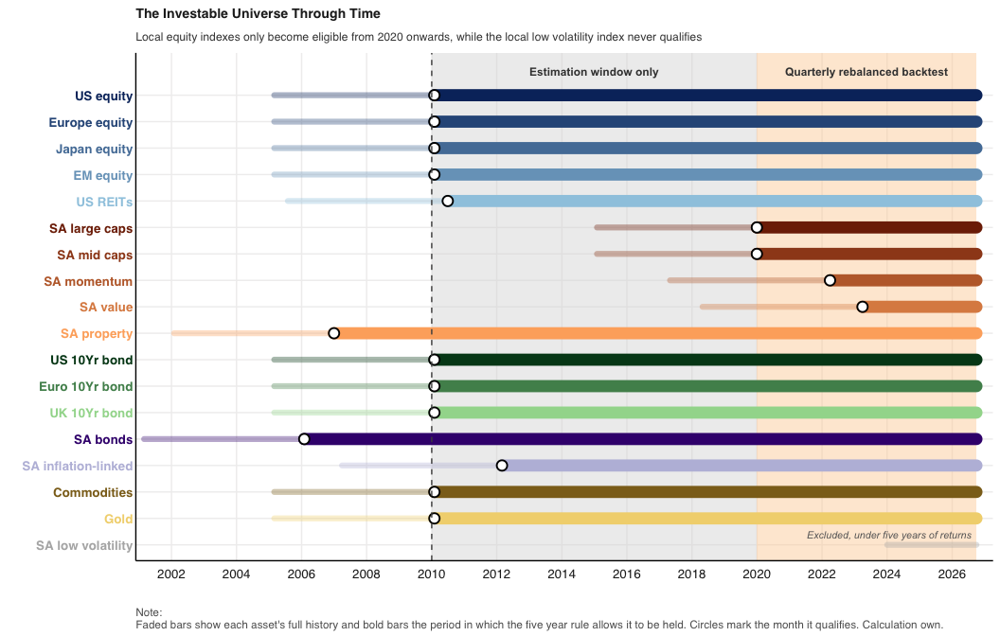

The timeline showed that ten years of post-2010 data first exist in
December 2019, the month the local equity indexes qualify, so I started
the backtest there, with momentum joining in March 2022 and value in
March 2023.

## Building Bond Indexes From Yields

The brief gives yields, not returns, so I built each bond index by
repricing a ten year par bond at the next month’s yield and adding a
month of coupon. I chose full repricing over a duration approximation
because it captures convexity when yields move sharply, as they did in
2022.

``` r
Bond_Facts <- Bond_Rets %>% group_by(Name) %>% summarise(Ret = prod(1 + Returns)^(12 / n()) - 1, Vol = sd(Returns) * sqrt(12), DD_2022 = prod(1 + Returns[lubridate::year(date) == 2022]) - 1, Neg_Months = sum(Yield < 0), .groups = "drop") # return, volatility and the 2022 loss of each constructed index
Plot_Bond_Construction(Bond_Rets, # yields next to the indexes built from them
                       Title = "From Yields to Bond Returns", # the plot title
                       Subtitle = "Falling yields delivered steady bond returns until 2020, and the 2022 rate shock erased several years of gains", # the main message
                       Caption = "Note:\nMonthly returns of a ten year par bond repriced at the next month's yield, plus a month of coupon. Returns are in each bond's own currency. Calculation own.") # the note under the plot
```

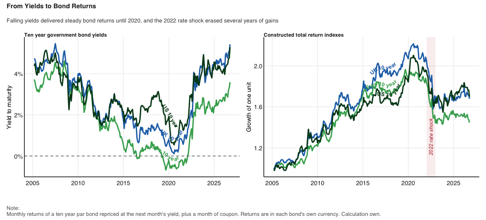

The US index returned 2.5 percent a year since 2005, which is plausible
for a ten year Treasury over that period.

## How the Assets Move Together

Before optimising, I wanted to see which assets diversify each other, so
I drew the strong correlations as a chord diagram.

``` r
Q4_Cor <- Plot_Cor_Chord(Asset_Rets, Q4_Pal, Est_Start = lubridate::ymd(20100101), Pos_Threshold = 0.5, Neg_Threshold = -0.15, Title = "Correlation Links Across the Universe, 2010 to 2026") # the chord diagram, which also returns the correlation matrix
```

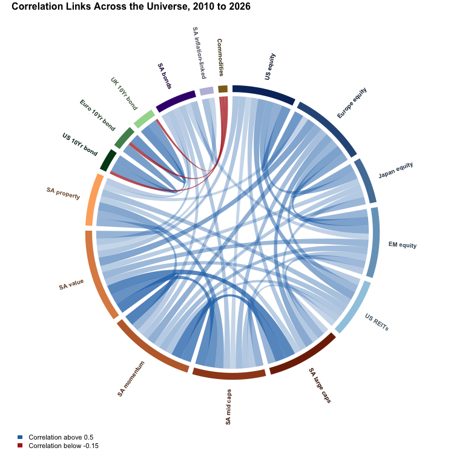

``` r
Local_Eq <- c("SA large caps", "SA mid caps", "SA momentum", "SA value") # the local equity indexes
Global_Eq <- c("US equity", "Europe equity", "Japan equity", "EM equity") # the offshore equity indexes
```

Local equities form one tight cluster, with an average correlation of
0.86, and gold links to nothing, which told me gold would earn a place
in every optimiser.

## Four Ways to Build the Portfolio

I estimated the inputs at each quarter end from all monthly returns
since 2010, which always satisfies the ten year look-back. I shrank
correlations a quarter of the way to their average and means half way to
their grand mean, because sample means are the noisiest input and an
unshrunk optimiser chases them. Every rule faces the same linear
constraints in quadprog, and the five year rule drops any asset with
fewer than 60 returns on each date.

``` r
Q4_Strategies <- list(`Constrained equal weight` = Opt_Equal, `Minimum variance` = Opt_MinVar, `Risk parity` = Opt_RiskParity, `Maximum Sharpe` = Opt_MaxSharpe) # the four portfolio rules
Q4_Weights <- Rebalance_Calc(Asset_Rets, Q4_Meta, Rebal_Dates, Q4_Strategies, Est_Start = lubridate::ymd(20100101), Min_Months = 60, Min_Years = 10, Cor_Shrink = 0.25, Mu_Shrink = 0.5) # the weights of each rule on every quarter end
Q4_Check <- Q4_Weights %>% group_by(date, Strategy) %>% summarise(Sum = sum(Weight), Min = min(Weight), Max = max(Weight), Bonds = sum(Weight[Class == "Bonds"]), Equity = sum(Weight[Class == "Equity"]), Commodity = sum(Weight[Class == "Commodity"]), Global = sum(Weight[Region == "Global"]), .groups = "drop") # every exposure the mandate limits, on every date
Q4_Breach <- with(Q4_Check, max(abs(Sum - 1), -Min, Max - 0.35, Bonds - 0.25, Equity - 0.75, Commodity - 0.15, Global - 0.60)) # the largest breach of any limit, which should be zero up to rounding
```

Across 27 dates and four rules the largest breach of any limit was
0.000000, so every portfolio is valid.

## The Efficient Frontier and the Cost of the Mandate

To see what the mandate costs, I traced the efficient frontier with and
without its limits.

``` r
Q4_Frontiers <- Frontier_Path_Calc(Asset_Rets, Q4_Meta, Rebal_Dates, Est_Start = lubridate::ymd(20100101), Min_Months = 60) # the frontiers and asset positions on every rebalance date
Fr_Now <- Q4_Frontiers$Frontiers %>% filter(date == max(date)) %>% group_by(Frontier) %>% summarise(Min_Vol = min(Vol), Max_Ret = max(Ret), .groups = "drop") # the lowest volatility and highest return on each latest frontier
Plot_Efficient_Frontier(Q4_Frontiers, Q4_Weights, Q4_Pal, # the efficient frontiers on the latest rebalance date
                        Title = "The Efficient Frontier, June 2026", # the plot title
                        Subtitle = "The mandate removes the lowest risk portfolios and caps the highest return ones", # the main message
                        Caption = "Note:\nExpected values from the shrunk estimates on the latest rebalance date. Calculation own.") # the note under the plot
```

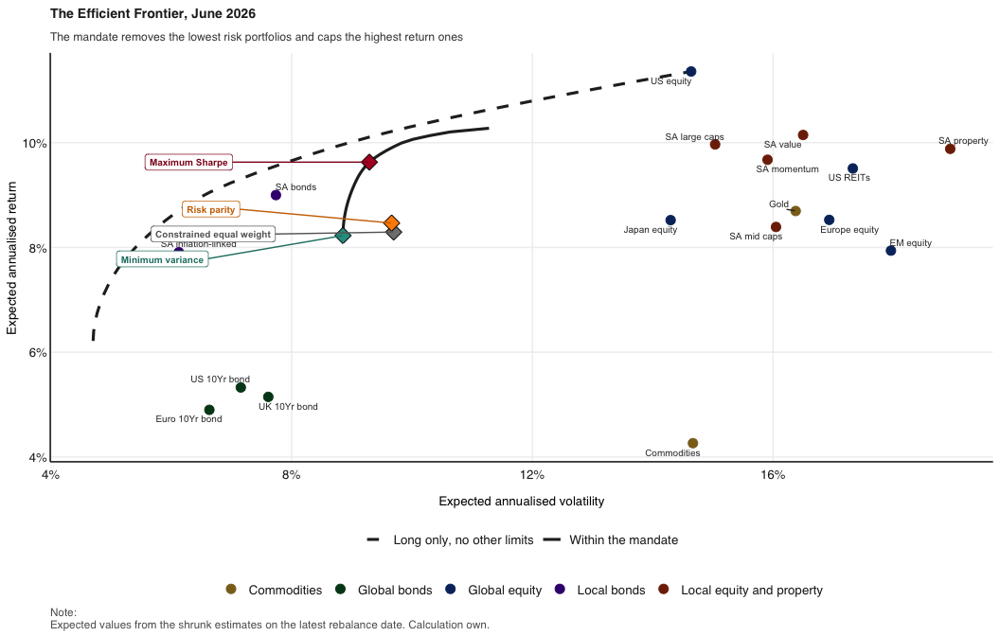

The least volatile long-only portfolio sits at 4.7 percent and the least
volatile mandate portfolio at 8.9 percent, so the bond and global caps
cost most at the low risk end.

## Weights Along the Frontier

I then looked at which assets build the frontier, using the frontier
construction from the Practical 3 bonus.

``` r
Q4_Fw <- Frontier_Weights_Calc(Asset_Rets, Q4_Meta, Date = max(Rebal_Dates), Est_Start = lubridate::ymd(20100101), Min_Months = 60) # the weights of each frontier portfolio on the latest rebalance date
Fw_Facts <- Q4_Fw %>% group_by(Vol) %>% summarise(N = sum(Weight > 0.005), Bonds = sum(Weight[Asset %in% Q4_Meta$Asset[Q4_Meta$Class == "Bonds"]]), US = sum(Weight[Asset == "US equity"]), .groups = "drop") # the number of holdings and the bond and US equity weights along the frontier
Plot_Frontier_Weights(Q4_Fw, Q4_Weights, Q4_Pal, # stacked weights along the frontier
                      Title = "Portfolio Weights Along the Efficient Frontier, June 2026", # the plot title
                      Subtitle = "Bonds stay at their cap along the whole frontier, and higher risk is bought with US equity and local shares", # the main message
                      Caption = "Note:\nWeights of portfolios on the mandate frontier, from lowest to highest risk. Dashed lines mark the volatility of each rule on the same date. Calculation own.") # the note under the plot
```

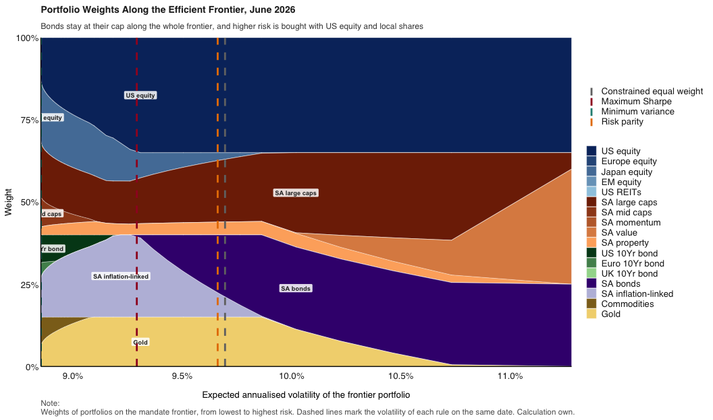

Bonds sit at their cap along the whole frontier, and US equity rises
from 13 percent to its cap as risk increases.

## Random Portfolios Within the Mandate

As a benchmark that needs no optimiser, I drew random portfolios that
meet every limit.

``` r
Q4_Random <- Random_Portfolios_Calc(Asset_Rets, Q4_Meta, Date = max(Rebal_Dates), N_Draws = 20000, Seed = 4321) # random portfolios that meet the mandate on the latest rebalance date
Plot_Random_Portfolios(Q4_Random, Q4_Frontiers, Q4_Weights, Q4_Pal, # the cloud of random portfolios under the frontier
                       Title = "Random Portfolios Within the Mandate, June 2026", # the plot title
                       Subtitle = "Every random portfolio lies inside the frontier, and the optimised rules sit at or near its edge", # the main message
                       Caption = "Note:\nRandom class budgets within each limit, spread at random across each class, keeping draws that meet every limit. Expected values from the shrunk estimates. Calculation own.") # the note under the plot
```

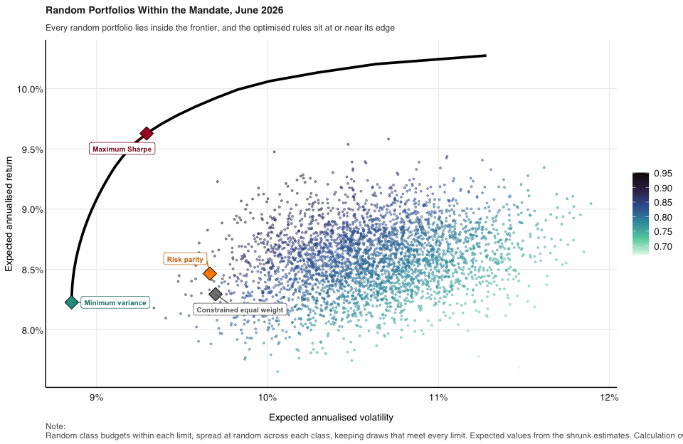

Only 17.4 percent of the draws were feasible, and none reached the
frontier.

## Capital Versus Risk

Weights show where the money sits, not where the risk comes from, so I
compared each family’s share of capital with its share of risk.

``` r
Risk_Facts <- Q4_Weights %>% group_by(Strategy, date) %>% summarise(Bond_Cap = sum(Weight[Class == "Bonds"]), Bond_Risk = sum(Risk_Share[Class == "Bonds"]), Eq_Cap = sum(Weight[Class == "Equity"]), Eq_Risk = sum(Risk_Share[Class == "Equity"]), Top_Risk = max(Risk_Share), Top_Asset = Asset[which.max(Risk_Share)], .groups = "drop") %>% group_by(Strategy) %>% summarise(across(c(Bond_Cap, Bond_Risk, Eq_Cap, Eq_Risk, Top_Risk), mean), Top_Asset = names(which.max(table(Top_Asset))), .groups = "drop") # capital and risk shares by class, averaged over all rebalance dates
Plot_Capital_Risk_Bars(Q4_Weights, Q4_Pal, # capital next to risk for every rule
                       Title = "Where the Capital Sits and Where the Risk Comes From", # the plot title
                       Subtitle = "Bonds take a quarter of every portfolio's capital but contribute only a small share of its risk", # the main message
                       Caption = "Note:\nRisk shares are each family's weight times its marginal contribution to ex ante portfolio variance, averaged over all quarterly rebalances. Calculation own.") # the note under the plot
```

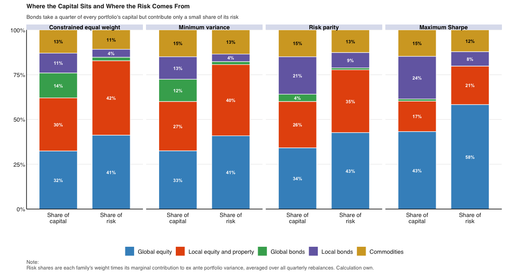

In risk parity, bonds held 25 percent of the capital but only 10 percent
of the risk, which is the main limit on how balanced any of these funds
can be.

## The Latest Portfolios

I drew the latest weights as treemaps to show the practical difference
between the rules.

``` r
Latest_W <- Q4_Weights %>% filter(date == max(date)) # the latest weights
Holdings_N <- Latest_W %>% group_by(Strategy) %>% summarise(N = sum(Weight > 0.001), Top = max(Weight), Top_Asset = Asset[which.max(Weight)], .groups = "drop") # the number of holdings and the largest weight of each rule
Plot_Weight_Treemap(Q4_Weights, Q4_Pal, # the treemaps of the latest weights
                    Title = "Latest Portfolio Composition, June 2026", # the plot title
                    Subtitle = "Risk parity spreads its capital across almost every asset, while maximum Sharpe concentrates in three", # the main message
                    Caption = "Note:\nWeights on the latest quarterly rebalance date. Thick borders separate families of assets. Calculation own.") # the note under the plot
```

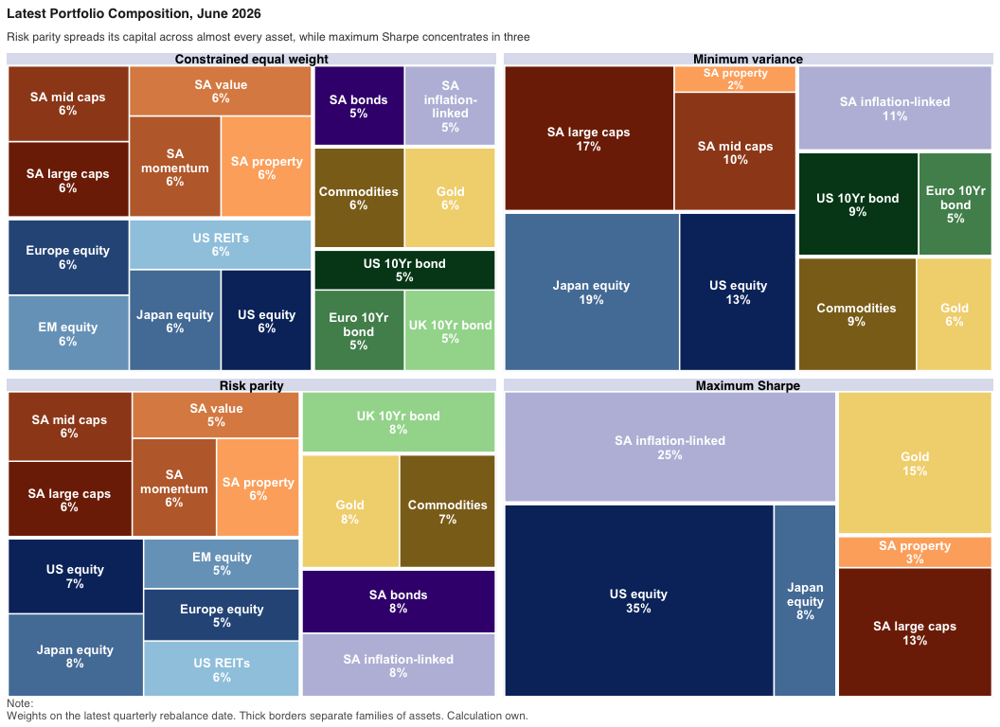

Risk parity holds 15 assets with none above 8 percent, while maximum
Sharpe concentrates in a few.

## How Hard the Mandate Binds

I measured how much of each limit every rule uses, to see which
conditions actually shape the fund.

``` r
Q4_Use <- Q4_Check %>% group_by(Strategy) %>% summarise(Bonds = mean(Bonds) / 0.25, Global = mean(Global) / 0.60, Commodity = mean(Commodity) / 0.15, Largest = mean(Max) / 0.35, .groups = "drop") # the average use of each limit
Plot_Constraint_Radial(Q4_Weights, Q4_Pal, # the circular barplot of limit use
                       Title = "How Hard Each Rule Leans on the Mandate", # the plot title
                       Subtitle = "Every rule fills the bond limit, and all but risk parity also fill the global limit", # the main message
                       Caption = "Note:\nAverage exposure as a share of each limit across all quarterly rebalance dates from December 2019. Calculation own.") # the note under the plot
```


The bond limit binds for every rule and the equity limit for none, since
filling the bond and commodity limits leaves equities near 60 percent.

## Growth and Drawdowns

The backtest holds each quarter’s weights and lets them drift. I found
that the practical’s lag option shifts monthly weights back by only one
day, which would have let weights earn the month in which they were
chosen, so I switched it off for monthly data to remove that look-ahead.

``` r
Q4_BT <- Backtest_Calc(Asset_Rets, Q4_Weights) # monthly portfolio returns and turnover of each rule
Q4_Stats <- Strategy_Stats_Calc(Q4_BT, Q4_Weights) # the summary statistics of each rule
Q4_Sub <- Q4_BT$Returns %>% mutate(Period = ifelse(date < lubridate::ymd(20230101), "2020-2022", "2023-2026")) %>% group_by(Period, Strategy) %>% summarise(Ret = prod(1 + Returns)^(12 / n()) - 1, .groups = "drop") %>% mutate(Key = paste(Strategy, Period)) # annualised returns in the stressed and the calm sub-period
Plot_Growth_Underwater(Q4_BT$Returns, Q4_Pal, # growth curves above the underwater chart
                       Title = "Growth and Drawdowns of the Four Portfolios", # the plot title
                       Subtitle = "All four rules recovered quickly from the Covid crash, and maximum Sharpe pulled ahead in the rally from 2023", # the main message
                       Caption = "Note:\nMonthly returns with weights drifting between quarterly rebalances. Offshore returns in dollars, local returns in rand. Calculation own.") # the note under the plot
```


Maximum Sharpe returned 12.2 percent a year and risk parity 10.7
percent.

## Monthly Return Distributions

I used rainclouds to see whether the rules differ in their tails, not
only on average.

``` r
Plot_Return_Raincloud(Q4_BT$Returns, Q4_Pal, # the rainclouds of monthly returns
                      Title = "Monthly Return Distributions", # the plot title
                      Subtitle = "The four rules share a similar shape, with March 2020 the worst month for every one of them", # the main message
                      Caption = "Note:\nHalf densities, boxplots and individual monthly returns from January 2020 to September 2026. Calculation own.") # the note under the plot
```


The average of the worst five percent of months ranged only from 7.4
percent to 7.9 percent, so the tails were similar.

## Calendar Year Rankings

A bump chart of yearly ranks shows whether any rule leads consistently.

``` r
Plot_Rank_Bump(Q4_BT$Returns, Q4_Pal, # the bump chart of yearly ranks
               Title = "Calendar Year Rankings", # the plot title
               Subtitle = "Risk parity led through the stressed years of 2021 and 2022, and maximum Sharpe has led every year since", # the main message
               Caption = "Note:\nRank by calendar year return, with each year's return inside its point. * Year to September 2026. Calculation own.") # the note under the plot
```


No rule led in every year, which pushed me to choose on robustness and
not on the latest ranking.

## Scorecard

I brought the measures together in a radar scorecard, and then tested my
two judgement calls, the correlation shrinkage and the mean shrinkage,
since a recommendation that flips with them would not be worth making.

``` r
Plot_Strategy_Radar(Q4_Stats, Q4_Pal, # the radar scorecard
                    Title = "Strategy Scorecard", # the plot title
                    Subtitle = "Risk parity combines a middling return with the broadest diversification and the lowest turnover", # the main message
                    Caption = "Note:\nEach measure is scaled across the four rules, with the best rule on the outer ring. Diversified risk is the effective number of risk sources. Calculation own.") # the note under the plot
```


``` r
Robust <- map_df(c(0, 0.5), function(cs) { W_r <- Rebalance_Calc(Asset_Rets, Q4_Meta, Rebal_Dates, Q4_Strategies, Cor_Shrink = cs, Mu_Shrink = 0.5); Strategy_Stats_Calc(Backtest_Calc(Asset_Rets, W_r), W_r) %>% mutate(Shrink = cs) }) %>% mutate(Key = paste(Strategy, Shrink)) # the four rules with no correlation shrinkage and with twice the base case shrinkage
W_Raw <- Rebalance_Calc(Asset_Rets, Q4_Meta, Rebal_Dates, Q4_Strategies["Maximum Sharpe"], Cor_Shrink = 0.25, Mu_Shrink = 0) # maximum Sharpe with raw sample means
Raw_MS <- Strategy_Stats_Calc(Backtest_Calc(Asset_Rets, W_Raw), W_Raw) # its backtest statistics
```

## Recommendation and Robustness

I recommend constrained risk parity. It returned 10.7 percent a year,
held up best in the stressed years, spread its risk across an effective
12.8 sources and does not rely on expected returns. Without mean
shrinkage, maximum Sharpe’s return falls to 11.6 percent, and with no
correlation shrinkage risk parity still returns 11.1 percent, so the
choice does not hinge on my estimation settings.

## Conclusion to Question 4

My conclusion is that a fund meeting every condition of the mandate can
be built from this universe, and that the mandate shapes it more than
the choice of rule does, since the bond and global limits bind for
almost every rule. Constrained risk parity gives the most balanced mix
of return, diversification and low turnover. Its weakness is that bonds
still carry little of its risk, and a live fund would also carry rand
exposure that this dollar-based backtest leaves out. The full report is
in [Question4.pdf](Questions/Question4/Question4.pdf).

# Closing Animation, the Frontier Through Time

I end where Question 4 left off, with the efficient frontier played
forward through every quarterly rebalance from December 2019. The dashed
frontier is what a long-only investor could reach, the solid one is what
the mandate allows, and the diamonds are the four rules. Watching it
move makes two of my findings visible at once, the frontier shifting as
new assets qualify and the estimation window lengthens, and the gap
between the two frontiers, the cost of the mandate, persisting
throughout.

``` r
Animate_In_Fresh_R("Animate_Frontier_Path", # render the moving frontier in a separate R session, where gganimate runs freely
                   Args = list(Fr = Q4_Frontiers, W = Q4_Weights, Pal = Q4_Pal, File = "README_files/animations/frontier_path.gif", # the frontiers, the portfolios and where the gif is saved
                               Title = "The Efficient Frontier Through Time", Subtitle = "Quarterly rebalance of", # the title and the start of the subtitle, which ends with the current date
                               Caption = "Note:\nExpected values from the shrunk estimates on each rebalance date. Diamonds mark the four portfolio rules. Calculation own.")) # the note under the animation
```


