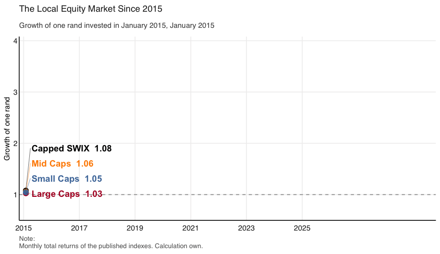
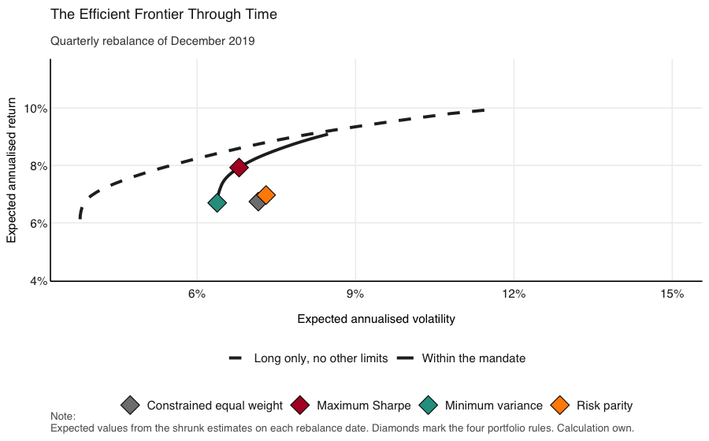

---
output:
  md_document:
    variant: markdown_github
---

# Purpose

This repository contains the answers to the 2026 Financial Econometrics practical examination for student number 24991422. This README is the primary document, as it sets out the code and the reasoning behind each question in the order in which the paper presents them. The finished write-ups are stored in the `Questions` folder, with one folder per question.

The repository follows a consistent structure. Every function is stored in the `code` folder, with one subfolder per question, and this README only calls those functions. The data is stored in the `data` folder, which is excluded from the repository through the `.gitignore` file.

```{r setup, include=FALSE}
knitr::opts_chunk$set(message = FALSE, warning = FALSE, fig.width = 9, fig.height = 5.5) # hide package messages and warnings in the output and set a sensible default figure size
```

```{r housekeeping}
rm(list = ls()) # clean the environment so that nothing old leaks into the results
gc() # garbage collection, which hands memory back to the operating system after the clean
library(tidyverse) # load the tidyverse for data wrangling and plotting
list.files('code/', full.names = T, recursive = T) %>% .[grepl('.R', .)] %>% as.list() %>% walk(~source(.)) # source every function saved in the code folder and its subfolders
```

# Folder Construction

The root project was created with `fmxdat::make_project()`, and each question folder was created with Texevier. The chunk below records those calls for transparency but is not evaluated, since the folders already exist.

```{r folder_build, eval = FALSE}
fmxdat::make_project(Mac = TRUE) # build the root project with its code, data, bin and settings folders
Texevier::create_template(directory = "Questions", template_name = "Question1", build_project = TRUE, open_project = FALSE) # pdf write-up folder for question 1
Texevier::create_template(directory = "Questions", template_name = "Question2", build_project = TRUE, open_project = FALSE) # pdf write-up folder for question 2
Texevier::create_template(directory = "Questions", template_name = "Question3", build_project = TRUE, open_project = FALSE) # folder for question 3, which is later knitted to PowerPoint slides
Texevier::create_template(directory = "Questions", template_name = "Question4", build_project = TRUE, open_project = FALSE) # pdf write-up folder for question 4
```

The exam data was then downloaded from the course website and unzipped into the `data` folder.

# Packages

```{r packages}
if(!require("pacman")) install.packages("pacman") # make sure the package loader itself is installed
pacman::p_load(tidyverse, lubridate, xts, tbl2xts, PerformanceAnalytics, RcppRoll, fmxdat, rmsfuns, glue, gt, patchwork) # load the core packages that every question relies on, with xts attached because fmxdat::Safe_TE calls its functions directly
Needed <- c("quadprog", "Rsolnp", "Matrix", "ggdist", "treemapify", "geomtextpath", "circlize", "ggrepel", "ggridges", "sandwich", "lmtest", "rugarch", "rmgarch", "gganimate", "gifski", "callr") # packages that the functions only ever call with ::, so they are installed but not attached, including gganimate and its gif renderer for the two animations
Missing <- setdiff(Needed, rownames(installed.packages())) # the ones not yet installed on this machine
if(length(Missing) > 0) install.packages(Missing) # install only those
options(dplyr.summarise.inform = F) # stop summarise from printing a grouping message every time it runs
options(scipen = 999) # show numbers in full instead of scientific notation
```

# The Local Market in Motion

Before the questions, the animation below sets the scene. It traces the growth of one rand invested in the Capped SWIX and the three local size indexes from January 2015, drawing each line month by month. The race shows the themes that recur through this repository, namely the Covid crash of 2020, the long stretch in which the indexes moved together, and the separation of the size indexes in the rally that followed.

```{r anim_top, results = "hide"}
dir.create("README_files/animations", recursive = TRUE, showWarnings = FALSE) # a folder for the animations, next to the README's other figures
Race_Monthly <- read_rds("data/Index_Returns_Daily.rds") %>% filter(Tickers %in% c("J433", "J200", "J201", "J202")) %>% mutate(Name = recode(Name, "Top 40" = "Large Caps", MidCaps = "Mid Caps", SmallCaps = "Small Caps")) %>% select(date, Name, Returns) %>% Monthly_Returns_Calc() # monthly returns of the benchmark and the size indexes
Animate_In_Fresh_R("Animate_Index_Race", # render the racing growth chart in a separate R session, where gganimate runs freely
                   Args = list(Monthly = Race_Monthly, File = "README_files/animations/index_race.gif", # the data and where the gif is saved
                               Cols = c(`Capped SWIX` = "black", `Large Caps` = "#B2182B", `Mid Caps` = "darkorange", `Small Caps` = "#4C78A8"), # one colour per index, matching question 2
                               Title = "The Local Equity Market Since 2015", Subtitle = "Growth of one rand invested in January 2015,", # the title and the start of the subtitle, which ends with the current month
                               Caption = "Note:\nMonthly total returns of the published indexes. Calculation own.")) # the note under the animation
```



# Question 1, Exploring Risk and Uncertainty

```{r q1_data}
Uncertainty_Indexes <- read_rds("data/Econ_Uncertainty_Indexes.rds") # economic policy uncertainty indexes and the MOVE bond volatility index
Implied_Vol <- read_rds("data/Implied_Vol_Indexes.rds") # implied volatility indexes, namely the VIX, V2X and VXEEM
Local_Index_Constituents <- read_rds("data/Index_Constituents.rds") # daily constituents, weights and returns for nine local indexes
Idx_Daily <- read_rds("data/Index_Returns_Daily.rds") # daily returns for the local headline, size and factor indexes
Stock_Returns <- read_rds("data/Stock_Returns_Daily.rds") # daily returns for every local stock
Local_Cncy_Vol_Index <- read_rds("data/LCL_Currency_Vol_Index.rds") # the SAVIUSD index of rand volatility
Gl_Cncy_Vol_Index <- read_rds("data/Global_Currency_Vol_Index.rds") # the JP Morgan global currency volatility index
Commods <- read_rds("data/Commodities.rds") # total return indexes for the Bloomberg commodity index, gold and Brent oil
SafeCore <- read_rds("data/SafeCore.rds") # monthly holdings and weights of the SafeCore fund
Factor_Scores <- read_rds("data/Factor_Scores.rds") # third party factor scores per stock, where a lower value means a lower exposure
Monthly_Constituents <- read_rds("data/Monthly_Index_Constituents.rds") # monthly constituents and weights of the Capped SWIX and the size indexes, used to rebuild the benchmark
STeFI <- read_rds("data/STeFI_Index.rds") # daily returns of the local cash index, used as the risk free rate
```

## Part A, Local Volatility in a Global Context

### Approach

This part establishes whether volatility on the local exchange has increased and whether that increase mirrors the global experience. The analysis moves from simple measures to model-based ones. It first compares annualised volatility across sub-periods and traces its timing with rolling windows and a monthly heatmap. It then separates the volatility signal from noise using GARCH models, examines how strongly volatility responds to bad news, and uses a DCC model to test whether the local market has become more tightly linked to global markets. Finally, it stratifies the sample by global conditions to identify which external forces local volatility responds to, and which local segment holds up best when they strike. Several figures borrow their layout from the R Graph Gallery, including small multiples with greyed-out context, a time series heatmap, ridgelines, lollipops and a dumbbell chart, with each design chosen because it makes a specific comparison easier to see.

Three choices shape the analysis. The Capped SWIX (J433) serves as the local yardstick, since it is the fund's benchmark in Part B and its capping prevents a handful of large shares from dominating the result. The MSCI All Country World index represents the global experience, while the MSCI Emerging Markets index represents the peer group to which South Africa belongs. The local index is quoted in rand and the MSCI indexes in dollars, and each is kept in its own currency because the question concerns the volatility that each investor base experiences. Part of any difference between them may therefore reflect movements in the rand.

```{r q1a_returns}
Local_Rets <- Idx_Daily %>% filter(Name %in% c("Capped SWIX", "Top 40", "MidCaps", "SmallCaps")) %>% mutate(dlogret = log(1 + Returns)) %>% select(date, Name, Returns, dlogret) # keep the four vanilla local indexes and add log returns for the volatility models
Global_Rets <- read_rds("data/MSCI_Indexes.rds") %>% filter(Name %in% c("MSCI_ACWI", "MSCI_EM", "MSCI_USA")) %>% TRI_Returns_Calc(Start_Date = lubridate::ymd(20150101)) # turn the global index levels into daily returns over the same sample as the local data
All_Rets <- bind_rows(Local_Rets, Global_Rets) # stack local and global returns into one tidy data frame
Index_Order <- c("Capped SWIX", "Top 40", "MidCaps", "SmallCaps", "MSCI_EM", "MSCI_ACWI") # the order in which indexes appear in the figures, local first and then emerging and global
```

### Volatility by Period

The most direct test compares annualised volatility across periods. The sample is divided into the calm years before Covid, the Covid year itself, the recovery from 2021 to 2024, and 2025 and 2026 separately, since these two years are the focus of the seminar. The shift chart below tracks how each index moved from its 2021 to 2024 baseline into 2026, with the grey diamond marking its full sample norm and the change in percentage points displayed in the right-hand column.

```{r q1a_period_shift, fig.width = 10, fig.height = 5.5}
Periods <- tibble(Period = c("2015-2019", "2020 (Covid)", "2021-2024", "2025", "2026 YTD"), # the names of the sub-periods
                  Start = lubridate::ymd(c(20150101, 20200101, 20210101, 20250101, 20260101)), # the first day of each sub-period
                  End = lubridate::ymd(c(20191231, 20201231, 20241231, 20251231, 20261231))) # the last day of each sub-period
Vol_Periods <- Vol_Period_Table(All_Rets, Periods) # annualised volatility of every index in every sub-period
Vol_Facts <- Vol_Periods %>% mutate(Key = paste(Name, Period)) # every index and period in one keyed table, used for the numbers in the text
Plot_Vol_Shift(Vol_Periods, Base_Per = "2021-2024", Target_Per = "2026 YTD", Index_Sel = Index_Order, # the shift from the 2021 to 2024 baseline into 2026 for each index
               Title = "Shift in Annualised Volatility from the 2021-2024 Baseline to 2026", # the plot title
               Subtitle = "Local large caps and emerging markets surged, while global equities and small caps cooled", # the main message
               Caption = "Note:\nAnnualised standard deviation of daily returns. Arrows run from the 2021-2024 baseline to 2026 YTD.\nDiamonds mark the 2015-2026 full sample norm. Calculation own.") # the note under the plot
```

The figure shows that local volatility rose in 2026 while global volatility did not. The Capped SWIX recorded annualised volatility of 20.7 percent in 2026, above the 15.7 percent of 2021 to 2024 and its full sample level of `r Fact_Pull(Vol_Facts, "Capped SWIX Full Sample", "SD", Key_Col = "Key", Pct = 0.1)`. The MSCI ACWI moved in the opposite direction, at 12.0 percent in 2026 against a full sample level of `r Fact_Pull(Vol_Facts, "MSCI_ACWI Full Sample", "SD", Key_Col = "Key", Pct = 0.1)`, while the MSCI Emerging Markets index rose to 25.2 percent. The rise in local volatility therefore resembles the emerging market experience far more closely than the global one. Small caps are a notable exception, with volatility of 12.0 percent in 2026 against `r Fact_Pull(Vol_Facts, "SmallCaps Full Sample", "SD", Key_Col = "Key", Pct = 0.1)` over the full sample, which suggests that the turbulence was concentrated in the larger and more globally exposed shares of the Top 40, where volatility reached 22.4 percent.

### Rolling Realised Volatility

Period averages conceal the timing of volatility, so a rolling window of three months (63 trading days) is passed through the sample. Three months is long enough to give a stable estimate and short enough to show when an episode begins and ends. Each index receives its own panel, with every other index drawn in grey behind it, so that its path can be judged against the rest of the market without a tangle of overlapping lines. The dashed line marks the index's own long run average and the labelled point marks its peak in 2026.

```{r q1a_rolling, fig.width = 10, fig.height = 6.5}
Roll_Vol <- Roll_SD_Calc(All_Rets, NSel = 63) # rolling three month annualised volatility for every index
Roll_Facts <- Roll_Vol %>% group_by(Name) %>% summarise(Last = dplyr::last(RollSD), Pctile = mean(RollSD <= dplyr::last(RollSD)), Peak_2026 = max(RollSD[date >= lubridate::ymd(20260101)])) # the latest reading, where it ranks in the index's history and the 2026 peak, used in the text
Plot_Roll_Vol(Roll_Vol %>% filter(Name %in% Index_Order) %>% mutate(Name = factor(Name, levels = Index_Order)), # plot the local, emerging and global indexes as small multiples
              Title = "Rolling 3 Month Realised Volatility", # the plot title
              Subtitle = "Large local shares and emerging markets peaked in 2026, while small caps and global equities stayed close to normal", # the main message
              Caption = "Note:\nGrey lines show every other index for context. Dashed lines show each index's own average. Local indexes in ZAR, MSCI indexes in USD. Calculation own.") # the note under the plot
```

The small multiples show that the 2026 increase was a pronounced but temporary episode, and that it was not shared by every part of the market. Rolling volatility on the Capped SWIX peaked at 27 percent in April 2026, its highest level outside of the Covid crash and the 2015 to 2016 sell-off, with the Top 40 and mid caps peaking at 29 and 28 percent. Small caps, by contrast, peaked at only 16 percent. By the end of September 2026 volatility on the Capped SWIX had fallen back to `r Fact_Pull(Roll_Facts, "Capped SWIX", "Last", Pct = 1)`, a level exceeded on `r Pct_Text(1 - Roll_Facts$Pctile[Roll_Facts$Name == "Capped SWIX"], accuracy = 1)` of days since 2015. Emerging market volatility followed a similar path at a higher level, peaking at 31 percent, while the global index peaked at only 15 percent. The evidence points to a temporary volatility episode, with no sign of a lasting shift to a higher level of local volatility.

### A Heatmap of Monthly Volatility

The rolling measure shows when volatility rose, but not how unusual each month was by the standards of the whole sample. The heatmap below, modelled on the well-known vaccination heatmap, lays every month end to end with one row per index and colours each tile by that month's annualised realised volatility. Major events are marked so that episodes can be matched across rows. The colour scale is capped at 40 percent so that the Covid months do not wash out the rest of the sample.

```{r q1a_heatmap, fig.width = 10, fig.height = 5}
Monthly_Vol <- Monthly_Vol_Calc(All_Rets %>% filter(Name %in% Index_Order)) %>% mutate(Name = factor(Name, levels = Index_Order)) # realised volatility of each index in every calendar month
Events <- tibble(date = lubridate::ymd(c(20151209, 20200315, 20220224, 20250402, 20260301)), # the dates of the events to mark
                 Label = c("Nenegate", "Covid crash", "Ukraine invasion", "US tariffs", "2026 episode")) # the names of the events
Plot_Vol_Heatmap(Monthly_Vol, Events = Events, Cap = 0.4, # plot the monthly heatmap with the events marked
                 Title = "Monthly Realised Volatility, 2015 to 2026", # the plot title
                 Subtitle = "April 2025 was a global shock, while the 2026 episode was confined to large local shares and emerging markets", # the main message
                 Caption = "Note:\nAnnualised standard deviation of daily returns within each month. Colours capped at 40 percent. Calculation own.") # the note under the plot
Cal_Facts <- Monthly_Vol %>% group_by(Name) %>% mutate(Rank = rank(-Vol)) %>% ungroup() %>% mutate(Key = paste(Name, format(Month_Date, "%b %Y"))) # rank every month within its own index, where one is the most volatile month, used in the text
```

The heatmap makes the reach of each episode clear. The US tariff announcements of April 2025 turned every row dark at once, which marks them as a genuinely global shock. The 2026 episode looks very different. March 2026 was the `r Fact_Pull(Cal_Facts, "Capped SWIX Mar 2026", "Rank", Key_Col = "Key", Ordinal = TRUE)` most volatile month on the Capped SWIX since 2015, at `r Fact_Pull(Cal_Facts, "Capped SWIX Mar 2026", "Vol", Key_Col = "Key", Pct = 0.1)`, and the emerging market row stays dark into July 2026, when volatility reached `r Fact_Pull(Cal_Facts, "MSCI_EM Jul 2026", "Vol", Key_Col = "Key", Pct = 0.1)`, the `r Fact_Pull(Cal_Facts, "MSCI_EM Jul 2026", "Rank", Key_Col = "Key", Ordinal = TRUE)` highest in the sample. The global and small cap rows, however, stay pale throughout 2026. The local episode was also shorter than its emerging market counterpart, since volatility on the Capped SWIX had already fallen to `r Fact_Pull(Cal_Facts, "Capped SWIX Jul 2026", "Vol", Key_Col = "Key", Pct = 0.1)` in July 2026, the month in which emerging market volatility peaked.

### Conditional Volatility from GARCH Models

Realised volatility has a mechanical weakness, since a single large return remains in the window for three months and then drops out abruptly. A GARCH model avoids this by separating the volatility signal from the noise in returns. To avoid imposing a specification, the function fits four candidate models to each index, namely the standard GARCH, GJR, EGARCH and APARCH, each with an AR(1) mean equation and student t errors, and retains the model with the lowest AIC. The ridgeline plot then shows the full distribution of each index's daily conditional volatility within every year, with a line at each year's median, which reveals shifts in the whole distribution that a single average would hide.

```{r q1a_garch, fig.height = 7}
Garch_Sigma <- c("Capped SWIX", "MSCI_ACWI", "MSCI_EM") %>% map_df(~Best_Garch_Sigma(All_Rets, Series = .x)) # fit the best GARCH model to each index and stack the conditional volatility series
Garch_Facts <- Garch_Sigma %>% group_by(Name) %>% summarise(Persistence = dplyr::first(Persistence), Half_Life = log(0.5) / log(dplyr::first(Persistence)), Avg = mean(Sigma), Avg_2026 = mean(Sigma[date >= lubridate::ymd(20260101)])) # persistence, the half life of a shock in trading days and the average volatility, used in the text
Plot_Garch_Sigma(Garch_Sigma, X_Max = 0.5, # plot the yearly distributions of conditional volatility
                 Title = "Distribution of GARCH Conditional Volatility by Year", # the plot title
                 Subtitle = "In 2026 the local and emerging market distributions shift right and widen, while the global distribution barely moves", # the main message
                 Caption = "Note:\nBest fitting GARCH(1,1) model per index by AIC, with student t errors. Vertical lines mark each year's median. Axis truncated at 50 percent. Calculation own.") # the note under the plot
```

The data favour asymmetric models for all three indexes, as the legend shows, with an EGARCH selected for the Capped SWIX and the global index and a GJR model for emerging markets. Asymmetry means that negative shocks raise volatility by more than positive shocks of the same size, so volatility tends to arrive when returns are already falling. Persistence of `r Fact_Pull(Garch_Facts, "Capped SWIX", "Persistence")` for the Capped SWIX implies that half of a volatility shock is still present after roughly `r Fact_Pull(Garch_Facts, "Capped SWIX", "Half_Life", Digits = 0)` trading days. Through most of the sample the global distribution sits to the left of the other two, reflecting its lower base level of volatility. In 2026 the local and emerging market distributions shift to the right and spread out, while the global distribution stays close to its usual position. Local conditional volatility averaged `r Fact_Pull(Garch_Facts, "Capped SWIX", "Avg_2026", Pct = 0.1)` in 2026 against `r Fact_Pull(Garch_Facts, "Capped SWIX", "Avg", Pct = 0.1)` over the full sample, while global conditional volatility averaged `r Fact_Pull(Garch_Facts, "MSCI_ACWI", "Avg_2026", Pct = 0.1)`, slightly below its own norm of `r Fact_Pull(Garch_Facts, "MSCI_ACWI", "Avg", Pct = 0.1)`. With the noise removed, the GARCH estimates confirm the pattern found in realised volatility.

### The Asymmetric Response to Bad News

The GARCH results establish that volatility responds asymmetrically to shocks, but not how strongly each market does so. The news impact curve from the univariate volatility practical answers this by tracing the volatility implied for today across a range of shocks to yesterday's return, with the lagged variance held at its long run level. The curves below use the model selected for each index in the previous step and a common grid of shocks between minus and plus six percent, with the response to a 4 percent shock marked on each curve.

```{r q1a_nic}
Best_Models <- Garch_Sigma %>% distinct(Name, Model) # the model chosen by AIC for each index in the previous step
NIC_df <- Best_Models %>% pmap_df(~Garch_NIC_Calc(All_Rets, Series = ..1, Model = ..2, Shock_Range = 0.06)) # trace each index's news impact curve over shocks of minus to plus six percent
NIC_Facts <- NIC_df %>% group_by(Name) %>% summarise(At_Zero = Vol[which.min(abs(Shock))], Asym = Vol[which.min(abs(Shock + 0.04))] / Vol[which.min(abs(Shock - 0.04))]) %>% mutate(Name = as.character(Name)) # the volatility after no surprise and the ratio of the response to a 4 percent fall relative to a 4 percent rise, used in the text
Plot_NIC(NIC_df, Mark_Shock = 0.04, # plot the three news impact curves together
         Title = "News Impact Curves for Local, Global and Emerging Markets", # the plot title
         Subtitle = "Local volatility starts higher but reacts less sharply to bad news than global or emerging markets", # the main message
         Caption = "Note:\nCurves from the best fitting GARCH(1,1) model per index, with lagged variance at its long run level. Points mark shocks of plus and minus 4 percent. Calculation own.") # the note under the plot
```

All three curves rise far more steeply in the shaded bad news half than in the good news half, which confirms the leverage effect described in the theory slides. The local curve is, however, notably flatter. After an unexpected fall of 4 percent, implied local volatility rises to 23.9 percent, against 26.4 percent for the global index and 32.1 percent for emerging markets. Measured as the response to a 4 percent fall relative to a 4 percent rise, the asymmetry is `r Fact_Pull(NIC_Facts, "Capped SWIX (eGARCH)", "Asym")` locally against `r Fact_Pull(NIC_Facts, "MSCI_ACWI (eGARCH)", "Asym")` globally and `r Fact_Pull(NIC_Facts, "MSCI_EM (gjrGARCH)", "Asym")` for emerging markets. The local market therefore starts from a higher base level of volatility, at `r Fact_Pull(NIC_Facts, "Capped SWIX (eGARCH)", "At_Zero", Pct = 0.1)` against `r Fact_Pull(NIC_Facts, "MSCI_ACWI (eGARCH)", "At_Zero", Pct = 0.1)` globally when yesterday held no surprise, but reacts less violently to bad news. One plausible explanation is the large weight of rand hedge shares in the local index, whose rand value tends to be supported when the currency weakens during a sell-off, although this reading would need to be tested directly.

### Co-movement with Global Markets

Volatility can rise relative to global markets in two different ways. The local market may become more tightly linked to them, so that global shocks pass through more fully, or it may simply be exposed to larger shocks in the markets it already moves with. The two carry different implications for a risk ballast, so the time-varying correlation between the Capped SWIX and the two MSCI indexes is estimated with the DCC model from the multivariate volatility practical. Weekly log returns are used because the Johannesburg and New York markets close at different times, which biases daily correlations downwards, and because log returns can be summed across the days of a week. The lollipop chart shows each month's average correlation measured from the pair's long run average, so that months of tighter co-movement point up in red and months of looser co-movement point down in blue.

```{r q1a_dcc, fig.height = 6}
Weekly_Rets <- Weekly_Returns_Calc(All_Rets %>% filter(Name %in% c("Capped SWIX", "MSCI_ACWI", "MSCI_EM"))) # weekly log returns, which sidestep the different closing times of Johannesburg and New York
DCC_df <- DCC_Cor_Calc(Weekly_Rets, Base = "Capped SWIX") # time-varying correlation of the local index with the global and emerging market indexes
DCC_Facts <- DCC_df %>% mutate(Pair = as.character(Pair)) %>% group_by(Pair) %>% summarise(Avg_2124 = mean(Rho[date >= lubridate::ymd(20210101) & date < lubridate::ymd(20250101)]), Avg_2026 = mean(Rho[date >= lubridate::ymd(20260101)]), Low_2016 = min(Rho[date >= lubridate::ymd(20160101)]), Low_Date = format(date[date >= lubridate::ymd(20160101)][which.min(Rho[date >= lubridate::ymd(20160101)])], "%B %Y")) # period averages and the lowest weekly reading since 2016, used in the text
Plot_DCC(DCC_df, # plot both correlation series as lollipops from their averages
         Title = "Dynamic Conditional Correlations with the Capped SWIX", # the plot title
         Subtitle = "The link with offshore markets did not tighten in 2026, and the link with emerging markets weakened", # the main message
         Caption = glue::glue("Note:\nMonthly averages of weekly DCC(1,1) correlations with GJR-GARCH univariate models, measured from each pair's average. DCC a = {round(dplyr::first(DCC_df$dcc_a), 3)} and b = {round(dplyr::first(DCC_df$dcc_b), 3)}. Calculation own.")) # the note under the plot, including the fitted parameters
```

The correlations are remarkably stable, as the small size of most lollipops shows. The local index has averaged a correlation of 0.68 with the global index and 0.69 with emerging markets, and the fitted DCC parameters in the caption imply that correlations adjust only slowly to new shocks. The one clear break is the Covid crash, when the monthly correlation with the global index rose to 0.78. In 2026 the correlation with the global index averaged `r Fact_Pull(DCC_Facts, "Capped SWIX vs MSCI_ACWI", "Avg_2026", Key_Col = "Pair")`, essentially unchanged from its 2021 to 2024 average of `r Fact_Pull(DCC_Facts, "Capped SWIX vs MSCI_ACWI", "Avg_2124", Key_Col = "Pair")`, while the correlation with emerging markets fell from `r Fact_Pull(DCC_Facts, "Capped SWIX vs MSCI_EM", "Avg_2124", Key_Col = "Pair")` to `r Fact_Pull(DCC_Facts, "Capped SWIX vs MSCI_EM", "Avg_2026", Key_Col = "Pair")` and reached `r Fact_Pull(DCC_Facts, "Capped SWIX vs MSCI_EM", "Low_2016", Key_Col = "Pair")` in `r Fact_Pull(DCC_Facts, "Capped SWIX vs MSCI_EM", "Low_Date", Key_Col = "Pair")`, its lowest weekly reading since 2016. The rise in local volatility therefore did not come from a tighter link with offshore markets. It came instead from larger shocks to the emerging market and commodity complex to which the local market is exposed, and the run of blue lollipops in the second half of 2026 matches the heatmap, in which emerging market volatility kept rising after local volatility had settled.

### Volatility Across Global Regimes

The seminar attributed rising local volatility to oil price volatility and global policy uncertainty. This claim is tested by stratifying the sample, following the approach used for rand volatility in the Practical 2 bonus. Each month is ranked by a state variable, and the top and bottom quintiles of months are labelled stressed and calm. The volatility of the Capped SWIX within those months is then compared with its full sample volatility. Five state variables are considered, namely US and emerging market implied volatility, rand volatility, the global economic policy uncertainty index, and the realised volatility of Brent oil. The dumbbell chart places each state's calm and stressed readings on one line, with the gap between them in the column on the right.

```{r q1a_stratify}
State_Names <- c(VIX = "US implied volatility (VIX)", VXEEM = "EM implied volatility (VXEEM)", SAVIUSD = "Rand volatility (SAVIUSD)", EPUCGLCP = "Global policy uncertainty", Oil_Brent_Vol = "Brent oil volatility") # readable names for the state variables
Gauges <- bind_rows(Implied_Vol, Uncertainty_Indexes, Local_Cncy_Vol_Index %>% select(-Description)) # stack the volatility and uncertainty gauges that are quoted as levels
Oil_Rets <- Commods %>% TRI_Returns_Calc(Start_Date = lubridate::ymd(20150101)) # daily commodity returns, from which monthly oil volatility is measured
State_df <- State_Monthly_Calc(Level_df = Gauges, Level_Sel = c("VIX", "VXEEM", "SAVIUSD", "EPUCGLCP"), Vol_df = Oil_Rets, Vol_Sel = "Oil_Brent") %>% mutate(State = recode(State, !!!State_Names)) # one monthly value per state variable, with readable names
Vol_Strat <- Vol_Stratify(Local_Rets, States = State_df, Hi_Q = 0.8, Lo_Q = 0.2) # local index volatility in the high and low quintile months of each state
EPU_Annual <- Uncertainty_Indexes %>% filter(Name == "EPUCGLCP", date >= lubridate::ymd(20150101)) %>% group_by(Year = as.character(lubridate::year(date))) %>% summarise(Avg = mean(TRI)) # the yearly average of global policy uncertainty, used in the text
Plot_Vol_Stratify(Vol_Strat, Index_Sel = "Capped SWIX", # plot the result for the local benchmark
                  Title = "Capped SWIX Volatility in Calm and Stressed Global Regimes", # the plot title
                  Subtitle = "Market-based stress raises local volatility, while news-based policy uncertainty alone has little effect", # the main message
                  Caption = "Note:\nCalm and stressed months are the bottom and top quintile of months for each state variable since 2015. Calculation own.") # the note under the plot
```

The chart separates market-based stress from news-based uncertainty. In months when oil volatility sits in its top quintile, the Capped SWIX is 1.41 times as volatile as normal, and the equivalent ratios for emerging market and US implied volatility are 1.50 and 1.46. Rand volatility has a similar but smaller effect, at 1.34. Global policy uncertainty is the exception, with a gap of only 0.06 between its calm and stressed months, so the most uncertain months are barely more volatile than the calmest. Policy uncertainty reached its highest annual average since 2015 in `r EPU_Annual$Year[which.max(EPU_Annual$Avg)]`, at `r round(max(EPU_Annual$Avg))` against `r Fact_Pull(EPU_Annual, "2020", "Avg", Key_Col = "Year", Digits = 0)` during the Covid year, yet it appears to affect local share prices only once it is transmitted through a market channel, such as oil prices or emerging market risk appetite.

### Volatility Across Local Size Segments

The final step turns from the causes of local volatility to the defences against it. The stratification is repeated for the Top 40, the Capped SWIX, mid caps and small caps, and the grid below draws each result as a bubble, in the spirit of Bertin's valued points. Bubble size shows the annualised volatility of the index in those months, and colour shows that volatility relative to the index's own full sample level. This shows which segment of the local market offers the most natural ballast when global stress arrives.

```{r q1a_size_bubbles, fig.width = 10, fig.height = 6}
Plot_Strat_Heatmap(Vol_Strat %>% mutate(Name = factor(Name, levels = c("Top 40", "Capped SWIX", "MidCaps", "SmallCaps"))), # order the indexes from largest to smallest companies
                   Title = "Stratified Volatility Across Local Size Segments", # the plot title
                   Subtitle = "Small caps remain the calmest segment in every regime, although their volatility rises most in proportion", # the main message
                   Caption = "Note:\nBubble size and label show annualised volatility in the top and bottom quintile months of each state variable. Colour shows the ratio to full sample volatility. Calculation own.") # the note under the plot
```

Small caps are the calmest segment in every regime, since their bubbles are the smallest in every row. In months of high VIX, small caps ran at 23 percent against 27 percent for the Top 40, and in months of high oil volatility at 21 percent against 26 percent. Their bubbles are, however, also the reddest, with ratios reaching `r sprintf("%.2f", max(Vol_Strat$Ratio[Vol_Strat$Name == "SmallCaps"]))` times normal, so their volatility rises proportionally more in stress. The absolute gap of between 4 and 6 percentage points to the Top 40 nonetheless survives into the worst regimes, much like the gap of `r sprintf("%.1f", 100 * (Vol_Facts$SD[Vol_Facts$Key == "Top 40 Full Sample"] - Vol_Facts$SD[Vol_Facts$Key == "SmallCaps Full Sample"]))` points over the full sample. Two caveats apply to this result. Small caps trade less frequently, and stale prices tend to understate measured volatility, so part of their apparent calm may simply reflect illiquidity. Lower volatility also says nothing about the depth of drawdowns or the cost of trading these shares in a crisis. The Top 40, by contrast, is the most volatile segment in both the emerging market and VIX regimes, at 28 and 27 percent, which is consistent with its heavy weight in globally exposed resource and rand hedge shares.

### Conclusion to Part A

Local volatility has increased, subject to three qualifications. The increase took the form of an episode, peaking in March and April 2026 and subsiding by the third quarter, and not as a permanent rise in the level of volatility. It did not mirror the global experience, since developed market volatility stayed below its average throughout 2026, and instead followed emerging markets and the oil market. It also did not reflect a tighter link with offshore markets, as the correlation with global equities was little changed in 2026 and the correlation with emerging markets fell. The local market reacts less sharply to bad news than global markets do, which suggests a degree of built-in resilience.

For a team considering a risk ballast in a local fund, the relevant threat is therefore a commodity and emerging market shock, more than a developed market sell-off, and a ballast calibrated only to developed market stress would have missed the 2026 episode. Within the local market, small caps offer the most natural ballast in absolute terms, subject to the liquidity caveat noted above. Part B examines whether SafeCore already holds such a ballast.

## Part B, Volatility and Factor Exposures of SafeCore

### Approach

This part evaluates whether SafeCore, a fund built without explicit reference to volatility, has nonetheless managed volatility well. The analysis has three strands. The first compares the fund's return and risk profile with that of the Capped SWIX, its historical benchmark, across the full sample, through time, and in the calm and stressed regimes identified in Part A. The second decomposes the fund's volatility into the contribution of each sector and stock, using the marginal contribution approach from Practical 2. The third builds momentum and low volatility scores from price behaviour, tests them against the vendor's scores, and then uses all of the scores to compare SafeCore's factor exposures with those of the local strategy indexes.

### Reconstructing the Fund and its Benchmark

SafeCore is only provided as a set of monthly holdings, so its daily returns are rebuilt from the daily stock returns using the safe portfolio return function from the practicals, with weights drifting between month ends. Two data choices underpin this. The reported weights sum to less than one in 66 of the months since 2015, so they are rescaled to one on the assumption that the holdings represent the full equity book. A small number of daily stock returns are implausibly large, reaching 989 percent, and are capped at 25 percent, as was done in the PCA practical. The Capped SWIX is rebuilt from its own monthly constituents in exactly the same way, which ensures that any error introduced by the method affects the fund and its benchmark equally.

```{r q1b_build}
SafeCore_Rets <- Holdings_Returns_Calc(SafeCore, Stock_Returns, Start_Date = lubridate::ymd(20150101), Ret_Cap = 0.25, Port_Name = "SafeCore") # daily returns of SafeCore rebuilt from its monthly holdings
BM_Rets <- Holdings_Returns_Calc(Monthly_Constituents %>% filter(Fund == "CappedSWIX"), Stock_Returns, Start_Date = lubridate::ymd(20150101), Ret_Cap = 0.25, Port_Name = "Capped SWIX") # daily returns of the Capped SWIX rebuilt in exactly the same way
J433_Published <- Idx_Daily %>% filter(Tickers == "J433") %>% select(date, Returns) %>% mutate(Name = "Published") # the published index returns, used only to validate the rebuild
Rebuild_Check <-
    bind_rows(BM_Rets %>% mutate(Name = "Rebuilt"), J433_Published) %>% # stack the rebuilt and published benchmark returns
    group_by(Name, Year = as.character(lubridate::year(date))) %>% # one number per series per calendar year
    summarise(Return = prod(1 + Returns) - 1, .groups = "drop") %>% # chain the daily returns into a calendar year return
    spread(Name, Return) %>% # one column for the rebuilt index and one for the published index
    mutate(Gap = abs(Rebuilt - Published)) # the absolute difference between the two in each year, used in the text
Port_Daily <- bind_rows(SafeCore_Rets, BM_Rets) # the fund and its like for like benchmark in one tidy data frame
```

The rebuild tracks the published index closely. Calendar year returns differ by less than one percentage point in `r sum(Rebuild_Check$Gap < 0.01)` of the `r nrow(Rebuild_Check)` years, with `r Fact_Pull(Rebuild_Check, "2025", "Rebuilt", Key_Col = "Year", Pct = 0.1)` against `r Fact_Pull(Rebuild_Check, "2025", "Published", Key_Col = "Year", Pct = 0.1)` in 2025 and `r Fact_Pull(Rebuild_Check, "2021", "Rebuilt", Key_Col = "Year", Pct = 0.1)` against `r Fact_Pull(Rebuild_Check, "2021", "Published", Key_Col = "Year", Pct = 0.1)` in 2021. The largest gaps occur in `r Rebuild_Check %>% slice_max(Gap, n = 2) %>% pull(Year) %>% sort() %>% paste(collapse = " and ")`, which most likely reflects constituent changes within a month that monthly holdings cannot capture. The method is therefore reliable enough to compare SafeCore with its benchmark on a like for like basis.

### Return and Risk Profile

The figure below sets out the return, risk and market capture measures from Practicals 1 and 2, calculated on monthly returns, over the full sample and since 2020. Panel A tracks the fund's position in the up-market vs down-market capture space relative to the benchmark at (1.00, 1.00), where points below the diagonal line represent asymmetric alpha. Panel B contrasts annualised return, volatility, max drawdown and tail risk across both periods. The capture ratios use the arithmetic version of the PerformanceAnalytics calculation, because the default geometric version compounds every up or down month into a single return and overstates the ratio.

```{r q1b_capture, fig.width = 12, fig.height = 6.2}
Stats_Full <- Fund_Stats_Table(Port_Daily, BM_Name = "Capped SWIX", Rf_df = STeFI) %>% mutate(Period = "2015-2026") # statistics over the full sample
Stats_2020 <- Fund_Stats_Table(Port_Daily %>% filter(date >= lubridate::ymd(20200101)), BM_Name = "Capped SWIX", Rf_df = STeFI) %>% mutate(Period = "2020-2026") # statistics since the start of 2020
Stats_All <- bind_rows(Stats_Full, Stats_2020) # combine full and post-2020 statistics
Stats_Facts <- Stats_All %>% filter(Name == "SafeCore") # the fund's relative measures, used for the numbers in the text that the figure does not show
Plot_Fund_Capture(Stats_All, BM_Name = "Capped SWIX", Fund_Name = "SafeCore", # plot the capture quadrant and risk-return profile
                  Title = "Return and Risk Profile of SafeCore Against the Capped SWIX", # the plot title
                  Subtitle = "SafeCore outperforms via upside capture, but offers no volatility reduction or downside protection", # the main message
                  Caption = "Note:\nMonthly returns. Capture ratios use the arithmetic calculation. Modified CVaR shown as a positive loss. Calculation own.") # the note under the plot
```

SafeCore has delivered a better return than its benchmark, but it has not done so by managing volatility. Over the full sample the fund returned 11.1 percent a year against 8.6 percent, with an information ratio of `r Fact_Pull(Stats_Facts, "2015-2026", "Information Ratio", Key_Col = "Period")`, yet its volatility of 14.5 percent was slightly higher than the benchmark's 14.0 percent. Its beta of `r Fact_Pull(Stats_Facts, "2015-2026", "Beta", Key_Col = "Period")` shows that it moves one for one with the market, and its down capture of 0.98 means that it suffered almost the full extent of the benchmark's losses in falling months. The fund's protective features are modest. Its maximum drawdown of 27.8 percent was shallower than the benchmark's 31.2 percent, and its modified CVaR was marginally lower. The outperformance therefore came from stock selection in rising markets, with an up capture of 1.09, and not from protection in falling ones. The more recent period is less flattering still. Since 2020 the fund's down capture has risen to 1.09, so it has lost more than the benchmark in falling months, and its information ratio has fallen to `r Fact_Pull(Stats_Facts, "2020-2026", "Information Ratio", Key_Col = "Period")`.

### Rolling Volatility Relative to the Benchmark

A full sample average can hide periods when the fund ran materially more or less risk than the benchmark. The figure below follows the gallery's line chart with a filled intersection. The upper panel compares one year rolling volatility, shading the space between the two lines red where SafeCore was more volatile and blue where it was calmer, and the strip underneath isolates the gap itself.

```{r q1b_rolling, fig.height = 6}
Gap_Facts <- Port_Daily %>% Roll_SD_Calc(NSel = 252) %>% select(date, Name, RollSD) %>% spread(Name, RollSD) %>% tidyr::drop_na() %>% rename(BM = `Capped SWIX`) %>% summarise(Share = mean(SafeCore > BM), Avg_Gap = mean(SafeCore - BM)) # how often and by how much SafeCore ran more risk than its benchmark, used in the text
Plot_Roll_Vol_Gap(Port_Daily, Fund = "SafeCore", BM = "Capped SWIX", NSel = 252, # rolling one year volatility of the fund against its benchmark
                  Title = "SafeCore Rolling Volatility Against the Capped SWIX", # the plot title
                  Subtitle = "SafeCore has run slightly more risk than its benchmark on nine days out of ten", # the main message
                  Caption = "Note:\nRolling 252 day annualised standard deviation of daily returns. The lower strip shows SafeCore minus the Capped SWIX. Calculation own.") # the note under the plot
```

The figure shows that SafeCore's excess volatility is persistent, and not confined to a few episodes. The gap strip is red on `r Pct_Text(Gap_Facts$Share, accuracy = 1)` of days since the rolling window begins in 2016, by an average of `r sprintf("%.1f", 100 * Gap_Facts$Avg_Gap)` percentage points, and it widened again from late 2025 as rolling volatility for both rose towards 20 percent. The only sustained blue stretch, in which SafeCore was calmer, came in 2017. The gap is small in absolute terms, but its persistence is telling, since a fund that managed volatility deliberately would be expected to sit below its benchmark at least some of the time.

A ballast should also earn its keep when markets are stressed, so the stratification from Part A is repeated for SafeCore and its benchmark.

```{r q1b_regimes}
SC_Strat <- Vol_Stratify(Port_Daily, States = State_df, Hi_Q = 0.8, Lo_Q = 0.2) %>% select(State, Regime, Name, SD) %>% spread(Name, SD) %>% rename(BM = `Capped SWIX`) %>% mutate(Rel = SafeCore / BM) # SafeCore volatility relative to its benchmark in the high and low months of each state variable from Part A, used in the text
```

In the stressed months of every state variable, SafeCore's volatility is between `r sprintf("%.2f", min(SC_Strat$Rel[SC_Strat$Regime == "High"]))` and `r sprintf("%.2f", max(SC_Strat$Rel[SC_Strat$Regime == "High"]))` times the benchmark's, while in calm months it is between `r Pct_Text(min(SC_Strat$Rel[SC_Strat$Regime == "Low"]) - 1, accuracy = 1)` and `r Pct_Text(max(SC_Strat$Rel[SC_Strat$Regime == "Low"]) - 1, accuracy = 1)` more volatile. SafeCore therefore adds risk when markets are quiet and simply matches the market when they are not, which is the opposite of the profile the seminar recommended.

### Sources of Portfolio Volatility

The next question is where SafeCore's volatility comes from. On each quarter end since 2015, the fund's volatility is decomposed into the contribution of each holding, using the trailing year of daily returns. Following Practical 2, each stock's contribution is its weight multiplied by its marginal contribution to risk, which captures both its own volatility and its covariance with the rest of the fund, so that the contributions sum exactly to the fund's total volatility. The mirrored area chart below stacks each sector's share of capital above the axis and its share of risk below it, so that any sector whose risk outgrows its capital shows up as a band that is thicker underneath than on top.

```{r q1b_risk, fig.width = 10, fig.height = 6.5}
Risk_Dates <- SafeCore %>% distinct(date) %>% filter(date >= lubridate::ymd(20151231), lubridate::month(date) %in% c(3, 6, 9, 12) | date == max(date)) %>% pull(date) # every quarter end since 2015, plus the latest holdings date
Risk_Contrib <- Risk_Dates %>% map_df(~Risk_Contribution_Calc(SafeCore, Stock_Returns, Date_Sel = .x, Lookback_Months = 12)) # each holding's contribution to fund volatility on every date
Sector_Shares <- Risk_Contrib %>% mutate(Sector = coalesce(Sector, "Unclassified")) %>% group_by(date, Sector) %>% summarise(Capital = sum(Weight), Risk = sum(Risk_Share), .groups = "drop") %>% mutate(Key = paste(Sector, date)) # sector shares of capital and of risk on every date, used in the text
Plot_Risk_vs_Weight(Risk_Contrib, # sector shares of capital and of risk through time
                    Title = "SafeCore Sector Shares of Capital and of Risk", # the plot title
                    Subtitle = "Resources hold a third of the capital but have generated over half of the risk since late 2025", # the main message
                    Caption = "Note:\nRisk shares from weight times marginal contribution to risk, using a trailing one year covariance matrix at each quarter end. Calculation own.") # the note under the plot
```

The chart reveals a sharp change in where the fund's risk sits. Until 2024 the two halves broadly mirror each other, with financials taking a somewhat larger share of risk than of capital, at `r Fact_Pull(Sector_Shares, "Financials 2024-12-31", "Risk", Key_Col = "Key", Pct = 1)` against `r Fact_Pull(Sector_Shares, "Financials 2024-12-31", "Capital", Key_Col = "Key", Pct = 1)` at the end of 2024. From the second half of 2025 the red resources band swells below the axis while barely changing above it. At the end of 2025 resources made up `r Fact_Pull(Sector_Shares, "Resources 2025-12-31", "Capital", Key_Col = "Key", Pct = 1)` of the fund but generated `r Fact_Pull(Sector_Shares, "Resources 2025-12-31", "Risk", Key_Col = "Key", Pct = 1)` of its volatility, and at the latest holdings date the figures were `r Fact_Pull(Sector_Shares, paste("Resources", max(Sector_Shares$date)), "Capital", Key_Col = "Key", Pct = 1)` and `r Fact_Pull(Sector_Shares, paste("Resources", max(Sector_Shares$date)), "Risk", Key_Col = "Key", Pct = 1)`. The two unclassified holdings, VAL and PAN, add a further `r Fact_Pull(Sector_Shares, paste("Unclassified", max(Sector_Shares$date)), "Risk", Key_Col = "Key", Pct = 1)` of risk on `r Fact_Pull(Sector_Shares, paste("Unclassified", max(Sector_Shares$date)), "Capital", Key_Col = "Key", Pct = 1)` of capital, and since they appear to be Valterra Platinum and Pan African Resources, the true resource share of risk is closer to two thirds.

### The Largest Contributors to Risk

The arrow chart below lists the twelve largest contributors to SafeCore's volatility at the latest holdings date. Each arrow runs from a stock's share of capital to its share of risk, so red arrows pointing right mark stocks that add more risk than capital, and blue arrows pointing left mark stocks that dilute it.

```{r q1b_top_risk}
Latest_Risk <- Risk_Contrib %>% filter(date == max(date)) # the decomposition on the latest holdings date
Risk_Conc <- Latest_Risk %>% summarise(Top5_Capital = sum(sort(Weight, decreasing = TRUE)[1:5]), Top5_Risk = sum(sort(Risk_Share, decreasing = TRUE)[1:5]), Gold_Risk = sum(Risk_Share[Tickers %in% c("ANG", "GFI")]), Gold_Capital = sum(Weight[Tickers %in% c("ANG", "GFI")])) # concentration of capital and risk, used in the text
Plot_Top_Risk(Latest_Risk, Top_N = 12, # the twelve largest contributors to risk
              Title = "Largest Contributors to SafeCore's Volatility", # the plot title
              Subtitle = "Two gold miners carry 45 percent of the fund's risk on less than 20 percent of its capital", # the main message
              Caption = glue::glue("Note:\nHoldings at {format(max(Latest_Risk$date), '%d %B %Y')}. Ex ante fund volatility of {scales::percent(unique(Latest_Risk$Port_Vol), accuracy = 0.1)} from a trailing one year covariance matrix. Calculation own.")) # the note under the plot, including the date and the fund volatility
```

Risk in SafeCore is far more concentrated than capital. AngloGold Ashanti makes up `r Fact_Pull(Latest_Risk, "ANG", "Weight", Key_Col = "Tickers", Pct = 0.1)` of the fund but `r Fact_Pull(Latest_Risk, "ANG", "Risk_Share", Key_Col = "Tickers", Pct = 0.1)` of its risk, and Gold Fields makes up `r Fact_Pull(Latest_Risk, "GFI", "Weight", Key_Col = "Tickers", Pct = 0.1)` but `r Fact_Pull(Latest_Risk, "GFI", "Risk_Share", Key_Col = "Tickers", Pct = 0.1)`, so two gold miners carry `r Pct_Text(Risk_Conc$Gold_Risk, accuracy = 1)` of the fund's volatility on `r Pct_Text(Risk_Conc$Gold_Capital, accuracy = 1)` of its capital. More broadly, the five largest contributors generate `r Pct_Text(Risk_Conc$Top5_Risk, accuracy = 0.1)` of the fund's risk, while the five largest holdings account for `r Pct_Text(Risk_Conc$Top5_Capital, accuracy = 0.1)` of its capital. The large banks and MTN, by contrast, carry blue arrows, contributing between half and three quarters of their weight in risk, because their returns are less volatile and diversify the resource holdings. The fund's estimated volatility in the caption is therefore, to a large extent, a bet on the gold price.

### Building Own Momentum and Low Volatility Scores

Momentum is measured as the cumulative return from six months to one month before each month end, following the suggestion in the paper. Skipping the most recent month avoids the short term reversal effect, in which last month's winners tend to give back part of their gains. A six month window is preferred to the more common twelve month window because it responds faster when market leadership rotates, which matters for a fund concerned with volatility. The low volatility score is the negative of each stock's annualised realised volatility over the past six months, so that a higher score always indicates a more defensive stock. Realised volatility is preferred to beta because SafeCore's concern is the total volatility of its holdings, and because realised volatility is highly persistent, which makes the recent past a reasonable guide to the near future.

Both measures use daily returns capped at 25 percent and require a stock to have traded on at least 80 percent of the days in the window. Each month they are converted into cross-sectional z-scores within the vendor's universe and winsorised at three standard deviations, which places them on the same scale as the vendor's scores. A 12-1 momentum score and each stock's market and downside beta are also calculated, purely to diagnose what the vendor's scores measure.

```{r q1b_own_scores}
Score_Dates <- sort(unique(Factor_Scores$date)) # the month ends on which the vendor provides scores
Own_Scores <- Own_Factor_Scores(Stock_Returns, Score_Dates, Mom_Months = 6, Skip_Months = 1, Vol_Months = 6, Ret_Cap = 0.25, Min_Coverage = 0.8) # own 6-1 momentum and 6 month realised volatility for every stock
Own_Mom12 <- Own_Factor_Scores(Stock_Returns, Score_Dates, Mom_Months = 12, Skip_Months = 1, Vol_Months = 6) %>% select(date, Tickers, Mom12_Raw = Mom_Raw) # a 12-1 momentum variant, used only as a diagnostic
Stock_Betas <- Stock_Beta_Calc(Stock_Returns, Idx_Daily %>% filter(Tickers == "J433") %>% select(date, Mkt = Returns), Score_Dates, Months = 12) # market and downside betas against the Capped SWIX, used only as a diagnostic
Scores_All <-
    Factor_Scores %>%
    spread(Factor, Factor_Value) %>% # one column per vendor factor
    left_join(Own_Scores, by = c("date", "Tickers")) %>% # attach the own measures
    left_join(Own_Mom12, by = c("date", "Tickers")) %>% # attach the 12-1 momentum variant
    left_join(Stock_Betas, by = c("date", "Tickers")) %>% # attach the betas
    mutate(LowVol_Raw = -Vol_Raw) %>% # flip the sign so that a higher score means lower volatility
    Zscore_Calc(Cols = c("Mom_Raw", "Mom12_Raw", "LowVol_Raw"), Cap = 3) %>% # standardise within the vendor's universe each month
    rename(Momentum_Own = Mom_Raw, Momentum12_Own = Mom12_Raw, LowVol_Own = LowVol_Raw) # clearer names for the own scores
```

### Own Scores Against the Vendor Scores

The comparison uses the Spearman rank correlation across stocks each month, since what matters for a factor portfolio is whether two scores rank stocks in the same order, regardless of whether their values coincide. The left panel tracks three comparisons through time, labelled directly at the end of each line, while the heatmap on the right reports the average rank correlation between every own measure and every vendor factor, which shows what each vendor factor actually tracks.

```{r q1b_score_compare, fig.width = 11, fig.height = 6}
Score_Pairs <- tibble(X = c("Momentum_Own", "Momentum12_Own", "LowVol_Own"), # the own scores
                      Y = c("Momentum", "Momentum", "Volatility Sensitivity"), # the vendor score each is compared with
                      Label = c("Own 6-1 momentum vs vendor", "Own 12-1 momentum vs vendor", "Own low volatility vs vendor volatility sensitivity")) # readable labels
Score_Cor <- Score_Rank_Cor(Scores_All, Score_Pairs) # the monthly rank correlation of each pair
Own_Names <- c(Beta = "Market beta", Downside_Beta = "Downside beta", LowVol_Own = "Own low volatility", Momentum_Own = "Own 6-1 momentum", Momentum12_Own = "Own 12-1 momentum") # readable names for the own measures
Diag_Pairs <- tidyr::expand_grid(Y = c("Earnings Quality", "Growth", "Momentum", "Value", "Volatility Sensitivity"), X = names(Own_Names)) %>% mutate(Label = paste(X, Y, sep = " | ")) # every own measure against every vendor factor, with a label that can be split again
Score_Diag <-
    Score_Rank_Cor(Scores_All, Diag_Pairs) %>% # the monthly rank correlation of every combination
    group_by(Label) %>% # one number per combination
    summarise(Rho = mean(Rho)) %>% # the average over all months
    tidyr::separate(Label, c("Own", "Vendor"), sep = " \\| ") %>% # split the label back into its two parts
    mutate(Own = factor(recode(Own, !!!Own_Names), levels = rev(Own_Names))) # readable names in a fixed order
Plot_Score_Cor(Score_Cor, Diag = Score_Diag, # the time series and the diagnostic heatmap side by side
               Title = "Own Scores Against the Vendor's Scores", # the plot title
               Subtitle = "Vendor momentum matches a 12-1 definition almost exactly, while its volatility score tracks downside beta, not volatility", # the main message
               Caption = "Note:\nMonthly Spearman rank correlations across stocks. Dashed lines show averages. The heatmap averages each combination over all months. Calculation own.") # the note under the plot
```

The comparison yields two clear findings about the vendor's data. The vendor's momentum score is almost certainly a 12-1 measure, since a 12-1 score built from prices ranks stocks the same way with an average correlation of 0.93, while the 6-1 score proposed in the paper agrees only at 0.60 and dropped close to zero in early 2021. The two momentum scores therefore answer different questions, with the shorter window capturing more recent shifts in leadership.

The vendor's volatility score is more problematic. It has an average rank correlation of only 0.10 with the own low volatility score and fell below zero for much of 2021 and 2022. The heatmap suggests what it measures instead, since its strongest relationship is with downside beta, at -0.34, meaning that stocks which fall most when the market falls receive the lowest scores. Volatility Sensitivity is therefore closer to a measure of downside market exposure than of total volatility. A further oddity is that the vendor's earnings quality score correlates at -0.33 with the own low volatility score, so the vendor rates more volatile stocks as having higher quality earnings, which is the opposite of what quality strategies usually assume. Both findings counsel caution before using the vendor scores to steer a defensive mandate.

### Composite Factor Scores Across Strategies

To place SafeCore's exposures in context, each portfolio's composite score for a factor is calculated as the weighted average of its holdings' z-scores, rescaled over the holdings that have a score. The same calculation is applied to the Capped SWIX and to the local strategy, size and property indexes, so that SafeCore can be compared with portfolios built deliberately to hold each factor. Since the vendor scores are z-scores within a universe of mostly larger stocks, a score of zero represents the average stock in that universe. The lollipop small multiples show one factor per panel, with SafeCore in orange, the benchmark in black and the other strategies in grey.

```{r q1b_composite, fig.width = 11, fig.height = 7}
Strategy_Holdings <-
    Local_Index_Constituents %>%
    mutate(YM = format(date, "%Y%m")) %>% # a year and month label
    group_by(Index, YM) %>% # one set of holdings per index per month
    filter(date == max(date)) %>% # keep the last trading day of each month
    ungroup() %>% # remove the grouping again
    select(date, Portfolio = Index, Tickers, Weight = weight) # the shape that the composite score function expects
All_Holdings <- bind_rows(Strategy_Holdings, SafeCore %>% filter(date >= lubridate::ymd(20200101)) %>% select(date, Portfolio = Fund, Tickers, Weight)) # the strategy indexes and SafeCore together
Scores_Long <-
    Scores_All %>%
    select(date, Tickers, `Earnings Quality`, Growth, Value, `Vendor Momentum` = Momentum, `Vendor Volatility Sensitivity` = `Volatility Sensitivity`, # the vendor factors
           `Own Momentum (6-1)` = Momentum_Own, `Own Low Volatility` = LowVol_Own) %>% # and the own scores
    gather(Factor, Score, -date, -Tickers) # long format, one row per stock, factor and month
Port_Factor_Scores <- Portfolio_Factor_Scores(All_Holdings, Scores_Long) # the weighted average score of every portfolio for every factor and month
Comp_Avg <- Port_Factor_Scores %>% filter(date >= lubridate::ymd(20200801)) %>% group_by(Portfolio, Factor) %>% summarise(Score = mean(Score), .groups = "drop") %>% mutate(Key = paste(Portfolio, Factor, sep = " | ")) # the average composite score of every portfolio and factor, used in the text
Plot_Factor_Lollipops(Port_Factor_Scores, Start_Date = lubridate::ymd(20200801), Fund = "SafeCore", BM = "Capped SWIX", # average exposures since the strategy index data begins
                      Port_Order = c("SafeCore", "Capped SWIX", "LowVol", "Momentum", "Value", "Quality", "Large Caps", "Mid Caps", "Small Caps", "REITS"), # SafeCore and its benchmark first, then the strategies
                      Title = "Composite Factor Scores by Strategy", # the plot title
                      Subtitle = "SafeCore tilts towards earnings quality, value and momentum, but has no low volatility tilt", # the main message
                      Caption = "Note:\nWeighted average z-scores of holdings, averaged from August 2020 to August 2026. Calculation own.") # the note under the plot
```

The lollipops show that the own scores identify the strategy indexes correctly, which supports their construction. The low volatility index scores `r Fact_Pull(Comp_Avg, "LowVol | Own Low Volatility", "Score", Key_Col = "Key")` on the own low volatility score, well above the Capped SWIX at `r Fact_Pull(Comp_Avg, "Capped SWIX | Own Low Volatility", "Score", Key_Col = "Key")`, and the momentum index scores `r Fact_Pull(Comp_Avg, "Momentum | Own Momentum (6-1)", "Score", Key_Col = "Key")` on own momentum and `r Fact_Pull(Comp_Avg, "Momentum | Vendor Momentum", "Score", Key_Col = "Key")` on vendor momentum. The vendor's volatility score, by contrast, gives the low volatility index a score of `r Fact_Pull(Comp_Avg, "LowVol | Vendor Volatility Sensitivity", "Score", Key_Col = "Key")`, no different from the market, which confirms that it cannot identify a portfolio built to be defensive. Against this backdrop SafeCore carries modest positive tilts towards earnings quality, at `r Fact_Pull(Comp_Avg, "SafeCore | Earnings Quality", "Score", Key_Col = "Key")` against `r Fact_Pull(Comp_Avg, "Capped SWIX | Earnings Quality", "Score", Key_Col = "Key")` for the benchmark, value, at `r Fact_Pull(Comp_Avg, "SafeCore | Value", "Score", Key_Col = "Key")` against `r Fact_Pull(Comp_Avg, "Capped SWIX | Value", "Score", Key_Col = "Key")`, and momentum. Its own low volatility score of `r Fact_Pull(Comp_Avg, "SafeCore | Own Low Volatility", "Score", Key_Col = "Key")` is indistinguishable from the benchmark's and about a tenth of the low volatility index's, so the fund holds no meaningful low volatility exposure.

### SafeCore's Active Factor Exposures

Average exposures can conceal changes in a fund's character. The small multiples below track SafeCore's exposure to each factor minus the benchmark's, month by month, filling overweight tilts in orange and underweight tilts in blue, with the other factors drawn in grey behind each panel for context.

```{r q1b_active, fig.width = 10, fig.height = 8}
Active_Factors <- c("Own Low Volatility", "Vendor Volatility Sensitivity", "Own Momentum (6-1)", "Vendor Momentum", "Earnings Quality", "Value") # the factors most relevant to the volatility question, leaving out growth, which sits close to zero throughout
Active_Period <-
    Port_Factor_Scores %>%
    filter(Portfolio %in% c("SafeCore", "Capped SWIX"), Factor %in% Active_Factors, date >= lubridate::ymd(20200801)) %>% # the fund and benchmark scores for the chosen factors
    select(date, Portfolio, Factor, Score) %>% # keep only what the summary needs
    spread(Portfolio, Score) %>% # one column for the fund and one for the benchmark
    mutate(Active = SafeCore - `Capped SWIX`, Period = ifelse(date < lubridate::ymd(20250101), "Before 2025", ifelse(date < lubridate::ymd(20260101), "2025", "2026"))) %>% # the active exposure and the period it falls in
    group_by(Factor, Period) %>% # one number per factor per period
    summarise(Active = mean(Active), .groups = "drop") %>% # the average active exposure in the period
    mutate(Key = paste(Factor, Period, sep = " | ")) # a key for the inline numbers in the text
Plot_Active_Exposure(Port_Factor_Scores %>% filter(date >= lubridate::ymd(20200801), Factor %in% Active_Factors), Fund = "SafeCore", BM = "Capped SWIX", # active exposures of SafeCore against its benchmark
                     Title = "SafeCore Active Factor Exposures Against the Capped SWIX", # the plot title
                     Subtitle = "In 2026 the fund became a momentum play with more downside exposure than its benchmark", # the main message
                     Caption = "Note:\nSafeCore composite z-score minus Capped SWIX composite z-score. Orange marks an overweight tilt and blue an underweight tilt. Calculation own.") # the note under the plot
```

The active exposures change character in 2026. Through most of the sample SafeCore held a steady overweight in earnings quality and value and a varying momentum tilt, while its low volatility exposure moved either side of zero with no persistent sign. In 2026 the vendor momentum tilt rose to its highest level in the sample, averaging `r Fact_Pull(Active_Period, "Vendor Momentum | 2026", "Active", Key_Col = "Key")` against `r Fact_Pull(Active_Period, "Vendor Momentum | Before 2025", "Active", Key_Col = "Key")` before 2025, as the fund's gold miners rallied. Over the same months the vendor volatility sensitivity exposure turned clearly negative, at `r Fact_Pull(Active_Period, "Vendor Volatility Sensitivity | 2026", "Active", Key_Col = "Key")`, meaning that the fund held stocks with more downside market exposure than the benchmark. The fund's own low volatility exposure also turned slightly negative, at `r Fact_Pull(Active_Period, "Own Low Volatility | 2026", "Active", Key_Col = "Key")`. These shifts are consistent with the risk decomposition, since they describe a fund whose largest positions had become its most volatile.

### Conclusion to Part B

SafeCore does not navigate volatility effectively, although it has been successful on other measures. The fund outperformed the Capped SWIX by 2.5 percentage points a year with an information ratio of `r Fact_Pull(Stats_Facts, "2015-2026", "Information Ratio", Key_Col = "Period")`, and its drawdowns were somewhat shallower. That success came from stock selection in rising markets, not from risk management. The fund has been slightly more volatile than its benchmark on `r Pct_Text(Gap_Facts$Share, accuracy = 1)` of days, it merely matches the benchmark's volatility in stressed regimes, it has lost more than the benchmark in falling months since 2020, and it carries no meaningful low volatility exposure. Its risk has also become highly concentrated, with two gold miners generating `r Pct_Text(Risk_Conc$Gold_Risk, accuracy = 1)` of the fund's volatility at the latest holdings date.

For the team, three implications follow. The fund's risk is currently a concentrated bet on precious metals, far from a broad equity exposure, which the investment committee should either accept explicitly or reduce. A low volatility sleeve or a cap on any single stock's contribution to risk would be a more direct route to a risk ballast than relying on the fund's existing quality and value tilts. Lastly, the vendor's volatility score should not be used to build such a sleeve, since it fails to identify the existing low volatility index, and a score built from realised volatility does the job considerably better.

## Part C, Dispersion, Correlation and Alpha Opportunity

### Approach

This part measures the opportunity that the local market has offered active managers since 2020 and how that opportunity has moved with the global macro backdrop. Alpha opportunity is the scope for a manager's portfolio to differ in outcome from the benchmark, and it depends on two things. Stocks must move by different amounts, which is measured by cross-sectional dispersion, and they must not all move together, which is measured by inter-constituent correlation. The analysis therefore measures both, shows how they combine, tests whether the opportunity translated into different outcomes for South African active managers, and finally relates both measures to global macro variables.

The analysis uses the daily constituents and weights of the Capped SWIX, which start in August 2020 and so match the period the question asks about. Daily constituent returns above 50 percent in absolute value are winsorised, following the dispersion practical, since the file contains a handful of implausible values.

### Cross-Sectional Volatility

Dispersion is measured as in the Practical 2 bonus, as the cross-sectional volatility of each stock's compounded return over a rolling 21 trading day window. The weighted version follows the formula in the paper, weighting each stock's squared deviation from the index return by its index weight, while the unweighted version is the simple standard deviation across stocks. The weighted measure is preferred as the headline, because an active manager is measured against a cap-weighted benchmark. A large move in a heavyweight stock forces every manager into a large active bet whether they own the stock or not, while a large move in a stock that makes up 0.1 percent of the index barely matters. The unweighted measure is shown for comparison, since it gives the same voice to small and illiquid stocks whose returns are noisier.

```{r q1c_dispersion}
SWIX_Cons <- Local_Index_Constituents %>% filter(Index == "Capped SWIX") # daily constituents, weights and returns of the Capped SWIX
Dispersion <- Dispersion_Calc(SWIX_Cons, NSel = 21, Ret_Cap = 0.5) # rolling one month weighted and unweighted dispersion
Disp_Events <- tibble(date = lubridate::ymd(c(20220707, 20260828)), Label = c("Naspers and Prosus buyback", "Gold miners rally")) # the two largest spikes, identified by decomposing them stock by stock
Disp_Facts <- Dispersion %>% mutate(Period = ifelse(date < lubridate::ymd(20260101), "Before 2026", "2026")) %>% group_by(Period) %>% summarise(W = mean(Dispersion_W), U = mean(Dispersion_U), Max_W = max(Dispersion_W)) # average and peak dispersion before and during 2026, used in the text
Plot_Dispersion(Dispersion, Events = Disp_Events, Smooth_N = 63, # plot both dispersion measures with the event spikes labelled
                Title = "Cross-Sectional Volatility of the Capped SWIX", # the plot title
                Subtitle = "Weighted dispersion spikes when heavyweights make large stock-specific moves, as Naspers did in 2022 and the gold miners did in 2026", # the main message
                Caption = "Note:\nDispersion of rolling 21 day constituent returns. Faded lines are daily values and bold lines are 63 day averages. Calculation own.") # the note under the plot
```

The two measures tell different stories at the extremes. Weighted dispersion averaged `r Fact_Pull(Disp_Facts, "Before 2026", "W", Key_Col = "Period", Pct = 0.1)` before 2026 against `r Fact_Pull(Disp_Facts, "Before 2026", "U", Key_Col = "Period", Pct = 0.1)` for the unweighted measure, but its spikes are far sharper, reaching `r Fact_Pull(Disp_Facts, "Before 2026", "Max_W", Key_Col = "Period", Pct = 0.1)` in July 2022. Decomposing that spike stock by stock shows that Naspers and Prosus alone account for most of it, after the two shares rallied by more than 50 percent in a month on the announcement of an open-ended share buyback. The second spike, in August 2026, came from the gold miners, which gained around 40 percent in a month while the index rose by less than 10 percent. These episodes show why the weighted measure is the right one for this question. A manager who was underweight Naspers in mid 2022 or underweight gold in 2026 faced a large relative loss, and only the weighted measure registers that risk. In 2026 weighted dispersion averaged `r Fact_Pull(Disp_Facts, "2026", "W", Key_Col = "Period", Pct = 0.1)`, close to its earlier level, so the volatility episode of Part A did not translate into a lasting rise in dispersion.

### Rolling Inter-Constituent Correlation

Correlation is measured over a rolling three month window at each month end for the 40 largest constituents, which make up the bulk of the index's weight. Two versions are calculated. The first is the simple average of all pairwise correlations. The second is a cap-weighted implied correlation, built in the spirit of the CBOE implied correlation index, which finds the single correlation that, applied to every pair of stocks, reproduces the actual variance of the cap-weighted basket. Because it weights pairs by the size of the stocks involved, the gap between the two shows whether the largest stocks are moving together more or less than the average pair.

```{r q1c_correlation}
Month_Ends <- SWIX_Cons %>% mutate(YM = format(date, "%Y%m")) %>% group_by(YM) %>% summarise(date = max(date)) %>% pull(date) # the last trading day of every month
Corr <- Avg_Corr_Calc(SWIX_Cons, Month_Ends, Lookback = 63, Top_N = 40, Ret_Cap = 0.5) # average pairwise and implied correlation, plus the variance split, at every month end
Corr_Facts <- Corr %>% mutate(Period = ifelse(date < lubridate::ymd(20260101), "Before 2026", "2026")) %>% group_by(Period) %>% summarise(Implied = mean(Implied_Corr), Pairwise = mean(Avg_Corr), Share = mean(Dispersion_Var / (Common_Var + Dispersion_Var)), Vol = mean(Avg_Vol)) # averages before and during 2026, used in the text
Plot_Avg_Corr(Corr, # plot both correlation measures
              Title = "Correlation Among the 40 Largest Capped SWIX Constituents", # the plot title
              Subtitle = "In 2026 the largest stocks moved together more closely than at any point since 2020", # the main message
              Caption = "Note:\nRolling 63 day correlations of daily returns at each month end. Red shading marks months when the cap-weighted measure exceeds the pairwise average. Calculation own.") # the note under the plot
```

The implied correlation ranged from `r sprintf("%.2f", min(Corr$Implied_Corr))` to `r sprintf("%.2f", max(Corr$Implied_Corr))` over the sample, with peaks in mid 2022 during global monetary tightening and in 2026. The 2026 peak is the more striking of the two. The cap-weighted implied correlation averaged `r Fact_Pull(Corr_Facts, "2026", "Implied", Key_Col = "Period")` in 2026 against `r Fact_Pull(Corr_Facts, "Before 2026", "Implied", Key_Col = "Period")` before it, and for most of 2026 it sat well above the simple pairwise average, which shows that the largest stocks in particular were moving as a block. That pattern is consistent with Part B, where the index's heaviest resource names drove a growing share of risk. In mid 2025, by contrast, the implied correlation fell below 0.1, the most favourable environment for stock pickers in the sample.

### How Volatility and Correlation Combine

Dispersion and correlation are two sides of the same coin. The weighted average variance of the constituents can be split exactly into the part that is common to the basket, which no stock picker can avoid, and the remainder, which is the weighted cross-sectional variance. The remainder is the alpha opportunity, and its share of total stock risk is the fraction of a stock's volatility that an active manager can actually exploit.

```{r q1c_split}
Plot_Opportunity_Split(Corr, # plot the split of average stock variance into its common and diversifiable parts
                       Title = "Splitting Stock Risk into Common and Diversifiable Parts", # the plot title
                       Subtitle = "Stock risk rose in 2026, but a larger share of it was common to the whole market", # the main message
                       Caption = "Note:\nAverage stock variance of the 40 largest constituents over rolling 63 day windows, split into basket variance and the remainder. Calculation own.") # the note under the plot
```

The split shows that total stock risk and alpha opportunity do not always move together. Average stock volatility rose to `r Fact_Pull(Corr_Facts, "2026", "Vol", Key_Col = "Period", Pct = 1)` in 2026 from `r Fact_Pull(Corr_Facts, "Before 2026", "Vol", Key_Col = "Period", Pct = 1)` before it, yet the diversifiable share of that risk fell from an average of `r Fact_Pull(Corr_Facts, "Before 2026", "Share", Key_Col = "Period", Pct = 1)` to `r Fact_Pull(Corr_Facts, "2026", "Share", Key_Col = "Period", Pct = 1)`, reaching its lowest point in May 2026. The orange band did widen in absolute terms, so there was more raw dispersion to exploit, but much of the extra volatility was common to the market and could only have been avoided by holding less equity. The most efficient environment for stock picking came in mid 2025, when more than 90 percent of stock risk was diversifiable.

### Opportunity and Active Manager Outcomes

A wider opportunity set should allow skilled managers to separate from the pack, which is the claim tested in the Practical 2 bonus. The figure relates the trailing 12 month average of weighted dispersion to the spread of 12 month excess returns across South African active managers, and colours each month by the share of managers who beat the Capped SWIX over that year. The points are connected in time order.

```{r q1c_managers}
Active_Managers <- read_rds("data/Active_Managers.rds") # monthly returns of the active manager universe
BM_Monthly <- Idx_Daily %>% filter(Tickers == "J433") %>% mutate(YM = format(date, "%Y%m")) %>% group_by(YM) %>% summarise(BM = prod(1 + Returns) - 1) # monthly Capped SWIX returns, keyed by year and month
Hit_Rate <- Manager_Hit_Rate(Active_Managers, BM_Monthly, NSel = 12) # share of managers beating the benchmark and the spread of their excess returns over rolling 12 months
Opportunity <-
    Dispersion %>%
    mutate(YM = format(date, "%Y%m")) %>% # a year and month label
    group_by(YM) %>% filter(date == max(date)) %>% ungroup() %>% # the dispersion reading at each month end, which covers that month
    arrange(date) %>% # order by date before rolling
    mutate(Disp12 = RcppRoll::roll_mean(Dispersion_W, n = 12, fill = NA, align = "right")) %>% # the average over the trailing 12 months, matching the manager window
    select(YM, date, Disp12) %>% # keep only what is needed
    inner_join(Hit_Rate %>% select(YM, Share_Outperform, Median_Excess, Mgr_Spread), by = "YM") # attach the manager outcomes of the same month
Opp_Facts <- Opportunity %>% tidyr::drop_na() %>% summarise(N = n(), Cor_Spread = cor(Disp12, Mgr_Spread), Cor_Share = cor(Disp12, Share_Outperform), Cor_Median = cor(Disp12, Median_Excess)) # correlations between opportunity and outcomes, used in the text
Plot_Alpha_Opportunity(Opportunity, # the connected scatter of opportunity against manager outcomes
                       Title = "Market Dispersion and the Spread of Active Manager Results", # the plot title
                       Subtitle = "Higher dispersion separates managers from one another, but does not lift the share that beat the benchmark", # the main message
                       Caption = "Note:\nEach point is a month. Manager spread is the cross-sectional standard deviation of 12 month returns relative to the Capped SWIX. Calculation own.") # the note under the plot
```

Over the `r Opp_Facts$N` months for which both series exist, trailing dispersion has a correlation of `r sprintf("%.2f", Opp_Facts$Cor_Spread)` with the spread of manager excess returns, so managers' results diverged more when the market offered more dispersion. The opportunity is real, in the sense that portfolios that differ from the benchmark produce more different outcomes when stocks diverge. The correlation with the share of managers beating the benchmark is only `r sprintf("%.2f", Opp_Facts$Cor_Share)`, however, and the colours show that most months are red. In `r Pct_Text(mean(Opportunity$Share_Outperform[!is.na(Opportunity$Disp12)] < 0.5))` of months fewer than half of managers were ahead of the index, regardless of the level of dispersion. Higher dispersion therefore raises the stakes of active management without raising the average manager's success rate, which is what one would expect if skill is scarce and fees are a constant drag.

### Alpha Opportunity and the Global Macro Backdrop

The last step relates the two measures to global macro variables, following the state variables used in Part A and adding bond market volatility (the MOVE index) and gold volatility, given the role of gold in 2026. The small multiples show each relationship on its own, with the 2026 months in orange.

```{r q1c_macro_scatter, fig.width = 10, fig.height = 6}
Macro_Gauges <- bind_rows(Implied_Vol, Uncertainty_Indexes, Local_Cncy_Vol_Index %>% select(-Description), Gl_Cncy_Vol_Index) # every macro gauge quoted as a level
Commod_Rets <- Commods %>% TRI_Returns_Calc(Start_Date = lubridate::ymd(20200101)) # daily commodity returns, from which monthly oil and gold volatility are measured
Macro_Names <- c(VIX = "US implied vol (VIX)", MOVE_Index = "Bond vol (MOVE)", EPUCGLCP = "Global policy uncertainty", Oil_Brent_Vol = "Brent oil vol", Gold_Vol = "Gold vol", SAVIUSD = "Rand vol (SAVIUSD)") # readable names for the macro variables
Macro_Monthly <- State_Monthly_Calc(Level_df = Macro_Gauges, Level_Sel = c("VIX", "MOVE_Index", "EPUCGLCP", "SAVIUSD"), Vol_df = Commod_Rets, Vol_Sel = c("Oil_Brent", "Gold")) %>% mutate(State = recode(State, !!!Macro_Names)) %>% spread(State, Value) # one row per month with every macro variable as a column
Macro_Panel <-
    Dispersion %>%
    mutate(YM = format(date, "%Y%B")) %>% # the same year and month label that State_Monthly_Calc uses
    group_by(YM) %>% filter(date == max(date)) %>% ungroup() %>% # the dispersion reading at each month end
    left_join(Corr %>% mutate(YM = format(date, "%Y%B")) %>% select(YM, Implied_Corr), by = "YM") %>% # attach the implied correlation of the same month
    left_join(Macro_Monthly, by = "YM") # attach the macro variables of the same month
Plot_Macro_Scatter(Macro_Panel, Y = "Dispersion_W", X_Vars = unname(Macro_Names), Highlight_Year = 2026, # dispersion against each macro variable
                   Title = "Weighted Dispersion Against the Global Macro Backdrop", # the plot title
                   Subtitle = "Only US equity volatility has a clear positive link with dispersion on its own", # the main message
                   Caption = "Note:\nMonthly values from September 2020. Orange points are 2026 months. Lines are linear fits with 95 percent confidence bands. Calculation own.") # the note under the plot
```

Taken one at a time, the macro variables say little about dispersion. The strongest single relationship is with the VIX, where higher US equity volatility coincides with wider dispersion, while policy uncertainty and oil volatility show almost no relationship at all. The 2026 months sit across the range of every variable, which again suggests that the 2026 episode was driven by events specific to the largest local stocks, with no single global factor behind it.

Because the macro variables are themselves related, a multiple regression is needed to isolate the effect of each. Both dispersion and implied correlation are regressed on the six standardised variables, so that each coefficient is the effect of a one standard deviation move. Newey-West standard errors are used because the rolling windows overlap from month to month, which makes the residuals autocorrelated and would otherwise overstate significance. The largest correlation between any two regressors is `r sprintf("%.2f", max(abs(cor(Macro_Panel %>% select(all_of(unname(Macro_Names))), use = "complete.obs")[upper.tri(diag(6))])))`, so multicollinearity is modest.

```{r q1c_macro_regression}
Macro_Coefs <- bind_rows(Macro_Regression(Macro_Panel, Y = "Dispersion_W", X_Vars = unname(Macro_Names), Lag = 3, Label = "Weighted dispersion"), # dispersion on the standardised macro variables
                         Macro_Regression(Macro_Panel, Y = "Implied_Corr", X_Vars = unname(Macro_Names), Lag = 3, Label = "Implied correlation")) # implied correlation on the same variables
Coef_Facts <- Macro_Coefs %>% mutate(Key = paste(Model, Term, sep = " | ")) # a key for the inline numbers in the text
Plot_Macro_Coefs(Macro_Coefs, # the coefficients of both models side by side
                 Title = "What Moves Alpha Opportunity in the Local Market", # the plot title
                 Subtitle = "Oil and bond market volatility make local stocks move together, while US equity volatility widens dispersion", # the main message
                 Caption = "Note:\nStandardised OLS coefficients with 95 percent intervals from Newey-West standard errors with three lags. Monthly data from September 2020. Calculation own.") # the note under the plot
```

The regressions separate the macro drivers more clearly than the scatter plots. Implied correlation is the better explained of the two, with an R-squared of `r sprintf("%.2f", unique(Macro_Coefs$R2[Macro_Coefs$Model == "Implied correlation"]))`, and its significant drivers are oil volatility and bond market volatility. A one standard deviation rise in oil volatility raises the implied correlation by `r Fact_Pull(Coef_Facts, "Implied correlation | Brent oil vol", "Estimate", Key_Col = "Key")`, and the same move in the MOVE index raises it by `r Fact_Pull(Coef_Facts, "Implied correlation | Bond vol (MOVE)", "Estimate", Key_Col = "Key")`. Both are shocks that hit the whole local market at once, through commodity prices and the global cost of capital, so they push local stocks to move as a block and shrink the opportunity to stand out. The same two variables reduce dispersion once the VIX is held constant, while the VIX itself is the one significant positive driver of dispersion, adding `r sprintf("%.2f", 100 * Coef_Facts$Estimate[Coef_Facts$Key == "Weighted dispersion | US implied vol (VIX)"])` percentage points to dispersion per standard deviation. The dispersion model explains only `r Pct_Text(unique(Macro_Coefs$R2[Macro_Coefs$Model == "Weighted dispersion"]))` of the variation, however, which is consistent with dispersion being dominated by stock-specific events such as the Naspers buyback and the gold rally. Global policy uncertainty is insignificant in both models, which matches the finding in Part A that news-based uncertainty matters only once it reaches a market price.

### Conclusion to Part C

The alpha opportunity in the local market since 2020 has been episodic, with no clear trend. Weighted dispersion has hovered around 8 to 9 percent, punctuated by sharp spikes when heavyweight stocks made large idiosyncratic moves, and the most favourable environment for stock pickers came in mid 2025, when correlations fell below 0.1 and more than 90 percent of stock risk was diversifiable. In 2026 the picture deteriorated in a subtle way. Stock volatility rose, but the largest stocks moved together more closely than at any point in the sample, so a larger share of the extra risk was common to the market and could not be avoided by stock selection.

The macro evidence explains why. Oil and bond market volatility, the channels through which offshore shocks reach the local market, raise correlations and compress the opportunity set, while broader US equity volatility tends to widen dispersion. For the team, this links the three parts of the question. The commodity and rate shocks that drove local volatility in Part A are the same forces that reduce the room for active management, and SafeCore's concentration in gold miners in Part B left it exposed to exactly the kind of common, correlated risk that dominated 2026. A risk ballast built from genuinely diversifying holdings would therefore have helped on both fronts, by lowering volatility and by preserving the fund's ability to differ from the market when correlations rise.

# Question 2, Mid, Small and Large Cap Indices

## Approach

This question compares the traits of the three local size indexes, the large, mid and small caps, against the Capped SWIX as the full benchmark. The analysis draws on two sources. The monthly constituent file gives the holdings and weights of each index from January 2007, which show what each index owns, how concentrated it is and how far it departs from the benchmark. The daily stock returns, which start in January 2015, are then applied to those holdings to measure how volatile the constituents are and how much of that volatility survives once they are combined into an index. The published daily returns of the Top 40, Mid Cap and Small Cap indexes complete the picture of each index's risk and return profile through rolling returns, a comparison across sub-periods and stratification by market conditions.

The section is ordered in three steps. It first establishes what each index holds, through sector exposure, stock concentration and active share. It then measures the realised volatility of the constituents and the share of it that diversification removes. Finally, it asks how each index has rewarded that risk over time and across calm and stressed markets. Stocks without a sector in the constituent file are labelled unclassified, and weights are rescaled to sum to one in every month, since the reported weights do not always do so.

```{r q2_data}
Size_Idx <- read_rds("data/Monthly_Index_Constituents.rds") # monthly constituents and weights for the Capped SWIX and the large, mid and small cap indexes
Size_Hold <- Size_Holdings_Prep(Size_Idx) # readable index names, a label for missing sectors and weights rescaled to sum to one in every month
```

## Sector Exposure

The first trait is what each index is exposed to. The figure stacks the sector weights of every index through time, using the same sector colours as Question 1, so that each panel reads as the sector story of one index.

```{r q2_sectors, fig.width = 11, fig.height = 5}
Sector_Facts <- Size_Hold %>% filter(date %in% c(min(date), max(date))) %>% group_by(Fund, date, Sector) %>% summarise(W = sum(Weight), .groups = "drop") %>% mutate(Key = paste(Fund, lubridate::year(date), Sector)) # sector weights in the first and last month, used in the text
Plot_Size_Sectors(Size_Hold, # the stacked sector weights of every index
                  Title = "Sector Exposure by Size Index", # the plot title
                  Subtitle = "Large caps carry the market's resource exposure while small caps lean on property and the domestic economy", # the main message
                  Caption = "Note:\nMonthly index weights summed by sector. Unclassified stocks have no sector in the constituent file. Calculation own.") # the note under the plot
```

The three indexes are different bets on the South African economy. The large-cap index carries most of the market's resource exposure, with resources at `r Fact_Pull(Sector_Facts, "Large Caps 2007 Resources", "W", Key_Col = "Key", Pct = 1)` of the index in January 2007 and `r Fact_Pull(Sector_Facts, "Large Caps 2026 Resources", "W", Key_Col = "Key", Pct = 1)` in August 2026, after the gold rally of 2026 lifted Gold Fields and AngloGold Ashanti to the top of the index. Its returns therefore depend heavily on global commodity prices and on the offshore earnings of its largest industrials. The mid-cap index began the sample as an industrials index, with `r Fact_Pull(Sector_Facts, "Mid Caps 2007 Industrials", "W", Key_Col = "Key", Pct = 1)` of its weight in that sector, and has since spread across financials, resources and property. The small-cap index is the most domestic of the three. Property has grown from `r Fact_Pull(Sector_Facts, "Small Caps 2007 Property", "W", Key_Col = "Key", Pct = 1)` to `r Fact_Pull(Sector_Facts, "Small Caps 2026 Property", "W", Key_Col = "Key", Pct = 1)` of the index, while resources make up only `r Fact_Pull(Sector_Facts, "Small Caps 2026 Resources", "W", Key_Col = "Key", Pct = 1)`. Small caps are therefore the most exposed to local growth, interest rates and the property cycle, and the least exposed to the commodity cycle that dominates the large caps. A large unclassified share, which still stands at `r Fact_Pull(Sector_Facts, "Small Caps 2026 Unclassified", "W", Key_Col = "Key", Pct = 1)`, limits how finely the small-cap sector mix can be read.

## Stock Concentration

Stock concentration is measured by the effective number of stocks, the inverse of the Herfindahl index of weights. An index with an effective number of 20 carries the same concentration as one holding 20 stocks in equal weights, regardless of how many it actually holds, which makes the measure comparable across indexes of different sizes.

```{r q2_concentration}
Size_Conc <- Concentration_Calc(Size_Hold, Top_N = 10) # the number of stocks, effective number of stocks, top 10 share and effective number of sectors in every month
Conc_Facts <- Size_Conc %>% filter(date %in% c(min(date), max(date))) %>% mutate(Key = paste(Fund, ifelse(date == min(date), "First", "Last"))) # concentration in the first and last month, used in the text
Conc_Avg <- Size_Conc %>% group_by(Fund) %>% summarise(Eff_N = mean(Eff_N), Top_Share = mean(Top_Share), Eff_Sectors = mean(Eff_Sectors)) # averages over the full sample, used in the text
CFR_Facts <- Size_Hold %>% filter(Fund == "Large Caps", Tickers == "CFR", date %in% lubridate::ymd(c(20230531, 20230630))) %>% mutate(Key = format(date, "%B")) # Richemont's large-cap weight either side of its reweighting in June 2023
Overlap <- Size_Hold %>% filter(Fund %in% c("Large Caps", "Mid Caps")) %>% group_by(date) %>% summarise(Mid_Share = sum(Weight[Fund == "Mid Caps" & Tickers %in% Tickers[Fund == "Large Caps"]]), N_Shared = sum(Fund == "Mid Caps" & Tickers %in% Tickers[Fund == "Large Caps"]), .groups = "drop") # the share of mid-cap weight, and the number of mid-cap stocks, that are also large-cap constituents
Overlap_Start <- Overlap %>% filter(Mid_Share > 0) %>% pull(date) %>% min() # the first month in which the two indexes share a stock
Plot_Size_Concentration(Size_Conc, Overlap_From = Overlap_Start, Overlap_Y = 20, # the effective number of stocks in every index, with the overlap period shaded
                        Title = "Stock Concentration by Size Index", # the plot title
                        Subtitle = "Large caps are the most concentrated index, while mid caps have become steadily more concentrated since 2019", # the main message
                        Caption = "Note:\nEffective number of stocks is the inverse of the Herfindahl index of monthly weights. Calculation own.") # the note under the plot
```

Concentration falls as company size falls. The large-cap index has averaged an effective number of only `r Fact_Pull(Conc_Avg, "Large Caps", "Eff_N", Key_Col = "Fund", Digits = 0)` stocks, with `r Fact_Pull(Conc_Avg, "Large Caps", "Top_Share", Key_Col = "Fund", Pct = 1)` of its weight in its ten largest holdings, against `r Fact_Pull(Conc_Avg, "Small Caps", "Eff_N", Key_Col = "Fund", Digits = 0)` stocks and `r Fact_Pull(Conc_Avg, "Small Caps", "Top_Share", Key_Col = "Fund", Pct = 1)` for the small caps. The jump in the large-cap line in June 2023 comes from a single stock, as Richemont's weight fell from `r Fact_Pull(CFR_Facts, "May", "Weight", Key_Col = "Key", Pct = 1)` to `r Fact_Pull(CFR_Facts, "June", "Weight", Key_Col = "Key", Pct = 1)` of the index in one month, which lifted the effective number of stocks to above 20 and left the large caps far less exposed to one company. The mid caps moved the other way. Their effective number of stocks fell from `r Fact_Pull(Conc_Facts, "Mid Caps First", "Eff_N", Key_Col = "Key", Digits = 0)` in 2007 to `r Fact_Pull(Conc_Facts, "Mid Caps Last", "Eff_N", Key_Col = "Key", Digits = 0)` in 2026, close to the large caps. From `r format(Overlap_Start, "%B %Y")` the mid-cap index also began to hold stocks that sit in the large-cap index, starting with `r Overlap$N_Shared[Overlap$date == Overlap_Start]` names, and by August 2026 the `r dplyr::last(Overlap$N_Shared)` shared names made up `r Pct_Text(dplyr::last(Overlap$Mid_Share))` of mid-cap weight. The mid-cap index has therefore become less distinct from the large caps in both its concentration and its holdings, which matters for an investor who buys it as a separate source of return.

## Active Share Against the Capped SWIX

Active share measures how far an index's holdings differ from the benchmark, as half the sum of absolute weight differences across all stocks. A value of zero means identical holdings, while a value of one means that the two hold no stock in common. It is the natural measure of whether a size index offers something the Capped SWIX does not.

```{r q2_active_share}
Size_AS <- Active_Share_Calc(Size_Hold, BM = "Capped SWIX") # the active share of each size index against the Capped SWIX in every month
AS_Facts <- Size_AS %>% group_by(Fund) %>% summarise(Avg = mean(Active_Share), Pre = mean(Active_Share[date < lubridate::ymd(20230601)]), Post = mean(Active_Share[date >= lubridate::ymd(20230601)]), Last = dplyr::last(Active_Share)) # average active share before and after June 2023, used in the text
Plot_Active_Share(Size_AS, # the active share of each index through time
                  Title = "Active Share Against the Capped SWIX", # the plot title
                  Subtitle = "The large-cap index has become a near copy of the benchmark, while small caps share almost nothing with it", # the main message
                  Caption = "Note:\nActive share is half the sum of absolute weight differences against the Capped SWIX. Dashed lines are full sample averages. Calculation own.") # the note under the plot
```

The three indexes sit at very different distances from the benchmark. The large caps averaged an active share of `r Fact_Pull(AS_Facts, "Large Caps", "Pre", Key_Col = "Fund", Pct = 1)` before June 2023 and only `r Fact_Pull(AS_Facts, "Large Caps", "Post", Key_Col = "Fund", Pct = 1)` after it, the same Richemont reweighting that changed their concentration. At `r Fact_Pull(AS_Facts, "Large Caps", "Last", Key_Col = "Fund", Pct = 1)` in August 2026, the large-cap index is close to a copy of the Capped SWIX, which is unsurprising given that the largest 40 stocks make up most of the benchmark's weight. The mid caps averaged `r Fact_Pull(AS_Facts, "Mid Caps", "Avg", Key_Col = "Fund", Pct = 1)`, with a dip to around 70 percent between 2021 and 2024 that matches their growing overlap with the large caps. The small caps averaged `r Fact_Pull(AS_Facts, "Small Caps", "Avg", Key_Col = "Fund", Pct = 1)`, so almost all of their weight sits in stocks that are tiny or absent in the benchmark. Of the three, only the small caps offer a portfolio that is genuinely different from the Capped SWIX, and their risk and return should be judged with that in mind.

## Realised Volatility of the Constituents

The holdings are now combined with the daily stock returns to measure how volatile each index's constituents are through time. At every month end from April 2015, the realised volatility of each constituent is measured over the trailing 63 trading days and averaged using the index weights. The same weights are applied to the daily returns to form the index return, whose realised volatility is measured over the same window. The ratio of the two is the diversification ratio, which shows how much of the stand-alone risk of the stocks disappears once they are held together. Daily stock returns larger than 25 percent in absolute value are winsorised, and a month is used only when at least 80 percent of the index weight has return data.

```{r q2_volatility, fig.width = 11, fig.height = 5}
Size_Dates <- Size_Hold %>% filter(date >= lubridate::ymd(20150401)) %>% distinct(date) %>% pull(date) # month ends with at least three months of daily stock returns behind them
Size_Vol <- Size_Vol_Calc(Size_Hold, Stock_Returns, Size_Dates, Lookback = 63, Ret_Cap = 0.25, Min_Coverage = 0.8) # average constituent volatility, index volatility and the diversification ratio at every month end
Vol_Facts <- Size_Vol %>% mutate(Period = case_when(lubridate::year(date) == 2026 ~ "2026", date >= lubridate::ymd(20200301) & date <= lubridate::ymd(20200630) ~ "Covid", TRUE ~ "Other")) %>% group_by(Fund, Period) %>% summarise(Avg_Vol = mean(Avg_Vol), Index_Vol = mean(Index_Vol), DR = mean(Div_Ratio), .groups = "drop") %>% mutate(Key = paste(Fund, Period)) # averages in 2026, in the Covid crash and in all other months, used in the text
Vol_Avg <- Size_Vol %>% group_by(Fund) %>% summarise(Avg_Vol = mean(Avg_Vol), Index_Vol = mean(Index_Vol), DR = mean(Div_Ratio)) # full sample averages, used in the text
Plot_Size_Diversification(Size_Vol, Smooth_N = 3, # constituent and index volatility in every index
                          Title = "Constituent and Index Volatility by Size", # the plot title
                          Subtitle = "Small caps hold the most volatile stocks but form the calmest index, as their risks largely cancel out", # the main message
                          Caption = "Note:\nRolling 63 day realised volatility at each month end, smoothed over three months. The shaded gap is the risk removed by diversification. Calculation own.") # the note under the plot
```

The figure reveals the most interesting trait of the small caps. Their constituents are the most volatile of the three indexes, at an average of `r Fact_Pull(Vol_Avg, "Small Caps", "Avg_Vol", Key_Col = "Fund", Pct = 1)` against `r Fact_Pull(Vol_Avg, "Large Caps", "Avg_Vol", Key_Col = "Fund", Pct = 1)` for the large caps, yet the small-cap index is the calmest, at `r Fact_Pull(Vol_Avg, "Small Caps", "Index_Vol", Key_Col = "Fund", Pct = 1)` against `r Fact_Pull(Vol_Avg, "Large Caps", "Index_Vol", Key_Col = "Fund", Pct = 1)`. The diversification ratio of the small caps averaged `r Fact_Pull(Vol_Avg, "Small Caps", "DR", Key_Col = "Fund", Digits = 1)` against `r Fact_Pull(Vol_Avg, "Large Caps", "DR", Key_Col = "Fund", Digits = 1)` for the large caps. Small-cap stocks are driven mostly by their own news, such as a single property portfolio or a regional retailer, so their shocks are largely unrelated and cancel out inside the index. Large-cap stocks share common drivers, namely commodity prices, the rand and global risk appetite, so far less of their risk diversifies away.

That benefit is not stable. During the Covid crash between March and June 2020, average small-cap stock volatility reached `r Fact_Pull(Vol_Facts, "Small Caps Covid", "Avg_Vol", Key_Col = "Key", Pct = 1)` and the diversification ratio fell to `r Fact_Pull(Vol_Facts, "Small Caps Covid", "DR", Key_Col = "Key", Digits = 1)`, as every stock fell together. In 2026 the pattern reversed between sizes. The gold miners pushed average large-cap stock volatility to `r Fact_Pull(Vol_Facts, "Large Caps 2026", "Avg_Vol", Key_Col = "Key", Pct = 1)`, above the `r Fact_Pull(Vol_Facts, "Small Caps 2026", "Avg_Vol", Key_Col = "Key", Pct = 1)` of small-cap stocks, while the small-cap diversification ratio slipped to `r Fact_Pull(Vol_Facts, "Small Caps 2026", "DR", Key_Col = "Key", Digits = 1)` from `r Fact_Pull(Vol_Facts, "Small Caps Other", "DR", Key_Col = "Key", Digits = 1)` in other months.

Part of the small caps' calm is also a measurement effect. Small stocks trade thinly, so their prices often go unchanged for days and then catch up, which smooths daily returns and understates volatility measured from them.

```{r q2_thin_trading}
Size_Pub <- Idx_Daily %>% filter(Tickers %in% c("J433", "J200", "J201", "J202")) %>% mutate(Name = recode(Name, "Top 40" = "Large Caps", MidCaps = "Mid Caps", SmallCaps = "Small Caps")) %>% select(date, Name, Returns) # daily returns of the published Capped SWIX and size indexes, with the same names as the constituent indexes
Size_Monthly <- Monthly_Returns_Calc(Size_Pub) # calendar month returns of each published index
Thin_Facts <-
    Size_Pub %>%
    group_by(Name) %>% # one row per index
    summarise(Vol_Daily = sd(Returns) * sqrt(252), .groups = "drop") %>% # annualised volatility measured from daily returns
    left_join(Size_Monthly %>% arrange(date) %>% group_by(Name) %>% summarise(Vol_Monthly = sd(Returns) * sqrt(12), AC1 = cor(Returns, dplyr::lag(Returns), use = "complete.obs"), .groups = "drop"), by = "Name") # annualised volatility from monthly returns and the first order autocorrelation of monthly returns
```

The published small-cap index has a first order autocorrelation of `r Fact_Pull(Thin_Facts, "Small Caps", "AC1")` in its monthly returns, against `r Fact_Pull(Thin_Facts, "Large Caps", "AC1")` for the large caps. It is also the only index whose volatility is higher when measured from monthly returns, at `r Fact_Pull(Thin_Facts, "Small Caps", "Vol_Monthly", Pct = 0.1)`, than from daily returns, at `r Fact_Pull(Thin_Facts, "Small Caps", "Vol_Daily", Pct = 0.1)`, while the large caps show the reverse. Both are the signature of stale prices, so the daily figures above flatter the small caps somewhat and their true volatility sits closer to that of the other indexes.

## Return and Risk Profiles

The published indexes give a full record of returns from January 2015 to September 2026. Each size index is measured against the Capped SWIX, with the STeFI as the risk free rate, and the full sample is then split into three sub-periods. These are the weak years before Covid, the Covid crash and recovery between 2020 and 2022, and the recent period from 2023.

```{r q2_risk_return, fig.width = 11, fig.height = 5.5}
Size_Stats <- Fund_Stats_Table(Size_Pub, BM_Name = "Capped SWIX", Rf_df = STeFI) # return, risk and capture statistics of each index against the Capped SWIX
Size_Periods <- tibble(Period = c("2015-2019", "2020-2022", "2023-2026"), Start = lubridate::ymd(c(20150101, 20200101, 20230101)), End = lubridate::ymd(c(20191231, 20221231, 20261231))) # the three sub-periods
Period_Stats <- Size_Period_Calc(Size_Monthly, Size_Periods) %>% mutate(Key = paste(Name, Period)) # annualised return, volatility and maximum drawdown in each sub-period
Plot_Size_RiskReturn(Period_Stats, # the path of each index through risk and return space
                     Title = "Risk and Return by Sub-Period", # the plot title
                     Subtitle = "Small caps moved from the worst to the best risk-return trade-off, while mid caps were hit hardest in 2020 to 2022", # the main message
                     Caption = "Note:\nAnnualised from monthly returns of the published indexes. Point size shows the maximum drawdown. Grey paths show the other indexes. Calculation own.") # the note under the plot
```

Over the full sample, the large caps delivered the best trade-off, with an annualised return of `r Fact_Pull(Size_Stats, "Large Caps", "Return (Ann.)", Pct = 0.1)`, a Sharpe ratio of `r Fact_Pull(Size_Stats, "Large Caps", "Sharpe Ratio")` and the shallowest maximum drawdown, at `r Fact_Pull(Size_Stats, "Large Caps", "Max Drawdown", Pct = 0.1)`. The small caps earned almost as much, at `r Fact_Pull(Size_Stats, "Small Caps", "Return (Ann.)", Pct = 0.1)`, with a beta of only `r Fact_Pull(Size_Stats, "Small Caps", "Beta")` and a down capture of `r Fact_Pull(Size_Stats, "Small Caps", "Down Capture")`, so on average they lost less than half of what the benchmark lost in its down months. Their bear market beta of `r Fact_Pull(Size_Stats, "Small Caps", "Beta Bear")` tells a less comfortable story, however. In ordinary down months small caps hold up, but in a deep sell-off they fall one for one with the market, which is how they suffered the largest drawdown of any index, at `r Fact_Pull(Size_Stats, "Small Caps", "Max Drawdown", Pct = 0.1)`. The mid caps were the weakest, with a return of `r Fact_Pull(Size_Stats, "Mid Caps", "Return (Ann.)", Pct = 0.1)`, a Sharpe ratio of `r Fact_Pull(Size_Stats, "Mid Caps", "Sharpe Ratio")` and the worst asymmetry of all, a bull beta of `r Fact_Pull(Size_Stats, "Mid Caps", "Beta Bull")` against a bear beta of `r Fact_Pull(Size_Stats, "Mid Caps", "Beta Bear")`.

The sub-periods show that these averages hide large shifts. The small caps returned `r Fact_Pull(Period_Stats, "Small Caps 2015-2019", "Ret", Key_Col = "Key", Pct = 0.1)` a year between 2015 and 2019, the worst of any index, then `r Fact_Pull(Period_Stats, "Small Caps 2020-2022", "Ret", Key_Col = "Key", Pct = 0.1)` in the volatile recovery, and `r Fact_Pull(Period_Stats, "Small Caps 2023-2026", "Ret", Key_Col = "Key", Pct = 0.1)` since 2023 with volatility of only `r Fact_Pull(Period_Stats, "Small Caps 2023-2026", "Vol", Key_Col = "Key", Pct = 0.1)` and a maximum drawdown of `r Fact_Pull(Period_Stats, "Small Caps 2023-2026", "MDD", Key_Col = "Key", Pct = 0.1)`, the best profile of any index in any period. The mid caps were hit hardest between 2020 and 2022, earning `r Fact_Pull(Period_Stats, "Mid Caps 2020-2022", "Ret", Key_Col = "Key", Pct = 0.1)` with a drawdown of `r Fact_Pull(Period_Stats, "Mid Caps 2020-2022", "MDD", Key_Col = "Key", Pct = 0.1)`. The returns of the large caps improved steadily across all three periods.

## Rolling Returns

Rolling returns show how the ranking of the indexes has changed from one investment horizon to the next. The figure plots rolling three year annualised returns, following Practical 1, and shades the months in which small caps were ahead of large caps.

```{r q2_rolling}
Size_Roll <- Roll_Return_Calc(Size_Monthly, NSel = 36) # rolling three year annualised returns of each index
Roll_Wide <- Size_Roll %>% select(date, Name, RollRet) %>% spread(Name, RollRet) # one column per index
Roll_Facts <- Size_Roll %>% group_by(Name) %>% summarise(Min = min(RollRet), Max = max(RollRet), Min_Date = date[which.min(RollRet)], Max_Date = date[which.max(RollRet)], Last = dplyr::last(RollRet), .groups = "drop") # the range and latest value of each index, used in the text
Plot_Size_Rolling(Size_Roll, # rolling returns with the small-cap lead shaded
                  Title = "Rolling 3 Year Annualised Returns", # the plot title
                  Subtitle = "Small caps have the widest range of outcomes and have led large caps for most of the period since 2022", # the main message
                  Caption = "Note:\nRolling 36 month annualised returns of the published indexes. Blue shading marks months in which small caps beat large caps. Calculation own.") # the note under the plot
```

Small caps have the widest range of three year outcomes, from `r Fact_Pull(Roll_Facts, "Small Caps", "Min", Pct = 0.1)` in `r format(Roll_Facts$Min_Date[Roll_Facts$Name == "Small Caps"], "%B %Y")` to `r Fact_Pull(Roll_Facts, "Small Caps", "Max", Pct = 0.1)` in `r format(Roll_Facts$Max_Date[Roll_Facts$Name == "Small Caps"], "%B %Y")`, while the worst three year return of the large caps was `r Fact_Pull(Roll_Facts, "Large Caps", "Min", Pct = 0.1)`. An investor who bought small caps in early 2017 and held them for three years would have lost money, even though the index looked calm on a daily basis throughout. The two segments led in turn, with small caps ahead in `r Pct_Text(mean(Roll_Wide$"Small Caps" > Roll_Wide$"Large Caps", na.rm = TRUE))` of months, `r Pct_Text(mean(Roll_Wide$date[Roll_Wide$"Small Caps" > Roll_Wide$"Large Caps"] >= lubridate::ymd(20220101)))` of them from 2022 onwards. The rolling returns of small and large caps have a correlation of `r sprintf("%.2f", cor(Roll_Wide$"Small Caps", Roll_Wide$"Large Caps", use = "complete.obs"))`, the lowest of any pair, so over a three year horizon the small caps are the size segment that most changes the outcome of a portfolio built around the benchmark.

## Stratification

The final step asks how each index behaves in different market conditions, following the stratification practical. Months are sorted into quintiles of three state variables, and the annualised return and volatility of each index are compared between the bottom and top quintile. The state variables are the monthly return of the Capped SWIX, rand volatility measured by the monthly average of the SAVIUSD index, and global risk aversion measured by the monthly average of the VIX.

```{r q2_stratify, fig.height = 6.5}
Size_States <- bind_rows(State_Monthly_Calc(Level_df = bind_rows(Implied_Vol, Local_Cncy_Vol_Index %>% select(-Description)), Level_Sel = c("VIX", "SAVIUSD")), # the monthly average level of the VIX and the SAVIUSD
                         Size_Monthly %>% filter(Name == "Capped SWIX") %>% transmute(YM, State = "Market return", Value = Returns)) # the monthly return of the benchmark as a third state
Size_Strat <- Size_Stratify(Size_Monthly %>% filter(Name != "Capped SWIX"), Size_States, Hi_Q = 0.8, Lo_Q = 0.2) # annualised return and volatility of each size index in the top and bottom quintile months
Strat_Facts <- Size_Strat %>% mutate(Key = paste(State, Regime, Name)) # a key for the inline numbers in the text
Size_Strat %>%
    mutate(State = recode(State, "Market return" = "Capped SWIX return", SAVIUSD = "Rand volatility (SAVIUSD)", VIX = "US implied volatility (VIX)")) %>% # readable panel names
    Plot_Size_Slopes(Title = "Size Indexes in Calm and Stressed Regimes", # slopes from the bottom to the top quintile of each state
                     Subtitle = "Small caps lose least when the market falls but suffer the largest losses when the rand is volatile", # the main message
                     Caption = "Note:\nAnnualised return and volatility of monthly returns in the bottom and top quintile months of each state variable, from 2015. Calculation own.") # the note under the plot
```

Each quintile contains `r min(Size_Strat$Months)` months. The stratification adds detail to the capture statistics. In the worst fifth of months for the benchmark, the small caps lost at an annualised rate of `r Fact_Pull(Strat_Facts, "Market return Low Small Caps", "Ret_Ann", Key_Col = "Key", Pct = 1)`, against `r Fact_Pull(Strat_Facts, "Market return Low Large Caps", "Ret_Ann", Key_Col = "Key", Pct = 1)` for the large caps, but with nearly twice the volatility, at `r Fact_Pull(Strat_Facts, "Market return Low Small Caps", "Vol_Ann", Key_Col = "Key", Pct = 1)` against `r Fact_Pull(Strat_Facts, "Market return Low Large Caps", "Vol_Ann", Key_Col = "Key", Pct = 1)`. Their protection in falling markets is therefore real on average but unreliable from month to month. In the best fifth of months the large caps gained most, at `r Fact_Pull(Strat_Facts, "Market return High Large Caps", "Ret_Ann", Key_Col = "Key", Pct = 1)`, which is the mirror image of the small caps' low beta.

Rand volatility is the state that separates the indexes most clearly. When the rand is calm, small caps are the best performer, at `r Fact_Pull(Strat_Facts, "SAVIUSD Low Small Caps", "Ret_Ann", Key_Col = "Key", Pct = 1)`, with the lowest volatility of the three in that regime. When the rand is volatile they become the worst, at `r Fact_Pull(Strat_Facts, "SAVIUSD High Small Caps", "Ret_Ann", Key_Col = "Key", Pct = 1)`, with volatility more than doubling. That pattern fits their domestic sector mix, since a volatile rand signals local stress and raises imported inflation and interest rate risk, while the large caps' offshore earnings and resource exports act as a partial hedge. The VIX, by contrast, barely changes returns. It raises the volatility of every index, and most of all for small caps, whose volatility rises from `r Fact_Pull(Strat_Facts, "VIX Low Small Caps", "Vol_Ann", Key_Col = "Key", Pct = 1)` to `r Fact_Pull(Strat_Facts, "VIX High Small Caps", "Vol_Ann", Key_Col = "Key", Pct = 1)`, while the mid caps alone see their return fall sharply, to `r Fact_Pull(Strat_Facts, "VIX High Mid Caps", "Ret_Ann", Key_Col = "Key", Pct = 1)`.

## Conclusion to Question 2

The three size indexes offer very different exposures within the same market. The large-cap index is a concentrated, resource-heavy portfolio that has become close to a copy of the Capped SWIX, with an active share of `r Fact_Pull(AS_Facts, "Large Caps", "Last", Key_Col = "Fund", Pct = 1)`. Its risk comes from common global drivers that diversify poorly, but it has delivered the best full-sample trade-off and the shallowest drawdowns. The small-cap index is the only one that is genuinely different from the benchmark. It is a domestic, property-heavy portfolio of volatile but largely unrelated stocks, which makes the index calm in ordinary times and leaves it exposed in crises, in deep sell-offs and in periods of rand stress, when its diversification breaks down. Its low measured volatility is also partly an artefact of thin trading. The mid-cap index has drifted towards the large caps in its holdings and concentration, and has offered the weakest return and the least favourable asymmetry between up and down markets.

For an investor, the indexes are therefore not interchangeable ways of owning local equity. The large caps are effectively the benchmark. The small caps add diversification and have rewarded patience since 2022, but they should be sized for their crisis behaviour and their dependence on domestic conditions, and the calm suggested by their daily volatility should not be taken at face value.

# Question 3, Portfolio Return Comparison

## Approach

This question prepares a short slide deck for a portfolio manager who will speak at a conference and wants to make the case for ABC Fund using returns alone. The audience is not quantitative, so every slide carries one message in its headline, the figures avoid jargon, and the speaker notes explain each figure in plain language. The deck is stored as `Questions/Question3/Question3.pptx` and is knitted from `Question3.Rmd` with a reference template that sets slide sized fonts.

The manager suggested four themes, namely how high the typical rolling beta of active managers is, how different ABC Fund is in what drives its returns, how it has performed relative to peers over time, and whether it does well when market dispersion is high. Each theme is treated as a claim to be tested. Where the evidence supports the claim, the deck shows it plainly, and where it supports the claim only under a particular framing, the deck says so, since a sceptical audience at a conference will probe exactly those points.

```{r q3_data}
Active_Manager_Peers <- read_rds("data/Active_Managers.rds") # monthly returns for the active manager peer group
ABC_Fund <- read_rds("data/ABC_Fund.rds") # monthly returns for the ABC fund
BM_Monthly <- Idx_Daily %>% filter(Tickers == "J433") %>% select(date, Name, Returns) %>% Monthly_Returns_Calc() %>% transmute(date = lubridate::ceiling_date(date, "month") - 1, YM, BM = Returns) # monthly Capped SWIX returns, dated at the calendar month end like the fund returns
Q3_End <- max(ABC_Fund$date) # the last month that the fund and its peers cover
Univ <- Fund_Universe_Prep(Active_Manager_Peers, ABC_Fund, BM_Monthly, Fund_Label = "ABC Fund", End_Date = Q3_End) # peers, the fund and the benchmark return of each month in one data frame
```

The analysis combines three sources. The peer group contains `r n_distinct(Active_Manager_Peers$Name)` South African active managers from November 2005, including funds that later closed, which guards against survivorship bias. ABC Fund's returns start in July 2012, and the Capped SWIX benchmark, built from the daily index returns, starts in January 2015. Every comparison with the benchmark therefore runs from January 2015 to October 2025, the last month of fund data, and rolling windows only use consecutive months, since two peer funds have gaps in their histories. One peer, `r paste(attr(Univ, 'Clones'), collapse = ', ')`, has returns identical to ABC Fund in every one of its months, so it is ABC Fund listed under another name and is removed from the peer group, since comparing the fund with a copy of itself would understate how far it stands apart.

## Standing Against the Peer Group

The opening slide summarises where ABC Fund stands on six measures at once. Each measure is turned into the share of peers the fund beats, with lower volatility, drawdown and beta counted as better, so that very different statistics can be read on one scale.

```{r q3_scorecard, fig.width = 10, fig.height = 5.5}
Q3_Stats <- Fund_Stats_Calc(Univ, Min_Months = 36) # return, risk and exposure statistics for every fund with at least three years of returns since 2015
Q3_Fund <- Q3_Stats %>% filter(Group == "ABC Fund") # the fund's own statistics
Q3_Med <- Q3_Stats %>% filter(Group == "Peer") %>% summarise(across(c(Ret, Excess, Vol, Beta, Alpha, R2, MaxDD, IR), median)) # the typical peer
Plot_Peer_Scorecard(Q3_Stats, Fund_Label = "ABC Fund", # the scorecard of percentile standings
                    Title = glue::glue("ABC Fund Against {sum(Q3_Stats$Group == 'Peer')} Peers, 2015 to 2025"), # the plot title
                    Subtitle = "ABC Fund ranks in the top fifth of the peer group on return and on risk at the same time", # the main message
                    Caption = "Note:\nPeers with at least three years of returns since 2015. Lower volatility, drawdown and beta count as better. Calculation own.") # the note under the plot
```

ABC Fund returned `r Pct_Text(Q3_Fund$Ret, 0.1)` a year against `r Pct_Text(Q3_Med$Ret, 0.1)` for the median peer, and `r Pct_Text(Q3_Fund$Excess, 0.1)` a year above the benchmark, while the median peer lagged it by `r Pct_Text(abs(Q3_Med$Excess), 0.1)`. It did so with lower volatility, at `r Pct_Text(Q3_Fund$Vol, 0.1)` against `r Pct_Text(Q3_Med$Vol, 0.1)`, and a maximum drawdown of `r Pct_Text(Q3_Fund$MaxDD, 0.1)` against `r Pct_Text(Q3_Med$MaxDD, 0.1)`. Few funds combine a higher return with a lower risk, so this profile is the foundation of the case.

## Rolling Beta Across the Industry

The manager asked how high the typical rolling three year beta of active managers is, and suggested overlaying boxplots on a scatter. Each grey point below is one peer's beta to the Capped SWIX over the preceding 36 months in one month, the boxes summarise the spread of peers in each year, and ABC Fund's average rolling beta is drawn across the years. The first year is dropped, since it contains only one month of full windows.

```{r q3_beta_box, fig.width = 10, fig.height = 5.5}
Q3_Roll_Beta <- Roll_Beta_Calc(Univ, NSel = 36) # rolling three year betas of every fund, using consecutive months only
Beta_Range <- Q3_Roll_Beta %>% filter(Group == "Peer", lubridate::year(date) >= 2019) %>% group_by(Year = lubridate::year(date)) %>% summarise(Med = median(Beta)) %>% pull(Med) %>% range() # the range of the typical peer's yearly beta since 2019
Beta_Latest <- Q3_Roll_Beta %>% filter(date == max(date)) %>% summarise(Peer = median(Beta[Group == "Peer"]), Fund = Beta[Group == "ABC Fund"]) # the latest rolling betas
Plot_Roll_Beta_Box(Q3_Roll_Beta, Fund_Label = "ABC Fund", Min_Months = 6, # boxplots of peer betas over the individual fund points
                   Title = "Rolling 3 Year Beta to the Capped SWIX", # the plot title
                   Subtitle = "The typical active manager carries a beta close to one, while ABC Fund's beta has drifted down to the bottom of the range", # the main message
                   Caption = "Note:\nEach grey dot is one peer fund's beta over the preceding three years in one month. Boxes span the middle half of peers. Calculation own.") # the note under the plot
```

Since 2019 the median peer's rolling beta has stayed between `r sprintf("%.2f", Beta_Range[1])` and `r sprintf("%.2f", Beta_Range[2])`, so most of what clients pay active fees for is exposure to the market that an index fund provides at a fraction of the cost. ABC Fund's rolling beta stood at `r sprintf("%.2f", Beta_Latest$Fund)` in October 2025, against `r sprintf("%.2f", Beta_Latest$Peer)` for the median peer, and it has sat below the peer interquartile range in every year since 2020.

## Return Beyond the Market

Beta alone does not show whether a fund offers something other than the market, since a low beta fund could simply hold cash. The scatter therefore places every fund's full-sample beta against its alpha, the annualised return left after removing its market exposure.

```{r q3_beta_alpha, fig.width = 10, fig.height = 5.5}
Plot_Beta_Alpha(Q3_Stats, Fund_Label = "ABC Fund", # every fund's beta against its alpha
                Title = "Market Beta and Alpha, 2015 to 2025", # the plot title
                Subtitle = "ABC Fund sits alone in the corner of low market exposure and high return of its own", # the main message
                Caption = "Note:\nAlpha is the annualised return left after removing each fund's market exposure, from a regression on the Capped SWIX. Calculation own.") # the note under the plot
```

ABC Fund's alpha of `r Pct_Text(Q3_Fund$Alpha, 0.1)` a year compares with `r Pct_Text(Q3_Med$Alpha, 0.1)` for the median peer, and only `r sum(Q3_Stats$Group == 'Peer' & Q3_Stats$Alpha >= Q3_Fund$Alpha - 0.005)` other funds reach an alpha within half a percentage point of it, each with a beta of at least `r sprintf('%.2f', min(Q3_Stats$Beta[Q3_Stats$Group == 'Peer' & Q3_Stats$Alpha >= Q3_Fund$Alpha - 0.005]))` and volatility of at least `r Pct_Text(min(Q3_Stats$Vol[Q3_Stats$Group == 'Peer' & Q3_Stats$Alpha >= Q3_Fund$Alpha - 0.005]), 0.1)`. The fund's lower market exposure has therefore not come at the cost of return, which is the most direct answer to the manager's question about offering something other than market beta.

## What Drives the Returns

The manager also wanted to know how different ABC Fund is in what drives its returns. Each fund's monthly return variance is split into three parts. The first is the share explained by the Capped SWIX, the second is the extra share explained by the median non-market return of the other peers, which captures the bets the industry makes in common, and the remainder is unique to the fund. The peer median leaves each fund out of its own comparison, and funds need five years of returns for a stable split.

```{r q3_drivers, fig.width = 10, fig.height = 5.5}
Q3_Drivers <- Return_Drivers_Calc(Univ, Min_Months = 60) # the split of return variance into market, shared and unique parts
Drv_Fund <- Q3_Drivers %>% filter(Group == "ABC Fund") # the fund's split
Drv_Peer <- Q3_Drivers %>% filter(Group == "Peer") %>% summarise(across(c(Market, Shared, Unique), median)) # the typical peer's split
Plot_Return_Drivers(Q3_Drivers, Fund_Label = "ABC Fund", # the sorted barcode of return drivers
                    Title = "What Drives Each Fund's Returns, 2015 to 2025", # the plot title
                    Subtitle = "ABC Fund is among the least market driven funds, with more than twice the typical share of return of its own", # the main message
                    Caption = "Note:\nShares of monthly return variance explained by the Capped SWIX, then by the median non-market return of the other peers. Calculation own.") # the note under the plot
```

The market explains `r Pct_Text(Drv_Peer$Market)` of the typical peer's return variance, against `r Pct_Text(Drv_Fund$Market)` for ABC Fund, and the share unique to ABC Fund is `r Pct_Text(Drv_Fund$Unique)` against `r Pct_Text(Drv_Peer$Unique)`. One result tempers the story, however. ABC Fund's non-market returns move with the industry's common bets more than the typical peer's do, with a shared share of `r Pct_Text(Drv_Fund$Shared)` against `r Pct_Text(Drv_Peer$Shared)`. Its difference from the industry therefore comes mainly from taking less market risk, and the deck advises the manager to describe the fund as independent of the market, since describing it as contrarian to other managers would not survive scrutiny.

## Relative Performance Over Time

For the illustration of relative performance over time, the deck combines two views. The top panel places ABC Fund's rolling three year return inside the bands formed by the middle half and the middle 90 percent of peers, with the benchmark for reference. The strip underneath shows the share of peers the fund beat in each calendar year, coloured by quartile, so that an audience can read its consistency at a glance.

```{r q3_fan, fig.width = 10, fig.height = 6}
Q3_Pct <- Peer_Percentile_Calc(Univ, BM_Monthly %>% filter(date <= Q3_End), Fund_Label = "ABC Fund", NSel = 36) # rolling three year returns in peer percentile bands
Q3_Cal <- Calendar_Rank_Calc(Univ, Fund_Label = "ABC Fund") # the fund's calendar year ranks against the peers open for the whole year
Plot_Peer_Fan(Q3_Pct, Q3_Cal, Fund_Label = "ABC Fund", # the peer fan with the calendar year strip
              Title = "Rolling 3 Year Returns Against the Peer Group", # the plot title
              Subtitle = "ABC Fund has spent most of its history in the top half, and led clearly through the Covid period", # the main message
              Caption = "Note:\nBands span the middle half and middle 90 percent of peers. Tiles give the percentage of peers beaten each year.\n* Year to October 2025. Calculation own.") # the note under the plot
```

ABC Fund finished in the top half of the peer group in `r sum(Q3_Cal$Pct >= 0.5)` of the `r nrow(Q3_Cal)` calendar years since 2013, and in the top quartile in `r sum(Q3_Cal$Pct >= 0.75)`. In 2020 it beat `r Ahead_2020 <- round((1 - Q3_Cal$Pct[Q3_Cal$Year == 2020]) * Q3_Cal$N_Peers[Q3_Cal$Year == 2020]); ifelse(Ahead_2020 == 0, 'every one', paste('all but', Ahead_2020))` of the `r Q3_Cal$N_Peers[Q3_Cal$Year == 2020]` peers open for the whole year. Its rolling three year return sat above the peer interquartile range for most of 2020 to 2022, when it held up far better through the Covid crash. In the strong market of 2025 its low beta has held it back, and it ranks below the median for the year to October. The deck presents this openly, since a lower beta fund will lag in sharp rallies by design.

## Market Dispersion and Performance

The final claim is that ABC Fund performs well when market dispersion is high. Dispersion is measured as the weighted cross-sectional standard deviation of Capped SWIX constituent returns in each month, using index weights from the previous month end and winsorising daily stock returns at 25 percent. This extends the dispersion measure of Question 1 back to 2015 by building it from the monthly constituent weights and daily stock returns.

The claim is tested in two ways, because the answer depends on the framing. Month by month, ABC Fund's raw return above the benchmark has almost no relationship with dispersion. High dispersion months are often strong rising markets, in which a fund with a beta near one half lags by construction. Removing each fund's market exposure, and measuring over 12 month windows that match how clients judge performance, isolates the stock selection the manager has in mind.

```{r q3_dispersion, fig.width = 11, fig.height = 5.5}
Q3_Disp <- Market_Dispersion_Calc(Monthly_Constituents %>% filter(Fund == "CappedSWIX"), Stock_Returns, Ret_Cap = 0.25) # monthly market dispersion from 2015
Q3_DA <- Dispersion_Alpha_Calc(Univ, Q3_Disp, Fund_Label = "ABC Fund", NSel = 12) # trailing 12 month dispersion against trailing 12 month alpha for the fund and the typical peer
DA_Terc <- Q3_DA %>% group_by(Tercile) %>% summarise(Fund = mean(Fund_Alpha), Peer = mean(Peer_Alpha), Hit = mean(Fund_Alpha > Peer_Alpha)) # averages in each third of windows
NW_Fund <- NW_Slope_Test(Q3_DA, "Fund_Alpha", "Disp_Roll", Lag = 12) # does the fund's alpha rise with dispersion
NW_Gap <- NW_Slope_Test(Q3_DA %>% mutate(Gap = Fund_Alpha - Peer_Alpha), "Gap", "Disp_Roll", Lag = 12) # does the fund's lead over the typical peer rise with dispersion
Monthly_Cor <- Univ %>% filter(Group == "ABC Fund", !is.na(BM)) %>% inner_join(Q3_Disp %>% select(YM, Disp), by = "YM") %>% summarise(Cor = cor(Returns - BM, Disp)) %>% pull(Cor) # the raw monthly relationship
Plot_Dispersion_Alpha(Q3_DA, Fund_Label = "ABC Fund", # dispersion against trailing alpha
                      Title = "Market Dispersion and 12 Month Alpha", # the plot title
                      Subtitle = "Once market exposure is removed, ABC Fund's lead over the typical peer widens as stocks diverge", # the main message
                      Caption = "Note:\nDispersion is the weighted spread of Capped SWIX constituent returns each month. Alpha removes each fund's market exposure. Calculation own.") # the note under the plot
```

The monthly correlation between ABC Fund's raw excess return and dispersion is only `r sprintf("%.2f", Monthly_Cor)`, so the claim does not hold in its simplest form. Over 12 month windows and after removing market exposure, the picture changes. ABC Fund's alpha rises with dispersion, with a slope of `r sprintf("%.2f", NW_Fund$Estimate)` and a p-value of `r sprintf("%.3f", NW_Fund$p)` using Newey-West standard errors with 12 lags, which allow for the overlap between windows. Its lead over the typical peer also widens significantly, with a p-value of `r sprintf("%.3f", NW_Gap$p)`. In the most dispersed third of windows, ABC Fund's 12 month alpha averaged `r Pct_Text(DA_Terc$Fund[3], 0.1)` against `r Pct_Text(DA_Terc$Peer[3], 0.1)` for the typical peer, and it was ahead in `r Pct_Text(DA_Terc$Hit[3])` of those windows. The deck therefore supports the manager's claim in this framing, and the speaker notes give the safe wording, that high dispersion has rewarded the fund's stock selection over a year once its lower market exposure is allowed for.

## Conclusion to Question 3

The evidence gives the manager a strong and honest case. The typical active manager delivers mostly market beta, with a median rolling beta of between `r sprintf("%.2f", Beta_Range[1])` and `r sprintf("%.2f", Beta_Range[2])` since 2019, while ABC Fund has earned a higher return than most peers with roughly half the market exposure, lower volatility and shallower drawdowns. Its returns depend far less on the market than those of almost any peer, and it has finished in the top half of the peer group in most years. The dispersion claim holds once performance is measured over a year and adjusted for market exposure, but not in raw monthly returns, and the description of the fund as contrarian to other managers is the weakest part of the story. The deck closes by advising the manager to lead with independence from the market and the risk record, to frame dispersion carefully, and to acknowledge openly that a lower beta fund will lag in sharp rallies.

# Question 4, Portfolio Construction

## Approach

This question builds a Global Balanced Index Fund from traded indexes under a mandate with nine conditions. The fund must be long only, use a look-back of at least ten years for any mean or covariance estimate, hold no asset with less than five years of returns, rebalance quarterly, and keep bonds and credit at or below 25 percent, equities at or below 75 percent, commodities at or below 15 percent, any single asset at or below 35 percent and offshore exposure at or below 60 percent. The analysis uses monthly returns and estimates the covariance matrix from data after 2010, as the brief instructs.

The question invites several angles, so the analysis is built as a sequence. It first defines the universe and checks which assets the five year rule allows, then builds the bond indexes that the brief asks for from yields, and studies how the assets move together. It then constructs four portfolios that all satisfy every condition of the mandate, namely a constrained equal weight baseline, minimum variance, constrained risk parity and maximum Sharpe ratio, and compares them through the efficient frontier, the split between capital and risk, how hard each leans on the mandate, and an out-of-sample backtest from 2020. It closes with a recommendation and robustness checks. Each figure uses a chart type not used earlier in this repository, drawn from the R Graph Gallery, including a timeline, labels written along lines, a chord diagram, a mirrored stream, a treemap, a circular barplot, rainclouds, a bump chart and a radar chart.

Two data points shape the design. The brief mentions description files that are not in the data folder, so the universe is built from the files named in the brief's code. There is also no exchange rate in the data, so offshore assets are measured in dollars and local assets in rand. The backtest therefore reflects a fund whose offshore holdings are currency hedged, ignoring the cost of hedging, which is stated wherever it matters.

```{r q4_data}
MSCI <- read_rds("data/MSCI_Indexes.rds") # total return indexes for the MSCI global equity indexes
Bond_Yields <- read_rds("data/Global_Bond_Yields.rds") # ten year government bond yields, which still need to be turned into a return series
LCL_Yield_Proxies <- read_rds("data/Monthly_LCL_Yield_Indexes.rds") # monthly returns for the local bond, inflation linked bond and listed property indexes
```

## The Investable Universe

The universe combines four offshore regional equity indexes and United States real estate, three ten year government bond indexes built from yields, a broad commodity index and gold, the local large and mid cap indexes with two local factor indexes, and the local bond, inflation linked bond and listed property indexes. Regional equity indexes are preferred to the all country index, since holding both would double count the same shares. Listed property counts towards the equity limit, since it trades as equity, and inflation linked bonds count towards the bond limit. Of the three local factor indexes, low volatility only starts in 2024, so the five year rule rules it out and momentum and value are chosen.

```{r q4_universe, fig.width = 11, fig.height = 7}
Q4_Meta <- tribble(~Asset, ~Source, ~Source_Name, ~Class, ~Region, # the universe, each asset's source, asset class and region
                   "US equity", "MSCI", "MSCI_USA", "Equity", "Global",
                   "Europe equity", "MSCI", "MSCI_EU", "Equity", "Global",
                   "Japan equity", "MSCI", "MSCI_Jap", "Equity", "Global",
                   "EM equity", "MSCI", "MSCI_EM", "Equity", "Global",
                   "US REITs", "MSCI", "MSCI_USREIT", "Equity", "Global",
                   "US 10Yr bond", "Bonds", "US_10Yr", "Bonds", "Global",
                   "Euro 10Yr bond", "Bonds", "EURO_10Yr", "Bonds", "Global",
                   "UK 10Yr bond", "Bonds", "UK_10Yr", "Bonds", "Global",
                   "Commodities", "Commods", "Bcom_Index", "Commodity", "Global",
                   "Gold", "Commods", "Gold", "Commodity", "Global",
                   "SA large caps", "Local", "Top 40", "Equity", "Local",
                   "SA mid caps", "Local", "MidCaps", "Equity", "Local",
                   "SA momentum", "Local", "Mom", "Equity", "Local",
                   "SA value", "Local", "Val", "Equity", "Local",
                   "SA bonds", "LCL", "FTSE/JSE All Bond", "Bonds", "Local",
                   "SA inflation-linked", "LCL", "FTSE/JSE SA Inflation-Linked Government Bonds", "Bonds", "Local",
                   "SA property", "LCL", "FTSE/JSE SA Listed Property", "Equity", "Local")
Bond_Rets <- Bond_TRI_Calc(Bond_Yields, Bond_Sel = c("US_10Yr", "EURO_10Yr", "UK_10Yr"), Maturity = 10) # monthly bond returns built from yields, explained in the next section
Q4_End <- lubridate::ymd(20260930) # the last month in the data
Asset_Rets <- Asset_Returns_Build(Q4_Meta, MSCI, Commods, Bond_Rets, Idx_Daily, LCL_Yield_Proxies) %>% filter(date <= Q4_End) # monthly returns for every asset
Rebal_Dates <- seq(lubridate::ymd(20200101), lubridate::ymd(20260701), by = "3 months") - 1 # quarter ends from December 2019, the first date with ten years of data after 2010
Q4_Pal <- Q4_Palettes(Q4_Meta) # colours for assets, families and portfolio rules
Lvl_Start <- Idx_Daily %>% filter(Tickers == "STXLVLJ433") %>% pull(date) %>% min() # the first day of the local low volatility index
Excluded <- tibble(Asset = "SA low volatility", Start = Lvl_Start, End = Q4_End, Reason = "Excluded, under five years of returns") # the factor index the five year rule removes
Plot_Universe_Timeline(Asset_Rets, Q4_Meta, Q4_Pal, Excluded = Excluded, Est_Start = lubridate::ymd(20100101), Rebal_Dates = Rebal_Dates, Min_Months = 60, # the data history of every asset
                       Title = "The Investable Universe Through Time", # the plot title
                       Subtitle = "Local equity indexes only become eligible from 2020 onwards, while the local low volatility index never qualifies", # the main message
                       Caption = "Note:\nFaded bars show each asset's full history and bold bars the period in which the five year rule allows it to be held. Circles mark the month it qualifies. Calculation own.") # the note under the plot
```

The timeline shows why the backtest starts at the end of 2019. A look-back of at least ten years on data after 2010 first exists in December 2019, and the local large and mid cap indexes, whose returns begin in January 2015, qualify on that same date. Local momentum qualifies in `r format(sort(Asset_Rets$date[Asset_Rets$Asset == "SA momentum"])[60], "%B %Y")` and local value in `r format(sort(Asset_Rets$date[Asset_Rets$Asset == "SA value"])[60], "%B %Y")`, so the universe grows from `r sum(Asset_Rets %>% filter(date <= min(Rebal_Dates)) %>% count(Asset) %>% pull(n) >= 60)` to `r n_distinct(Asset_Rets$Asset)` assets over the backtest. For assets with less than ten years of history, the estimation window is still the full window from 2010, and each pair's correlation is estimated over the months both assets have returns.

## Building Bond Indexes From Yields

The brief provides ten year government bond yields, not returns, so a total return index must be built first. Each month the index is assumed to buy a ten year par bond, whose coupon equals that month's yield. A month later the bond has nine years and eleven months left and is repriced at the new yield, and its return is the price change plus a month of coupon income. This captures both the income from a bond and the capital loss when yields rise, and the full repricing also captures convexity, which a duration approximation would miss when yields move sharply.

```{r q4_bonds, fig.width = 11, fig.height = 5}
Bond_Facts <- Bond_Rets %>% group_by(Name) %>% summarise(Ret = prod(1 + Returns)^(12 / n()) - 1, Vol = sd(Returns) * sqrt(12), DD_2022 = prod(1 + Returns[lubridate::year(date) == 2022]) - 1, Neg_Months = sum(Yield < 0), .groups = "drop") # return, volatility and the 2022 loss of each constructed index
Plot_Bond_Construction(Bond_Rets, # yields next to the indexes built from them
                       Title = "From Yields to Bond Returns", # the plot title
                       Subtitle = "Falling yields delivered steady bond returns until 2020, and the 2022 rate shock erased several years of gains", # the main message
                       Caption = "Note:\nMonthly returns of a ten year par bond repriced at the next month's yield, plus a month of coupon. Returns are in each bond's own currency. Calculation own.") # the note under the plot
```

The constructed indexes behave as expected. The United States index returned `r Fact_Pull(Bond_Facts, "US_10Yr", "Ret", Pct = 0.1)` a year since 2005 with volatility of `r Fact_Pull(Bond_Facts, "US_10Yr", "Vol", Pct = 0.1)`, and the euro index, whose yield was below zero in `r Bond_Facts$Neg_Months[Bond_Facts$Name == "EURO_10Yr"]` months, returned only `r Fact_Pull(Bond_Facts, "EURO_10Yr", "Ret", Pct = 0.1)`. In 2022 the three indexes lost between `r Pct_Text(abs(max(Bond_Facts$DD_2022)), 0.1)` and `r Pct_Text(abs(min(Bond_Facts$DD_2022)), 0.1)` as central banks raised rates, which is a reminder that government bonds can fall together with equities when inflation is the shock.

## How the Assets Move Together

Diversification depends on correlation, so the chord diagram links every pair of assets whose monthly returns since 2010 have a correlation above 0.5, with wider and deeper blue chords for stronger links, and draws red chords for pairs with a correlation below -0.15.

```{r q4_chord, fig.width = 8, fig.height = 8}
Q4_Cor <- Plot_Cor_Chord(Asset_Rets, Q4_Pal, Est_Start = lubridate::ymd(20100101), Pos_Threshold = 0.5, Neg_Threshold = -0.15, Title = "Correlation Links Across the Universe, 2010 to 2026") # the chord diagram, which also returns the correlation matrix
Local_Eq <- c("SA large caps", "SA mid caps", "SA momentum", "SA value") # the local equity indexes
Global_Eq <- c("US equity", "Europe equity", "Japan equity", "EM equity") # the offshore equity indexes
```

The diagram is dominated by two dense clusters. Local equity indexes are tightly linked to one another, with an average correlation of `r sprintf("%.2f", mean(Q4_Cor[Local_Eq, Local_Eq][upper.tri(diag(4))]))`, and offshore equities form a second cluster, while the average correlation between the two clusters is lower, at `r sprintf("%.2f", mean(Q4_Cor[Local_Eq, Global_Eq]))`, partly because local returns are in rand and offshore returns in dollars, and the rand tends to weaken when global markets fall. Bonds connect mainly to each other, and the only red chords link the three offshore bonds with commodities, which tend to rise when inflation pushes bond yields up. Gold does not appear at all, since its strongest correlation with any asset is only `r sprintf("%.2f", max(abs(Q4_Cor["Gold", setdiff(colnames(Q4_Cor), "Gold")])))`, which makes it the most independent asset in the universe and explains why every optimiser holds it.

## Four Ways to Build the Portfolio

All four portfolios share the same inputs and the same constraints, so their differences come only from the rule that sets the weights. At each quarter end the covariance matrix and expected returns are estimated from monthly returns since January 2010. Correlations are shrunk a quarter of the way towards their average and expected returns half way towards their grand mean, since sample means are the noisiest input to any optimiser, and the matrix is then made positive definite. The constraints enter the optimisers as linear restrictions, with the five year rule applied by dropping assets that have fewer than 60 monthly returns on the rebalance date.

The constrained equal weight portfolio is the closest portfolio to equal weights that satisfies the mandate and uses no estimates, so it is the naive benchmark. Minimum variance uses only the covariance matrix. Constrained risk parity searches for the weights whose contributions to portfolio risk are as close to equal as the mandate allows, using numerical optimisation. Maximum Sharpe maximises expected return per unit of volatility and is the only rule that relies on expected returns, solved as a quadratic programme by rescaling the weights and rewriting every cap relative to the scale.

```{r q4_rebalance}
Q4_Strategies <- list(`Constrained equal weight` = Opt_Equal, `Minimum variance` = Opt_MinVar, `Risk parity` = Opt_RiskParity, `Maximum Sharpe` = Opt_MaxSharpe) # the four portfolio rules
Q4_Weights <- Rebalance_Calc(Asset_Rets, Q4_Meta, Rebal_Dates, Q4_Strategies, Est_Start = lubridate::ymd(20100101), Min_Months = 60, Min_Years = 10, Cor_Shrink = 0.25, Mu_Shrink = 0.5) # the weights of each rule on every quarter end
Q4_Check <- Q4_Weights %>% group_by(date, Strategy) %>% summarise(Sum = sum(Weight), Min = min(Weight), Max = max(Weight), Bonds = sum(Weight[Class == "Bonds"]), Equity = sum(Weight[Class == "Equity"]), Commodity = sum(Weight[Class == "Commodity"]), Global = sum(Weight[Region == "Global"]), .groups = "drop") # every exposure the mandate limits, on every date
Q4_Breach <- with(Q4_Check, max(abs(Sum - 1), -Min, Max - 0.35, Bonds - 0.25, Equity - 0.75, Commodity - 0.15, Global - 0.60)) # the largest breach of any limit, which should be zero up to rounding
```

Across `r length(Rebal_Dates)` rebalance dates and four rules, the largest breach of any limit is `r sprintf("%.6f", max(Q4_Breach, 0))`, so every portfolio satisfies the mandate on every date.

## The Efficient Frontier and the Cost of the Mandate

The frontier view shows what the mandate costs. On the latest rebalance date, the solid line is the efficient frontier within the mandate and the dashed line is the frontier with only the long-only condition. Each asset is marked by its family colour, and the four rules are marked as diamonds.

```{r q4_frontier, fig.width = 11, fig.height = 7}
Q4_Frontiers <- Frontier_Path_Calc(Asset_Rets, Q4_Meta, Rebal_Dates, Est_Start = lubridate::ymd(20100101), Min_Months = 60) # the frontiers and asset positions on every rebalance date
Fr_Now <- Q4_Frontiers$Frontiers %>% filter(date == max(date)) %>% group_by(Frontier) %>% summarise(Min_Vol = min(Vol), Max_Ret = max(Ret), .groups = "drop") # the lowest volatility and highest return on each latest frontier
Plot_Efficient_Frontier(Q4_Frontiers, Q4_Weights, Q4_Pal, # the efficient frontiers on the latest rebalance date
                        Title = "The Efficient Frontier, June 2026", # the plot title
                        Subtitle = "The mandate removes the lowest risk portfolios and caps the highest return ones", # the main message
                        Caption = "Note:\nExpected values from the shrunk estimates on the latest rebalance date. Calculation own.") # the note under the plot
```

The mandate binds most at the low risk end. With only the long-only condition, the least volatile portfolio has an expected volatility of `r Fact_Pull(Fr_Now, "Long only, no other limits", "Min_Vol", Key_Col = "Frontier", Pct = 0.1)`, built mostly from bonds and led by local inflation linked bonds, but the 25 percent bond limit and the 60 percent global limit push the least volatile mandate portfolio up to `r Fact_Pull(Fr_Now, "Within the mandate", "Min_Vol", Key_Col = "Frontier", Pct = 0.1)`. The 35 percent single asset cap also stops the frontier from reaching the high return end, where United States equity sits on its own. Within the mandate, minimum variance sits at the lowest point of the frontier and maximum Sharpe on its upper section, while risk parity and the equal weight baseline sit just inside it, since neither uses expected returns.

## Capital Versus Risk

A portfolio's weights describe where the money sits, while its risk contributions describe where its ups and downs come from, and the two can be very different. The paired bars below show, for each rule, the share of capital in each family of assets next to that family's share of portfolio risk, averaged over every rebalance date.

```{r q4_capital_risk, fig.width = 12, fig.height = 6.5}
Risk_Facts <- Q4_Weights %>% group_by(Strategy, date) %>% summarise(Bond_Cap = sum(Weight[Class == "Bonds"]), Bond_Risk = sum(Risk_Share[Class == "Bonds"]), Eq_Cap = sum(Weight[Class == "Equity"]), Eq_Risk = sum(Risk_Share[Class == "Equity"]), Top_Risk = max(Risk_Share), Top_Asset = Asset[which.max(Risk_Share)], .groups = "drop") %>% group_by(Strategy) %>% summarise(across(c(Bond_Cap, Bond_Risk, Eq_Cap, Eq_Risk, Top_Risk), mean), Top_Asset = names(which.max(table(Top_Asset))), .groups = "drop") # capital and risk shares by class, averaged over all rebalance dates
Plot_Capital_Risk_Bars(Q4_Weights, Q4_Pal, # capital next to risk for every rule
                       Title = "Where the Capital Sits and Where the Risk Comes From", # the plot title
                       Subtitle = "Bonds take a quarter of every portfolio's capital but contribute only a small share of its risk", # the main message
                       Caption = "Note:\nRisk shares are each family's weight times its marginal contribution to ex ante portfolio variance, averaged over all quarterly rebalances. Calculation own.") # the note under the plot
```

The bars make the central problem of a balanced fund visible. On average in the risk parity portfolio, bonds hold `r Fact_Pull(Risk_Facts, "Risk parity", "Bond_Cap", Key_Col = "Strategy", Pct = 1)` of the capital but contribute only `r Fact_Pull(Risk_Facts, "Risk parity", "Bond_Risk", Key_Col = "Strategy", Pct = 1)` of the risk, while equities hold `r Fact_Pull(Risk_Facts, "Risk parity", "Eq_Cap", Key_Col = "Strategy", Pct = 1)` of the capital and contribute `r Fact_Pull(Risk_Facts, "Risk parity", "Eq_Risk", Key_Col = "Strategy", Pct = 1)` of the risk. The 25 percent bond limit is what stops risk parity from balancing risk fully, since equal risk would require far more in bonds. Maximum Sharpe is the extreme case, with `r Fact_Pull(Risk_Facts, "Maximum Sharpe", "Top_Asset", Key_Col = "Strategy")` alone contributing `r Fact_Pull(Risk_Facts, "Maximum Sharpe", "Top_Risk", Key_Col = "Strategy", Pct = 1)` of its risk on average.

## The Latest Portfolios

The treemaps show the weights on the latest rebalance date, with each tile's area in proportion to its weight and thick borders around each family of assets.

```{r q4_treemap, fig.width = 11, fig.height = 8}
Latest_W <- Q4_Weights %>% filter(date == max(date)) # the latest weights
Holdings_N <- Latest_W %>% group_by(Strategy) %>% summarise(N = sum(Weight > 0.001), Top = max(Weight), Top_Asset = Asset[which.max(Weight)], .groups = "drop") # the number of holdings and the largest weight of each rule
Plot_Weight_Treemap(Q4_Weights, Q4_Pal, # the treemaps of the latest weights
                    Title = "Latest Portfolio Composition, June 2026", # the plot title
                    Subtitle = "Risk parity spreads its capital across almost every asset, while maximum Sharpe concentrates in three", # the main message
                    Caption = "Note:\nWeights on the latest quarterly rebalance date. Thick borders separate families of assets. Calculation own.") # the note under the plot
```

Risk parity holds `r Fact_Pull(Holdings_N, "Risk parity", "N", Key_Col = "Strategy", Digits = 0)` assets with no weight above `r Fact_Pull(Holdings_N, "Risk parity", "Top", Key_Col = "Strategy", Pct = 1)`, and minimum variance holds `r Fact_Pull(Holdings_N, "Minimum variance", "N", Key_Col = "Strategy", Digits = 0)`, led by `r Fact_Pull(Holdings_N, "Minimum variance", "Top_Asset", Key_Col = "Strategy")` at `r Fact_Pull(Holdings_N, "Minimum variance", "Top", Key_Col = "Strategy", Pct = 1)`. Maximum Sharpe holds only `r Fact_Pull(Holdings_N, "Maximum Sharpe", "N", Key_Col = "Strategy", Digits = 0)`, with `r Fact_Pull(Holdings_N, "Maximum Sharpe", "Top_Asset", Key_Col = "Strategy")` at the 35 percent cap and the inflation linked bonds and gold at their class caps, which is the familiar tendency of mean-variance optimisation to bet heavily on the assets with the highest estimated returns.

## How Hard the Mandate Binds

The circular barplot shows how much of each limit every rule uses on average across the rebalance dates, with the dashed ring marking a limit that is fully used.

```{r q4_radial, fig.width = 9, fig.height = 9}
Q4_Use <- Q4_Check %>% group_by(Strategy) %>% summarise(Bonds = mean(Bonds) / 0.25, Global = mean(Global) / 0.60, Commodity = mean(Commodity) / 0.15, Largest = mean(Max) / 0.35, .groups = "drop") # the average use of each limit
Plot_Constraint_Radial(Q4_Weights, Q4_Pal, # the circular barplot of limit use
                       Title = "How Hard Each Rule Leans on the Mandate", # the plot title
                       Subtitle = "Every rule fills the bond limit, and all but risk parity also fill the global limit", # the main message
                       Caption = "Note:\nAverage exposure as a share of each limit across all quarterly rebalance dates from December 2019. Calculation own.") # the note under the plot
```

The bond limit is the most binding condition, used in full by every rule, since bonds are the only low volatility asset class and every rule wants as much of them as it can hold. The global limit binds for three of the four rules, as offshore assets diversify the rand assets, and risk parity uses `r Fact_Pull(Q4_Use, "Risk parity", "Global", Key_Col = "Strategy", Pct = 1)` of it. The equity limit never binds. Equities take whatever capital the other classes leave, and since the rules fill the bond limit and most of the commodity limit, equities settle near 60 percent, well below their 75 percent cap. The single asset cap matters only for maximum Sharpe, which uses `r Fact_Pull(Q4_Use, "Maximum Sharpe", "Largest", Key_Col = "Strategy", Pct = 1)` of it on average.

## Backtest Performance

The backtest holds each rule's weights for the quarter after each rebalance, letting them drift with returns, and measures performance from January 2020 to September 2026, a period that contains the Covid crash, the 2022 rate shock and the strong markets of 2023 to 2026.

```{r q4_backtest, fig.width = 11, fig.height = 7}
Q4_BT <- Backtest_Calc(Asset_Rets, Q4_Weights) # monthly portfolio returns and turnover of each rule
Q4_Stats <- Strategy_Stats_Calc(Q4_BT, Q4_Weights) # the summary statistics of each rule
Q4_Sub <- Q4_BT$Returns %>% mutate(Period = ifelse(date < lubridate::ymd(20230101), "2020-2022", "2023-2026")) %>% group_by(Period, Strategy) %>% summarise(Ret = prod(1 + Returns)^(12 / n()) - 1, .groups = "drop") %>% mutate(Key = paste(Strategy, Period)) # annualised returns in the stressed and the calm sub-period
Plot_Growth_Underwater(Q4_BT$Returns, Q4_Pal, # growth curves above the underwater chart
                       Title = "Growth and Drawdowns of the Four Portfolios", # the plot title
                       Subtitle = "All four rules recovered quickly from the Covid crash, and maximum Sharpe pulled ahead in the rally from 2023", # the main message
                       Caption = "Note:\nMonthly returns with weights drifting between quarterly rebalances. Offshore returns in dollars, local returns in rand. Calculation own.") # the note under the plot
```

Maximum Sharpe returned `r Fact_Pull(Q4_Stats, "Maximum Sharpe", "Ret", Key_Col = "Strategy", Pct = 0.1)` a year, ahead of risk parity at `r Fact_Pull(Q4_Stats, "Risk parity", "Ret", Key_Col = "Strategy", Pct = 0.1)`, minimum variance at `r Fact_Pull(Q4_Stats, "Minimum variance", "Ret", Key_Col = "Strategy", Pct = 0.1)` and the equal weight baseline at `r Fact_Pull(Q4_Stats, "Constrained equal weight", "Ret", Key_Col = "Strategy", Pct = 0.1)`, with volatility between `r Pct_Text(min(Q4_Stats$Vol), 0.1)` and `r Pct_Text(max(Q4_Stats$Vol), 0.1)` for all four. The underwater chart shows that the Covid crash produced the deepest losses for every rule, with risk parity's maximum drawdown of `r Fact_Pull(Q4_Stats, "Risk parity", "MaxDD", Key_Col = "Strategy", Pct = 0.1)` slightly deeper than minimum variance's `r Fact_Pull(Q4_Stats, "Minimum variance", "MaxDD", Key_Col = "Strategy", Pct = 0.1)`. The split by sub-period matters for a balanced fund. In the stressed years from 2020 to 2022, risk parity returned the most, at `r Fact_Pull(Q4_Sub, "Risk parity 2020-2022", "Ret", Key_Col = "Key", Pct = 0.1)` a year against `r Fact_Pull(Q4_Sub, "Maximum Sharpe 2020-2022", "Ret", Key_Col = "Key", Pct = 0.1)` for maximum Sharpe, while maximum Sharpe's lead comes entirely from the rally since 2023, when its 35 percent position in United States equity paid off.

The rainclouds show the full distribution of monthly returns, with a half density, a boxplot and every individual month as a dot.

```{r q4_raincloud, fig.width = 11, fig.height = 7}
Plot_Return_Raincloud(Q4_BT$Returns, Q4_Pal, # the rainclouds of monthly returns
                      Title = "Monthly Return Distributions", # the plot title
                      Subtitle = "The four rules share a similar shape, with March 2020 the worst month for every one of them", # the main message
                      Caption = "Note:\nHalf densities, boxplots and individual monthly returns from January 2020 to September 2026. Calculation own.") # the note under the plot
```

The distributions are close, which is expected when all four rules face the same tight limits. The average of the worst five percent of months ranges only from `r Pct_Text(min(Q4_Stats$CVaR), 0.1)` to `r Pct_Text(max(Q4_Stats$CVaR), 0.1)`, and the main difference lies in the right tail, where maximum Sharpe has more strong months.

The bump chart ranks the rules by calendar year return, which shows how consistently each one leads.

```{r q4_bump, fig.width = 11, fig.height = 5.5}
Plot_Rank_Bump(Q4_BT$Returns, Q4_Pal, # the bump chart of yearly ranks
               Title = "Calendar Year Rankings", # the plot title
               Subtitle = "Risk parity led through the stressed years of 2021 and 2022, and maximum Sharpe has led every year since", # the main message
               Caption = "Note:\nRank by calendar year return, with each year's return inside its point. * Year to September 2026. Calculation own.") # the note under the plot
```

The ranks shift between regimes. Risk parity ranked first in 2021 and 2022, including the 2022 sell-off in which bonds and equities fell together and its spread of risk helped most, while maximum Sharpe ranked last in 2022 and first in every year since. No rule leads in every environment, which is the case for choosing on robustness and not on the latest ranking.

## Scorecard and Recommendation

The radar chart brings the measures together, scaling each so that the outer ring is the best of the four rules.

```{r q4_radar, fig.width = 13, fig.height = 5}
Plot_Strategy_Radar(Q4_Stats, Q4_Pal, # the radar scorecard
                    Title = "Strategy Scorecard", # the plot title
                    Subtitle = "Risk parity combines a middling return with the broadest diversification and the lowest turnover", # the main message
                    Caption = "Note:\nEach measure is scaled across the four rules, with the best rule on the outer ring. Diversified risk is the effective number of risk sources. Calculation own.") # the note under the plot
```

```{r q4_robust}
Robust <- map_df(c(0, 0.5), function(cs) { W_r <- Rebalance_Calc(Asset_Rets, Q4_Meta, Rebal_Dates, Q4_Strategies, Cor_Shrink = cs, Mu_Shrink = 0.5); Strategy_Stats_Calc(Backtest_Calc(Asset_Rets, W_r), W_r) %>% mutate(Shrink = cs) }) %>% mutate(Key = paste(Strategy, Shrink)) # the four rules with no correlation shrinkage and with twice the base case shrinkage
W_Raw <- Rebalance_Calc(Asset_Rets, Q4_Meta, Rebal_Dates, Q4_Strategies["Maximum Sharpe"], Cor_Shrink = 0.25, Mu_Shrink = 0) # maximum Sharpe with raw sample means
Raw_MS <- Strategy_Stats_Calc(Backtest_Calc(Asset_Rets, W_Raw), W_Raw) # its backtest statistics
```

The recommended design is the constrained risk parity portfolio. It delivered `r Fact_Pull(Q4_Stats, "Risk parity", "Ret", Key_Col = "Strategy", Pct = 0.1)` a year, more than minimum variance and the equal weight baseline at similar volatility, and it was the best rule in the stressed years. Its risk is spread across an effective `r Fact_Pull(Q4_Stats, "Risk parity", "Eff_Risk", Key_Col = "Strategy", Digits = 1)` sources, against `r Fact_Pull(Q4_Stats, "Maximum Sharpe", "Eff_Risk", Key_Col = "Strategy", Digits = 1)` for maximum Sharpe, and it trades only `r Fact_Pull(Q4_Stats, "Risk parity", "Turnover", Key_Col = "Strategy", Pct = 0.1)` of the portfolio a quarter, against `r Fact_Pull(Q4_Stats, "Minimum variance", "Turnover", Key_Col = "Strategy", Pct = 0.1)` for minimum variance, which matters for an index fund that must keep trading costs low. Most importantly, it does not depend on expected returns. Maximum Sharpe's higher return rests on its estimates of which assets will do best, and when those estimates are not shrunk, its return falls to `r Pct_Text(Raw_MS$Ret, 0.1)`, its drawdown deepens to `r Pct_Text(Raw_MS$MaxDD, 0.1)` and its turnover rises to `r Pct_Text(Raw_MS$Turnover, 0.1)`.

The ranking is robust to the estimation choices. With no correlation shrinkage, risk parity returns `r Fact_Pull(Robust, "Risk parity 0", "Ret", Key_Col = "Key", Pct = 0.1)` and minimum variance `r Fact_Pull(Robust, "Minimum variance 0", "Ret", Key_Col = "Key", Pct = 0.1)`, and with twice the shrinkage the figures are `r Fact_Pull(Robust, "Risk parity 0.5", "Ret", Key_Col = "Key", Pct = 0.1)` and `r Fact_Pull(Robust, "Minimum variance 0.5", "Ret", Key_Col = "Key", Pct = 0.1)`, so the conclusions do not hinge on that choice. Minimum variance remains a defensible alternative for a client who values the shallowest drawdown above everything else.

## Conclusion to Question 4

A balanced fund that meets every condition of the mandate can be built from the universe provided, and four different rules all satisfy it on every quarterly rebalance from December 2019. The mandate shapes the result more than the choice of rule. The 25 percent bond limit binds for every rule and stops any of them from balancing risk fully, the 60 percent global limit binds for most, and the equity limit never binds, since filling the bond and commodity limits leaves equities near 60 percent. Within those limits, constrained risk parity offers the most balanced combination of return, diversification and low turnover, without relying on expected returns, and it held up best in the stressed years of 2020 to 2022. Its main weakness is that bonds still contribute only a small share of its risk, so the fund remains an equity-driven portfolio, and offshore returns are measured in dollars, which means a live fund would also carry rand exposure that this backtest does not capture.

# Closing Animation, the Frontier Through Time

The final animation returns to Question 4 and plays the efficient frontier forward through every quarterly rebalance date from December 2019. The dashed frontier shows what a long-only investor could reach, the solid frontier what the mandate allows, and the diamonds show where the four portfolio rules sat on each date. The frontier rises and shifts as new assets qualify under the five year rule and as the estimation window lengthens, while the gap between the two frontiers, the cost of the mandate, persists throughout.

```{r anim_end, results = "hide"}
Animate_In_Fresh_R("Animate_Frontier_Path", # render the moving frontier in a separate R session, where gganimate runs freely
                   Args = list(Fr = Q4_Frontiers, W = Q4_Weights, Pal = Q4_Pal, File = "README_files/animations/frontier_path.gif", # the frontiers, the portfolios and where the gif is saved
                               Title = "The Efficient Frontier Through Time", Subtitle = "Quarterly rebalance of", # the title and the start of the subtitle, which ends with the current date
                               Caption = "Note:\nExpected values from the shrunk estimates on each rebalance date. Diamonds mark the four portfolio rules. Calculation own.")) # the note under the animation
```


